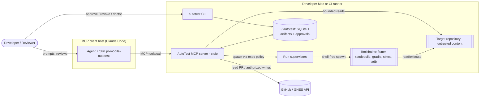
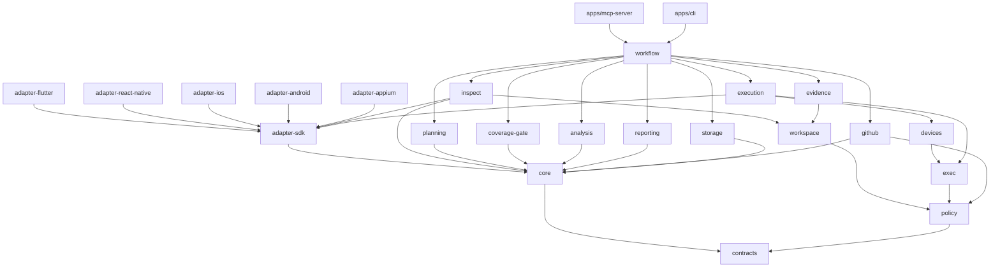
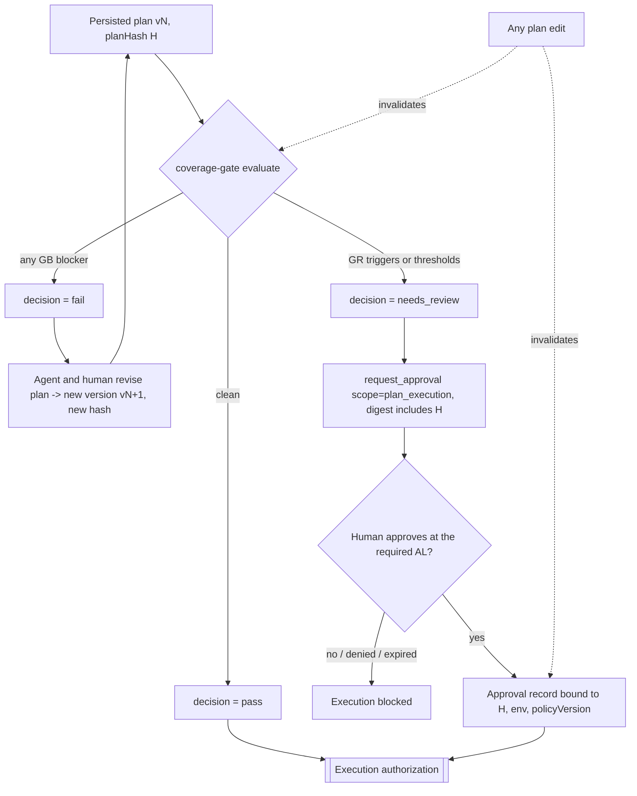
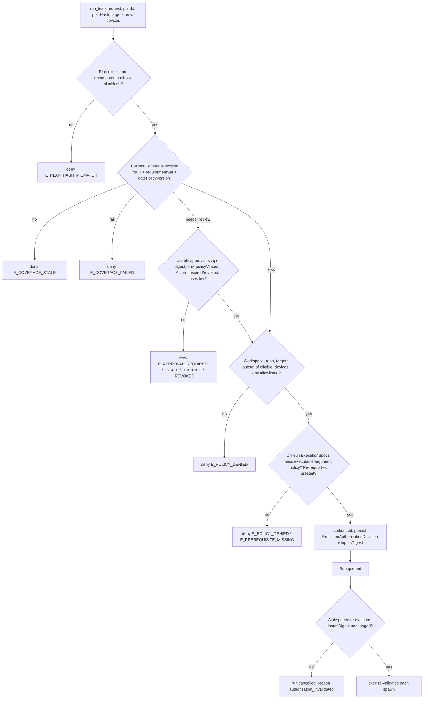
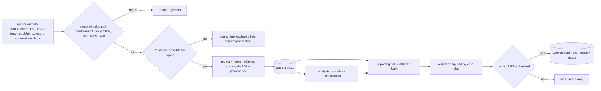
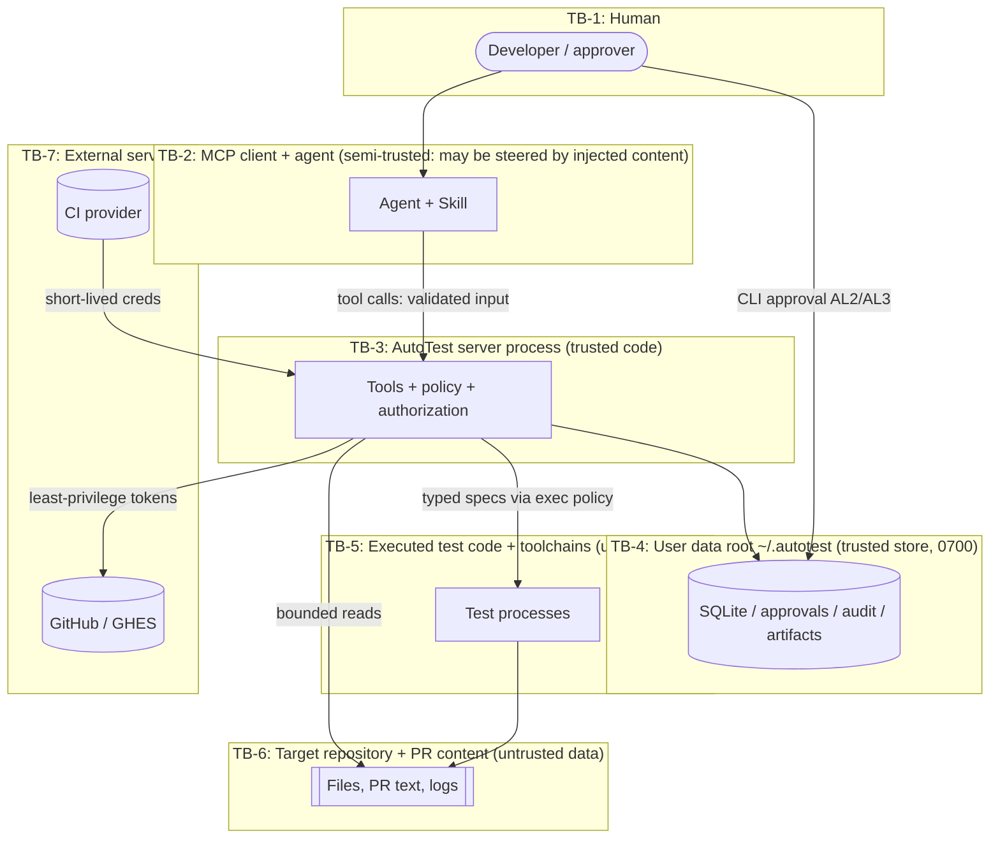

# Architecture

**Canonical home for:** system context, responsibility split, package boundaries and dependency rules, communication, workflow stages, and architecture diagrams.

**Not canonical here:**

| Topic | Canonical document |
|---|---|
| Entity schemas and the run state machine | [data-model-and-artifacts.md](data-model-and-artifacts.md) |
| Tool contracts and error codes | [mcp-tool-contracts.md](mcp-tool-contracts.md) |
| Threats | [security-threat-model.md](security-threat-model.md) |
| Rationale for decisions | the [ADRs](architecture-decisions/README.md) |

**Status:** Planning baseline. Nothing here is implemented yet.

## 1. System context



## 2. Responsibility split: Skill vs. MCP server

| Responsibility | Owner | Notes |
|---|---|---|
| Interpret PR prose; propose requirements and ACs | **Skill** (agent) | Results go to `extract_requirements` as `agentRequirements[]`, tagged with provenance `agent`. |
| Deterministic requirement parsing, ID assignment | **Server** (`planning`) | FR-009, FR-010 |
| Detect ambiguity and state assumptions | **Skill** proposes; **Server** stores and enforces severity rules | High-severity ambiguity triggers GR-01. |
| Draft test cases | **Skill** | |
| Validate, normalize and hash the plan; resolve targets; risk tier; eligibility | **Server** (`planning`) | ADR-0004 |
| Coverage evaluation | **Server** (`coverage-gate`) | Independent of `planning` (ADR-0005) |
| Ask the human for clarification | **Skill** | |
| Approval capture | **Human**, through the CLI, elicitation or preauthorization; the **server** verifies | The agent cannot grant approvals (ADR-0006). |
| Execution authorization | **Server** (`policy`, enforced by `execution` and `exec`) | |
| Execution, devices, evidence | **Server** | |
| Failure classification | **Server** (`analysis`), rule-based | The Skill may add commentary marked `narrative` (untrusted). |
| Report rendering, verdict | **Server** (`reporting`, `core`) | The Skill writes the narrative section only. |
| Publication | **Server** (`github`) after P3 authorization | |
| Explaining blocked states and next steps | **Skill**, using the server's `nextSteps[]` | |

**Rule.** Authoritative business logic lives only on the server. The Skill's references *summarize* and link to these documents. They never redefine gate rules, tiers or states ([agent-skill-spec.md](agent-skill-spec.md)).

## Packages and dependency rules

This table is canonical. `boundaries.json` mirrors it and is enforced by dependency-cruiser ([ADR-0015](architecture-decisions/ADR-0015.md)).

| Package | Responsibility | Public interface (main exports) | Allowed dependencies |
|---|---|---|---|
| `packages/contracts` | Zod schemas, inferred types, enums, error codes, state definitions, JSON Schema snapshots | `schemas.*`, `ErrorCode`, `RunState`, `TestOutcome`, … | — (only `zod`) |
| `packages/core` | Domain entities and behavior: run state machine, verdict rules, ID generation, canonical JSON and hashing, audit-chain hashing, workflow **ports** (`RunStore`, `PlanStore`, `ApprovalStore`, `ArtifactIndex`, `Clock`, `AuditSink`) | `transitionRun()`, `computeVerdict()`, `planHash()`, `newId()`, port interfaces | contracts |
| `packages/policy` | Policy config validation and versioning; executable and argument allowlist; path guard; env allowlist; permission tiers; approval verification; **execution authorization evaluator**; redaction rules; policy-decision records | `loadPolicy()`, `checkPath()`, `validateSpec()`, `authorizeExecution()`, `verifyApproval()`, `redact()` | contracts |
| `packages/workspace` | Repository root validation, bounded file reads, policy-controlled globbing, optional git metadata reading (read-only, no network) | `WorkspaceReader` implementation | contracts, policy |
| `packages/exec` | Shell-free spawning, process groups, process identity, timeouts, output caps, cancellation escalation, resource limits. The only place that may use `child_process` | `spawnSpec()`, `terminateGroup()`, `identify()` | contracts, policy |
| `packages/adapter-sdk` | `PlatformAdapter` contract, capability model, ExecutionSpec builder helpers, result normalization, JUnit writer, adapter contract test kit | `PlatformAdapter`, `CapabilitySet`, `toJUnit()` | contracts, core |
| `packages/adapter-flutter` | Flutter detection, inventory, command specs, JSON-reporter parsing, evidence hints | `flutterAdapter` | adapter-sdk (exec and workspace only through injected ports) |
| `packages/adapter-react-native` | RN detection, Jest/Detox/Maestro specs and parsing | `reactNativeAdapter` | adapter-sdk (ports only) |
| `packages/adapter-ios` | Xcode project detection, scheme inventory, xcodebuild specs, xcresult parsing | `iosAdapter` | adapter-sdk (ports only) |
| `packages/adapter-android` | Gradle detection, inventory, unit and instrumented specs, JUnit XML parsing | `androidAdapter` | adapter-sdk (ports only) |
| `packages/adapter-appium` | Optional Appium server and driver lifecycle specs and scenario parsing | `appiumAdapter` | adapter-sdk (ports only) |
| `packages/devices` | simctl, adb and emulator wrappers; ownership tags; device leases | `DeviceManager` | exec, policy |
| `packages/inspect` | Orchestration of `inspect_project` and `inspect_test_inventory` over registered adapters | `inspectProject()`, `inspectInventory()` | core, workspace, adapter-sdk |
| `packages/planning` | Requirement extraction and normalization, plan validation and enrichment, risk model, eligibility | `extractRequirements()`, `normalizePlan()` | core |
| `packages/coverage-gate` | Independent coverage rules, metrics, exceptions, decisions | `evaluateCoverage()` | core. **Must not depend on planning.** |
| `packages/execution` | Run manager, queue, concurrency, retries, dispatch with re-authorization, supervisor entrypoint, reconciliation | `RunManager`, `supervisorMain()` | core, exec, policy, adapter-sdk, devices |
| `packages/evidence` | Artifact file store, checksums, MIME sniffing, limits, redaction application, quarantine, retention | `EvidenceStore` | core, policy, workspace |
| `packages/analysis` | Rule-based failure classification, baseline and known-failure comparison | `classifyFailures()` | core |
| `packages/reporting` | Markdown, JSON and JUnit renderers | `renderReport()` | core |
| `packages/github` | PR reads, comment upsert, check runs, statuses, GHE `baseUrl`, rate-limit handling | `GitHubClient`, `Publisher` | core, policy |
| `packages/storage` | SQLite index (behind `SqlPort`), migrations, plan/run/approval/audit repositories, fs↔SQLite reconciliation | Implementations of the core ports | core |
| `packages/workflow` | **Shared orchestration** (use cases) that both apps call: intake → inspect → plan → gate → authorize → run → evidence → analyze → report → publish | `Workflow` use-case functions | core, policy, workspace, inspect, planning, coverage-gate, execution, evidence, analysis, reporting, github, storage, devices, adapter-sdk |
| `apps/mcp-server` | MCP SDK v2 tool registration, stdio transport, composition root, tool middleware (validation, limits, audit, error mapping), stderr logging | executable `autotest-mcp` | all packages |
| `apps/cli` | `approve`, `revoke`, `approvals`, `doctor`, `cleanup`, `ci run`; CI provider modules behind `CiEnvironmentPort` | executable `autotest` | all packages |

**Elaboration.** The specification gives `apps/cli` a dependency on "shared orchestration". That module is `packages/workflow`. It holds no business rules of its own, only sequencing. Approval verification and the authorization evaluator live in `policy`. The approval *store* lives in `storage`.

### Dependency rules (mandatory)

1. No package imports `apps/*`.
2. Adapters never import one another, and never import `node:child_process`, `node:fs` or network modules. They receive `WorkspaceReader` and return `ExecutionSpec` data.
3. `coverage-gate` must not import `planning`, directly or transitively.
4. Only `exec` spawns processes. Only `github` performs network I/O to GitHub. Only `apps/mcp-server` imports the MCP SDK.
5. No cycles. Cross-package imports go through each package's entrypoint only.



(For readability the diagram leaves out transitive and repeated edges, such as `execution --> core` and `execution --> policy`. The table is authoritative.)

### Service extraction criteria

See [ADR-0002](architecture-decisions/ADR-0002.md#decision):

- `execution` and `devices` become remote workers when a remote Mac pool or shared hosts are needed.
- `evidence` and `storage` become a central service when shared history or object storage is needed, or when SQLite contention is observed.
- `github` becomes a publication service when App credentials must be held centrally.

## 3. Communication

- **Client ↔ server:** MCP 2026-07-28 over stdio, through SDK v2 (ADR-0001). The server stores no per-connection state. All handles are explicit.
- **In-process:** typed function calls through ports. The composition roots live in the apps.
- **Server ↔ supervisor:** spawned detached. Communication goes through files in the run directory (`events.ndjson`, `heartbeat.json`, `terminal.json`) and a control file (`control.json`, used for cancel requests) plus signals. Nothing goes over sockets (ADR-0007).
- **Server ↔ GitHub:** HTTPS through Octokit with a configured `baseUrl` (ADR-0013).
- **CLI ↔ store:** the same storage packages, under file locks.

## 4. Main PR-to-test-report workflow

```mermaid
sequenceDiagram
  autonumber
  participant U as Developer
  participant A as Agent + Skill
  participant S as MCP server
  participant H as Human via CLI
  U->>A: /pr-mobile-autotest (PR text or URL)
  A->>S: get_pr_context
  S-->>A: PRContext (untrusted fields labelled)
  A->>S: inspect_project / inspect_test_inventory
  S-->>A: ProjectProfile, TestInventory (paged)
  A->>S: extract_requirements (+agentRequirements)
  S-->>A: RequirementSet (REQ/AC ids, ambiguities)
  A->>S: generate_test_plan (draft)
  S-->>A: TestPlan (planId, planHash, risk, eligibility)
  A->>S: validate_test_coverage(planId, planHash)
  S-->>A: CoverageDecision (pass / fail / needs_review)
  alt needs_review
    A->>S: request_approval(scope=plan_execution)
    S-->>A: approvalRequestId + CLI instructions
    A->>U: Explain findings; ask the human to review and approve
    H->>S: autotest approve <planHash> (AL2, interactive)
    A->>S: get_approval_status
  end
  A->>S: run_tests(planId, planHash, targets)
  S-->>A: runId (queued)
  loop poll
    A->>S: get_run_status(runId)
  end
  A->>S: get_run_results / collect_test_evidence / analyze_test_failures
  A->>S: generate_pr_test_report
  S-->>A: report refs + verdict
  opt publish (P3, authorized)
    A->>S: publish_github_report
  end
```

## 5. Coverage and approval workflow



## 6. Execution authorization flow



## 7. Asynchronous run lifecycle (interaction view)

The canonical state machine is in [data-model §Run lifecycle](data-model-and-artifacts.md#run-lifecycle).

```mermaid
sequenceDiagram
  participant A as Agent
  participant S as MCP server (per session)
  participant DB as SQLite + run dir
  participant V as Run supervisor (detached)
  participant T as Test process group
  A->>S: run_tests
  S->>DB: insert Run(queued) + AuthorizationDecision
  S-->>A: runId
  S->>V: spawn detached (runId) when slot free
  V->>DB: re-authorize; events: preparing
  V->>T: spawn shell-free, own pgid
  T-->>V: exit + outputs
  V->>DB: events: collecting, analyzing; terminal.json
  Note over S: Session may end; supervisor continues
  A->>S: (new session) get_run_status(runId)
  S->>DB: import events / terminal record
  S-->>A: state, counts, next poll hint
```

## 8. Cancellation and recovery

```mermaid
sequenceDiagram
  participant A as Agent
  participant S as Server
  participant V as Supervisor
  participant T as Process group
  A->>S: cancel_test_run(runId)
  S->>V: write control.json {cancel:true}; SIGTERM supervisor
  V->>T: SIGTERM to pgid
  V->>V: wait grace (default 10s)
  alt group exited
    V->>S: terminal.json state=cancelled
  else still alive
    V->>T: SIGKILL to pgid
    alt confirmed gone (identity check)
      V->>S: terminal.json state=cancelled
    else survivors
      V->>S: state=cancel_pending, survivors[]
      S-->>A: cancel_pending (retrying verification)
    end
  end
  Note over S: On server start: reconcile non-terminal runs
  S->>S: supervisor alive + fresh heartbeat? reattach
  S->>S: dead + terminal.json? import
  S->>S: dead + no terminal? kill identity-matched survivors, partial evidence, infra_error(supervisor_lost)
  S->>S: identity unverifiable? never signal, infra_error(orphan_unverified)
```

## 9. Evidence and reporting flow



## 10. Trust boundaries

Threat details are in [security-threat-model.md](security-threat-model.md).



## 11. Workflow stages and decision gates

"Retry" refers to automatic retry by the server. The agent may always re-invoke a tool after it fixes the input.

| # | Stage | Inputs → outputs | Component | Preconditions | Success criteria | Failure paths | Retry | Human approval | Observability |
|---|---|---|---|---|---|---|---|---|---|
| 1 | Receive PR input | Text or URL → request | Skill | — | Repo and PR identified | Ambiguous target → ask user | — | — | Audit `tool.call` |
| 2 | Validate repo and PR context | Request → `PRContext` | `workflow`, `github`, `policy` | Workspace allowlisted | PRContext valid, limitations listed | `E_WORKSPACE_NOT_ALLOWED`, `E_REPO_MISMATCH`, `E_GITHUB_*` | GitHub 5xx/429: backoff ×5 | — | Latency, API calls |
| 3 | Inspect project and inventory | Workspace → `ProjectProfile`, `TestInventory` | `inspect`, adapters | Stage 2 | Detection with evidence; completeness reported | Unsupported framework → report `unknown` | — | — | Files scanned, truncation |
| 4 | Extract requirements | PRContext + agent items → `RequirementSet` | `planning` | Stage 2 | Every item has an ID and provenance | Empty set → Skill asks for clarification | — | Clarification if critical ACs are missing | Ambiguity counts |
| 5 | Build traceability | Requirements + draft → mapping | Skill + `planning` | Stage 4 | Every case references valid REQ/AC | Unknown references → `E_VALIDATION` | — | — | — |
| 6 | Generate and prioritize test cases | Draft → `TestPlan` vN + hash | `planning` | Stages 3 and 4 | Schema-valid; risk tiers; eligibility | Validation errors with pointers | — | — | Plan size, tiers |
| 7 | Validate coverage | Plan → `CoverageDecision` | `coverage-gate` | Stage 6 | Decision persisted, bound to hash | — | — | — | Findings by rule |
| 8 | Clarify or record exceptions | Findings → revised plan or exceptions | Skill + human | Decision `fail` or `needs_review` | New plan version, or approved exception | Unresolvable → report `blocked` | — | **Yes**: exception approval at AL2+ | Exceptions audited |
| 9 | Resolve targets and authorize | Plan + decision + approvals → `ExecutionAuthorizationDecision` | `policy` (via `workflow`) | Current decision | `authorized` | `E_APPROVAL_*`, `E_COVERAGE_*`, `E_POLICY_DENIED` | — | `needs_review` → AL2+ | Decision with reasons |
| 10 | Prepare environment | Specs → prepared run dir, devices | `execution`, `devices` | Authorized | Prerequisites OK | `E_PREREQUISITE_MISSING`, `E_DEVICE_UNAVAILABLE` | Device boot: ×1 | P2 for non-owned devices | Prepare duration |
| 11 | Execute | Specs → raw outputs | `exec` via supervisor | Re-authorized at dispatch | Processes exit or time out | `timed_out`, `infra_error` | Per retry policy (FR-028) | — | Per-attempt events |
| 12 | Collect and validate evidence | Outputs → artifacts | `evidence` | Attempt ended | Metadata complete; redaction applied | Quarantine, oversize | — | — | Artifact sizes |
| 13 | Analyze failures | Results + artifacts → `FailureAnalysis[]` | `analysis` | Stage 12 | Every failed test classified | `unknown` with reasons | — | — | Class distribution |
| 14 | Retry (bounded) | Retryable failures → new attempt | `execution` | Policy allows | Attempt recorded; flaky labelled | Max attempts reached | ≤ `maxAttempts` (default 2) | — | Retry counts |
| 15 | Generate report | All of the above → MD/JSON/JUnit + verdict | `reporting`, `core` | Run terminal | Planned vs. executed distinct; limitations listed | — | — | — | Verdict |
| 16 | Publish (optional) | Report → comment/check/status | `github` | P3 authorization | Idempotent upsert | `E_GITHUB_*`, partial-publication result | Backoff ×5 | **Yes** (P3) | Publication audit |
| 17 | Audit and cleanup | Run → retained data | `storage`, `evidence` | Terminal | Audit chain intact; temp files removed | Cleanup errors are logged, never fatal | Next startup | — | Disk usage |

## 12. Cross-cutting concerns

- **Configuration:** the user config (`~/.autotest/config.yaml`) contains policy, allowlists, gate config and retention. It is validated by `policy`, and its canonical hash is the `policyVersion`. The gate section has its own hash, `gatePolicyVersion`. Repository-local configuration (`.autotest.yaml` in the target repo) may only *narrow* behavior, for example by excluding paths or adding test tags. It is untrusted and can never widen allowlists (SR-006).
- **Observability:** see [observability-and-failure-analysis.md](observability-and-failure-analysis.md). Event schemas live in `contracts`, audit hashing in `core`, persistence in `storage`, and sinks in the apps.
- **Security:** see [security-threat-model.md](security-threat-model.md).
