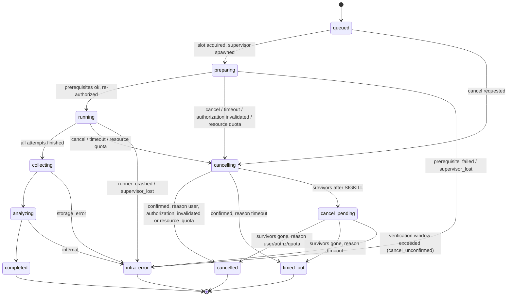

# Data Model and Artifacts

> **Status:** Planned design, baseline of 2026-10-22. Nothing described here is implemented yet.

**Canonical home for:**

- domain entities and their identifiers
- all enumerations, including run lifecycle states, per-test outcomes, coverage decisions, approval states, authorization results, failure classes and PR verdicts
- the plan-hash specification
- the on-disk layout and the SQLite schema sketch
- artifact metadata, retention and sensitive-data handling

Tool input/output schemas and error codes are in [mcp-tool-contracts.md](mcp-tool-contracts.md). They reuse the entities defined here.
Coverage metric formulas are in [test-planning-and-coverage.md](test-planning-and-coverage.md#coverage-metrics).

## 1. Conventions

- **Notation.** Types use TypeScript notation. Every entity is a Zod 4 schema in `packages/contracts` ([ADR-0003](architecture-decisions/ADR-0003.md)).
- **Optional fields** are marked `?`.
- **Time** values are RFC 3339 UTC strings. **Durations** are integer milliseconds.
- **Hashes** are written `sha256:<64 lowercase hex>`, except the plan hash ([§6](#plan-hash-specification)).
- **Opaque handles** are `<prefix>_<ULID>`. They are case-sensitive and never parsed by clients.
- **`schemaVersion`.** Every persisted entity carries an integer `schemaVersion`, starting at 1.

### Sensitivity classes

| Class | Meaning | Examples | Rules |
|---|---|---|---|
| S0 | Public or derived metadata | Enum values, counts | No restriction |
| S1 | Internal | Test names, file paths, plan text | Data root only. Published only under P3. |
| S2 | Confidential | Source snippets, runner logs, screenshots, PR body | Redaction required before persistence. Quarantined if redaction is impossible. |
| S3 | Secret | Tokens, passwords, keys | **Never persisted.** Referenced by name only (`secretRef`). |

## 2. Identifiers

| Entity | ID format | Stability |
|---|---|---|
| PRContext | `prc_<ulid>` | One per retrieval |
| ProjectProfile | `prj_<ulid>` | One per inspection |
| TestInventory | `inv_<ulid>` | One per inspection |
| RequirementSet | `rqs_<ulid>` + `requirementSetHash` | Immutable |
| Requirement | `REQ-NNN` (zero-padded, unique within its set) | Stable across re-extraction of identical input |
| AcceptanceCriterion | `REQ-NNN.AC-NN` | Stable within its requirement |
| TestPlan | `plan_<ulid>` + `version` (1, 2, …) + `planHash` | Each version is immutable |
| TestCase | `TC-NNN` (unique within a plan; kept across versions when the draft's `clientKey` matches) | Stable across versions |
| TestTarget | `TT-<adapterId>-<first 12 hex of sha256(relativePath + "#" + selector)>` | Stable across inventories while path and selector are unchanged |
| CoverageDecision | `cov_<ulid>` | Immutable |
| CoverageException | `EXC-NNN` (within a plan) | Stable |
| ApprovalRequest | `apr_<ulid>` | |
| Approval | `appr_<ulid>` | |
| ExecutionAuthorizationDecision | `authz_<ulid>` | Immutable |
| Run | `run_<ulid>` | |
| RunAttempt | `<runId>#<attemptNo>` | |
| TestResult | `res_<ulid>` | |
| EvidenceArtifact | `art_<ulid>` | |
| FailureAnalysis | `fa_<ulid>` | |
| PRReport | `rpt_<ulid>` | |
| AuditEvent | `aud_<ulid>` + monotonically increasing `seq` | Append-only |
| Device lease | `lease_<ulid>` | |

## 3. Enumerations (canonical)

### Run lifecycle

| State | Kind | Meaning | Status category |
|---|---|---|---|
| `queued` | non-terminal | Persisted and authorized; waiting for a slot. | `pending` |
| `preparing` | non-terminal | Supervisor started; re-authorizing; preparing devices and run dirs. | `pending` |
| `running` | non-terminal | At least one attempt is executing. | `running` |
| `collecting` | non-terminal | Executions finished; ingesting evidence. | `running` |
| `analyzing` | non-terminal | Classifying failures; computing summaries. | `running` |
| `cancelling` | transitional | A cancellation sequence is in progress. `cancelReason` is one of `user`, `timeout`, `authorization_invalidated`, `resource_quota` (the per-run disk quota was exceeded, EXE-004). | `running` |
| `cancel_pending` | non-terminal | SIGKILL was sent but termination of some managed process could not be confirmed. `survivors[]` is listed. | `running` |
| `completed` | **terminal** | The workflow finished. Individual tests may have failed. | `completed` |
| `cancelled` | **terminal** | Termination confirmed after a `user`, `authorization_invalidated` or `resource_quota` cancel. | `cancelled` |
| `timed_out` | **terminal** | Termination confirmed after a `timeout` cancel. | `failed` |
| `infra_error` | **terminal** | The workflow could not complete for infrastructure reasons. `infraReason` is one of `supervisor_lost`, `orphan_unverified`, `prerequisite_failed`, `storage_error`, `runner_crashed`, `cancel_unconfirmed`, `internal`. | `failed` |

`get_run_status` reports `statusCategory` as one of `pending | running | completed | failed | cancelled`. When a run cannot be read, the tool returns the error `E_RUN_NOT_FOUND` or `E_STORAGE_UNAVAILABLE`, and the Skill presents that as **unavailable**.

#### Valid transitions



**Transition rules:**

- A `queued` run that is cancelled has no processes, so it moves straight through `cancelling` to `cancelled` with an empty survivor check.
- The cancel-verification window defaults to 10 minutes. When it expires, the run is set to `infra_error(cancel_unconfirmed)`, never to `cancelled`.
- **Persistence timing.** The server writes the `queued` row before it returns. The supervisor appends each later state to `events.ndjson` (fsynced) before acting on it. The server imports those events into SQLite whenever it polls or reconciles.
- **Partial evidence.** Any terminal state other than `completed` still goes through evidence ingestion for whatever outputs exist. The flag `partial: true` is set and a limitation is recorded.

### Per-test outcome

| Outcome | Meaning | Counts as executed? | Counts as passing? |
|---|---|---|---|
| `passed` | The runner reported success. | yes | yes |
| `failed` | The runner reported a failure. `failureKind` is one of `assertion`, `exception`, `load_error`, `crash`. | yes | no |
| `blocked` | Never started because a prerequisite, authorization or dependency was not met. `blockedReason` is required. | no | no |
| `skipped` | The runner reported a skip (authoritatively, for example Flutter `testDone.skipped`). | no | no |
| `cancelled` | The run was cancelled before or while this test executed. | no | no |
| `timed_out` | The per-target or run timeout expired while this test was executing. | no (indeterminate) | no |
| `infra_error` | Runner or infrastructure error not attributable to the test body, for example a runner exit with no result or a Flutter `done.success == null`. | no (indeterminate) | no |
| `not_run` | Planned but not executed: ineligible, filtered, or the run ended before reaching it. | no | no |

`flaky: true` is an attribute, not an outcome. It is set when a test fails on one attempt and passes on a later attempt of the same run, and its final outcome is then `passed`.

### Coverage decision

`pass | fail | needs_review`. Semantics are in [test-planning-and-coverage.md](test-planning-and-coverage.md#independent-coverage-gate). A decision is **current** only if all of `planHash`, `requirementSetHash` and `gatePolicyVersion` match the values in effect. Otherwise it is **stale**.

### Approval states

`pending → approved | denied`. From `approved` → `expired | revoked | consumed | superseded`.

- `superseded` is set when a newer plan version replaces the plan the approval was bound to.
- Only `approved` with `uses < maxUses` and `now < expiresAt` is **usable**.

### Execution authorization result

`authorized | denied`, with `reasons[]` drawn from these codes:

- `plan_hash_mismatch`
- `coverage_missing`
- `coverage_stale`
- `coverage_failed`
- `approval_required`
- `approval_stale`
- `approval_expired`
- `approval_revoked`
- `approval_exhausted`
- `assurance_insufficient`
- `workspace_not_allowed`
- `target_not_eligible`
- `device_not_allowed`
- `environment_not_allowed`
- `command_denied`
- `prerequisite_missing`
- `superseded`
- `cancelled`
- `policy_unavailable`
- `unknown_state`

Any reason produces `denied`.

### Failure classification

| Class | Subtypes | Emitted as |
|---|---|---|
| `product_defect` | `behavior` | `hypothesis` by default. It is `supported` only when the evidence criteria in [observability §Classification](observability-and-failure-analysis.md#failure-classification) are met. It is **never** `confirmed` automatically. |
| `test_defect` | `assertion`, `setup`, `flaky` | `hypothesis` or `supported` |
| `environment_failure` | `infrastructure`, `dependency`, `device`, `toolchain` | `hypothesis` or `supported` |
| `pre_existing` | `baseline_failure`, `known_failure` | `supported` when baseline or registry evidence exists |
| `unknown` | `inconclusive` | — |

Each `FailureAnalysis` carries:

- `observations[]`: raw facts with evidence references
- `inference`: free text
- `confidence`: 0–1
- `strength`: `hypothesis` or `supported`
- `alternatives[]`
- `nextSteps[]`

### PR verdict rules

The verdict is computed by `core.computeVerdict()`. **Mandatory tests** are test cases with priority `must`, or test cases that cover a requirement with tier R2 or R3. The rules are evaluated in order, and the first match wins.

| # | Condition | Verdict |
|---|---|---|
| 1 | No authorized run exists for the current plan hash: gate `fail`; or `needs_review` without a usable approval; or authorization denied. | `blocked` |
| 2 | Every mandatory test case is `blocked` or `not_run`. | `blocked` |
| 3 | Any mandatory test case is `failed` and its analysis class is not `environment_failure` or `pre_existing`. | `fail` |
| 4 | Any mandatory test case is `timed_out`, `infra_error`, `cancelled`, `skipped`, `blocked` or `not_run`; or is `failed` with class `environment_failure` or `pre_existing`; or the run ended in a terminal state other than `completed`. | `inconclusive` |
| 5 | All mandatory test cases are `passed`, the gate decision was `pass` or approved `needs_review`, and the run is `completed`. | `pass` |

**Empty mandatory set.** When a plan has no mandatory test case, every test case is treated as mandatory for the verdict, so no verdict is decided by an empty set.

**Modifiers.** A `pass` with ≥1 mandatory `flaky` test, or with ≥1 non-mandatory failure, is still `pass`. The report must list those items under "Attention". A `test_defect` failure in a mandatory test yields `fail` under rule 3, because the test did not verify the requirement. The report states the classification.

### Risk tiers and permission tiers

| Kind | Values | Canonical definition |
|---|---|---|
| Risk tiers (test planning) | `R0 \| R1 \| R2 \| R3` | [test-planning-and-coverage §Risk model](test-planning-and-coverage.md#risk-model) |
| Permission tiers (tools and actions) | `P0 \| P1 \| P2 \| P3` | [security-threat-model §Permission tiers](security-threat-model.md#permission-tiers-and-approval-matrix) |

### Requirement verification status

`unmapped | mapped | eligible | executed | passing | failing | blocked | excepted | unverified`

Semantics are in [test-planning-and-coverage §Requirement verification status](test-planning-and-coverage.md#requirement-verification-status).

## 4. Entities

Each entity lists its purpose, fields, validation, relationships, persistence, retention, sensitivity and versioning. Common fields (`id`, `schemaVersion`, `createdAt`) are omitted from the field tables unless they are noteworthy.

### PRContext

- **Purpose.** Normalized PR intake, from manual input or GitHub.
- **Fields:**

  | Field | Type | Req | Notes |
  |---|---|---|---|
  | `source` | `"manual" \| "github"` | ✓ | |
  | `repository` | `{ host: string; owner?: string; name?: string; localPath?: string }` | ✓ | `host` is `github.com` or a GHES host |
  | `number` | `number` | ? | Present when `source = github` |
  | `title` | `string` (≤ 1 KiB) | ? | Untrusted |
  | `body` | `string` (≤ 64 KiB) | ✓ | Untrusted, S2 |
  | `labels` | `string[]` | ? | |
  | `base` / `head` | `{ ref: string; sha?: string }` | ? | |
  | `changedFiles` | `{ path; status; additions?; deletions? }[]` | ? | Capped at 3,000 entries, matching the GitHub API maximum. Truncation is recorded. |
  | `limitations` | `Limitation[]` | ✓ | e.g. `diff_unavailable`, `files_truncated` |
  | `untrustedFields` | `string[]` | ✓ | JSON pointers to untrusted content |

- **Validation.** `body` length is enforced. The host must match the configured GitHub hosts.
- **Relationships.** Referenced by RequirementSet and PRReport.
- **Persistence.** SQLite row plus a JSON snapshot (redacted).
- **Retention.** 14 days.
- **Sensitivity.** S2.
- **Versioning.** `schemaVersion`.

### ProjectProfile

- **Purpose.** Repository inspection result.
- **Fields:**
  - `workspace { rootRealPath, allowlistEntryId }`
  - `frameworks[] { adapterId, confidence (0–1), evidence[] (paths) }`
  - `platforms[] { platform: Platform, status: "present"|"absent"|"unknown", evidence[] }`. The `Platform` enum is `android | ios | web | macos | linux | windows | host`. `host` means the test runs on the developer or CI machine without a device; it is used for test targets and test cases.
  - `languages[]`
  - `toolchains[] { tool, versionsBySource[] { source, value }, resolved?, conflicts[] }`
  - `runners[] { adapterId, kind, configured: boolean, evidence[] }`
  - `limitations[]`
- **Validation.** Every claim of `present` requires ≥1 evidence path (FR-006).
- **Retention.** 14 days.
- **Sensitivity.** S1.

### TestInventory

- **Purpose.** Discovered test assets.
- **Fields:**
  - `profileId`
  - `targets[]` (TestTarget)
  - `helpers[] { path, kind: "mock"|"fixture"|"helper"|"config" }`
  - `automationConfigs[] { path, kind }`
  - `counts { byLevel, byAdapter }`
  - `completeness { complete: boolean, truncatedAt?, reasons[] }`
  - `limits { maxFiles, maxBytes }`
- **Persistence.** The full list is stored in SQLite (`test_targets`). Tool output is paged.
- **Retention.** 14 days.
- **Sensitivity.** S1.

### TestTarget

- **Purpose.** An executable unit known to an adapter.
- **Fields:**
  - `id` (TT-…)
  - `adapterId`
  - `level`: `"unit"|"widget"|"component"|"integration"|"e2e"`
  - `path` (relative)
  - `selector?`, of the form `{ kind: "file"|"name"|"tag"|"scheme"|"class"|"scenario"; value: string }`
  - `platforms[]`
  - `requires { host: "any"|"macos"|"linux"; device: "none"|"simulator"|"emulator"|"physical" }`
  - `tags[]`
- **Validation.** `path` canonicalizes inside the workspace. `selector.value` matches the adapter's selector regex.
- **Sensitivity.** S1.

### RequirementSet, Requirement, AcceptanceCriterion

- **RequirementSet fields:**
  - `prContextId`
  - `requirements[]`
  - `ambiguities[] { id: "AMB-NN", text, severity: "low"|"medium"|"high", relatedRefs[], status: "open"|"resolved"|"accepted" }`
  - `assumptions[] { id: "ASM-NN", text, relatedRefs[] }`
  - `requirementSetHash`: sha256 over the JCS of the set's **content only** (requirements, ambiguities and assumptions, with text normalized and set-like arrays sorted). It excludes `id`, `prContextId`, timestamps and `schemaVersion`, so identical extraction input always yields the same hash (FR-010).
- **Requirement fields:**
  - `id`
  - `title`
  - `statement`
  - `kind`: `"functional"|"behavior_change"|"bug_fix"|"non_functional"|"regression_scope"`
  - `testable: boolean`
  - `nonTestableReason?`
  - `provenance`: `"parsed"|"agent"|"human"`
  - `sourceSpan?` (offsets in the PR body)
  - `platforms[]`
  - `riskFactors` (see the risk model)
  - `riskTier` (computed)
  - `acceptanceCriteria[]`
- **AcceptanceCriterion fields:**
  - `id`
  - `text`
  - `format`: `"given_when_then"|"checklist"|"freeform"`
  - `observable: boolean` (whether an observable expected result is present)
  - `provenance`
- **Validation.** IDs are unique. A non-testable requirement requires `nonTestableReason`.
- **Retention.** 14 days. Copies embedded in reports follow report retention.
- **Sensitivity.** S1.

### TestPlan and TestCase

- **TestPlan fields:**
  - `id`
  - `version`
  - `planHash`
  - `hashVersion`
  - `requirementSetId`
  - `requirementSetHash`
  - `inventoryId`
  - `repository` (the RepositoryIdentity; hash-covered)
  - `headSha` (the head commit SHA, or `null` when unknown; hash-covered)
  - `riskPolicyVersion`
  - `platformsInScope[]`
  - `testCases[]`
  - `exceptions[]`
  - `ambiguities[]` (carried over)
  - `assumptions[]`
  - `display { summary?, narrative? }`: **untrusted, excluded from the hash**
  - `supersedes?` (previous version)
- **TestCase fields:**

  | Field | Type | Req |
  |---|---|---|
  | `id` | `TC-NNN` | ✓ |
  | `clientKey` | string from the draft (stable across versions) | ? |
  | `title` | string | ✓ |
  | `requirementRefs` | `REQ-NNN[]` (≥1) | ✓ |
  | `acRefs` | `REQ-NNN.AC-NN[]` | ✓ (may be empty only for `regression` cases) |
  | `level` | `unit\|widget\|component\|integration\|e2e\|manual` | ✓ |
  | `technique` | `positive\|negative\|boundary\|state_transition\|error_handling\|regression\|accessibility\|security\|platform_specific` | ✓ |
  | `priority` | `must\|should\|could` | ✓ |
  | `platforms` | platform[] | ✓ |
  | `preconditions` | string[] | ✓ |
  | `steps` | string[] | ✓ (≥1) |
  | `expectedResults` | string[] | ✓ (≥1) |
  | `targetRef` | `TT-…` \| null | ✓ |
  | `automation` | `existing_test\|new_test_required\|manual` | ✓ |
  | `eligibility` | `eligible \| ineligible:<reason>` (computed) | ✓ |
  | `riskTier` | `R0..R3` (max over the referenced requirements, computed) | ✓ |
  | `dependsOn` | `TC-NNN[]` | ? |

- **Validation.** Every reference resolves. An `automation=existing_test` case requires `targetRef`. Eligibility reasons come from the enum `platform_unavailable`, `capability_missing`, `no_target`, `manual`, `policy_denied`.
- **Persistence.** An immutable JSON snapshot per version, plus SQLite rows.
- **Retention.** 30 days after the last referencing run.
- **Sensitivity.** S1.

### CoverageException

- **Fields:**
  - `id` (EXC-NNN)
  - `requirementRefs[]`
  - `reason`: `"not_testable"|"covered_elsewhere"|"deferred"|"out_of_scope"`
  - `rationale` (≥ 20 chars)
  - `evidenceLink?` (must point to an executable assertion when `covered_elsewhere`)
  - `approvalId?`
  - `expiresAt` (≤ 30 days)
- **Validation.** An exception without a usable approval, or past its expiry, triggers gate blocker GB-02.

### CoverageDecision

- **Fields:**
  - `planId`
  - `planHash`
  - `requirementSetHash`
  - `gatePolicyVersion`
  - `decision`
  - `findings[] { ruleId, severity: "blocker"|"review"|"info", message, refs[] }`
  - `metrics` (six metrics)
  - `requirementStatus[] { requirementId, status }`
  - `evaluatedAt`
- **Persistence.** Immutable.
- **Retention.** Same as the plan.

### ApprovalRequest and Approval

- **ApprovalRequest fields:**
  - `scope { kind, digest, params }`
  - `requiredAssurance`
  - `status`: `"open"|"fulfilled"|"expired"|"withdrawn"`
  - `instructions` (the CLI command to run)
  - `createdBy: "agent"` (always, for audit)
  - `display { summary, justification }` (optional): what the CLI and elicitation dialog show. It is never part of the scope digest, and `justification` is agent text shown as untrusted. Scope `params` hold only digested values.
- **Approval fields.** Defined in [ADR-0006 §3](architecture-decisions/ADR-0006.md#3-approval-record):
  - `source`
  - `assuranceLevel`
  - `approver { osUser, githubLogin? }`
  - `planHash?`
  - `environment`
  - `policyVersion`
  - `expiresAt`
  - `maxUses`
  - `uses`
  - `state`
  - `signature?` (AL3)
  - `revokedAt?`
  - `revokedBy?`
- **Persistence.** `~/.autotest/approvals/<approvalId>.json` (mode `0600`) plus an SQLite index row. The JSON file is authoritative, and a mismatch causes quarantine.
- **Retention.** 90 days after the record expires.
- **Sensitivity.** S1.

### ExecutionAuthorizationDecision

- **Fields:**
  - `runId?`
  - `phase`: `"create"|"dispatch"`
  - `result`
  - `reasons[]`
  - `inputsDigest`: sha256 over the JCS of `{planHash, coverageDecisionId, approvalIds[], policyVersion, gatePolicyVersion, targets[], environment, devices[], specDigests[]}`
  - `evaluatedAt`
- **Usage.** The dispatch phase must produce the same `inputsDigest` as the create phase. If it differs, the run is cancelled with reason `authorization_invalidated`.
- **Retention.** Same as the run.

### Run and RunAttempt

- **Run fields:**
  - `planId`
  - `planHash`
  - `targets[]`
  - `environment`
  - `devices[]`
  - `state`
  - `statusCategory`
  - `cancelReason?`
  - `infraReason?`
  - `idempotencyKey?`
  - `requestDigest`
  - `authorizationIds[]`
  - `timeouts { runMs, attemptMs, targetMs }`
  - `retryPolicy { maxAttempts, retryOn[] }`
  - `supervisor { pid, pgid, startTime }`
  - `counts { byOutcome }`
  - `partial`
  - `limitations[]`
  - `createdAt`, `startedAt?`, `endedAt?`
- **RunAttempt fields:**
  - `attemptNo`
  - `specs[] { specDigest, executable, argv[], cwd }` (redacted)
  - `processes[] { pid, pgid, startTime, exitCode?, signal? }`
  - `startedAt`
  - `endedAt?`
  - `outcomeSummary`
- **Retention.** 14 days for artifacts. Run rows are kept for 90 days for history.
- **Sensitivity.** S1 (argv is redacted).

### TestResult

- **Fields:**
  - `runId`
  - `attemptNo`
  - `testCaseIds[]` (via the target mapping)
  - `targetId`
  - `name`
  - `suitePath`
  - `outcome`
  - `failureKind?`
  - `blockedReason?`
  - `durationMs?`
  - `flaky`
  - `messageExcerpt?` (≤ 2 KiB, redacted)
  - `artifactRefs[]`
  - `rawStatus` (what the runner reported, e.g. `"error"`)
- **Retention.** 90 days, with message excerpts dropped after 14 days.

### EvidenceArtifact

- **Fields:**
  - `runId`
  - `attemptNo?`
  - `kind`: `"stdout"|"stderr"|"runner_json"|"junit"|"xcresult"|"screenshot"|"video"|"log"|"coverage"|"report"`
  - `relativePath` (under the run dir)
  - `mimeType` (sniffed)
  - `sizeBytes`
  - `sha256`
  - `redaction { applied: boolean, rulesetVersion, findingsCount }`
  - `quarantined: boolean`
  - `quarantineReason?`
  - `provenance { producer: adapterId|"supervisor"|"server", specDigest?, toolVersion? }`
  - `truncated: boolean`
- **Validation.** Path containment. No symlinks. Size ≤ policy (default: 100 MiB per artifact, 1 GiB per run).
- **Sensitivity.** S2.

### FailureAnalysis

- **Fields:**
  - `runId`
  - `resultId`
  - `class`
  - `subtype`
  - `strength`
  - `confidence`
  - `observations[] { text, artifactRef?, location? }`
  - `inference`
  - `alternatives[] { class, subtype, confidence }`
  - `ruleIds[]`
  - `nextSteps[]`
- **Retention.** Same as the run.

### PRReport

- **Fields:**
  - `prContextId`
  - `planId`
  - `planHash`
  - `coverageDecisionId`
  - `runIds[]`
  - `verdict`
  - `verdictRule` (the matched row number)
  - `metrics`
  - `sections` (structured)
  - `limitations[]`
  - `artifacts { markdown, json, junit }` (artifact IDs)
  - `reportHash`
  - `narrative?` (agent-written, untrusted, labelled)
- **Retention.** 30 days.
- **Sensitivity.** S1/S2 (S2 content is redacted).

### AuditEvent

- **Fields:**
  - `seq`
  - `ts`
  - `actor`: `"agent"|"cli"|"supervisor"|"server"|"ci"`
  - `kind` (e.g. `tool.call`, `tool.result`, `policy.decision`, `approval.created`, `approval.revoked`, `authorization.decision`, `run.transition`, `artifact.quarantined`, `github.write`)
  - `subjectRefs[]`
  - `data` (redacted, ≤ 8 KiB)
  - `prevHash`
  - `hash` = sha256(prevHash ‖ JCS(event without hash))
- **Persistence.** Append-only NDJSON (`~/.autotest/audit/YYYY-MM.ndjson`) plus an SQLite index.
- **Retention.** 90 days.

### KnownFailure (registry, FR-047)

- **Fields:**
  - `id`
  - `targetId`
  - `namePattern`
  - `reason`
  - `addedBy`
  - `expiresAt`
  - `evidenceLink`
- **Note.** These entries are configuration that lives in the user data root. They never come from the target repository.

## Plan hash specification

1. **Algorithm.** `planHash = "v" + hashVersion + ":sha256:" + hex(SHA-256(UTF-8(JCS(hashInput))))`. JCS is RFC 8785 ([RL-013](research-log.md#rl-013--json-canonicalization-scheme)). For hashVersion 1 the result looks like `v1:sha256:9f2c…`.
2. **`hashInput` (hashVersion 1), included fields:**
   - `hashVersion`
   - `planSchemaVersion`
   - `requirementSetHash`
   - `repository` (host/owner/name or the local realpath digest)
   - `head.sha` if known, otherwise `null`
   - `platformsInScope` (sorted)
   - `riskPolicyVersion`
   - `testCases`, sorted by `id`. Each contains: `id`, `title`, `requirementRefs` (sorted), `acRefs` (sorted), `level`, `technique`, `priority`, `platforms` (sorted), `preconditions`, `steps`, `expectedResults`, `targetRef`, `automation`, `eligibility`, `riskTier`, `dependsOn` (sorted)
   - `exceptions`, sorted by `id`. Each contains: `id`, `requirementRefs`, `reason`, `rationale`, `evidenceLink`, `expiresAt`
   - `ambiguities`: `{id, severity, status}`, sorted
   - `assumptions`: `{id, text}`, sorted
3. **Excluded fields:**
   - `id` (planId) and `version`
   - `createdAt` and any other timestamps
   - `createdBy`
   - `display.*` (narrative and summary)
   - `clientKey`
   - storage row IDs
   - `inventoryId` (inventory content is reflected through `targetRef` and `eligibility`)

   An approval ID is not a plan field.
4. **Text normalization before hashing.** Unicode NFC. Trim leading and trailing whitespace. Collapse internal runs of spaces and tabs into a single space. Normalize line endings to `\n`. Array order is preserved for ordered fields (`steps`, `preconditions`, `expectedResults`). Set-like fields are sorted by UTF-16 code units, the same order JCS uses.
5. **Persistence.** The plan snapshot is stored with `planHash` and `hashVersion`. The hash is recomputed and compared on load. A mismatch quarantines the plan with `E_PLAN_HASH_MISMATCH`.
6. **Verification before execution.** `authorizeExecution` recomputes the hash from the stored snapshot and compares it to the stored value and the requested value. All three must be equal.
7. **Invalidation.**
   - Any change to a hashed field creates a new plan version with a new hash.
   - Coverage decisions and approvals bound to the old hash become stale.
   - Approvals move to `superseded`.
8. **Policy changes.**
   - `riskPolicyVersion` is inside the hash, so a risk-policy change requires re-normalization, which produces a new hash.
   - `gatePolicyVersion` is bound in the decision, so the decision becomes stale.
   - `policyVersion` is bound in approvals, so they become stale.
   - Changes to targets or the environment change the approval `scope.digest` but not the plan hash.
9. **Version migration.** Bumping `hashVersion` never rewrites old hashes. Old plans keep their hashes and can still be verified under their original version. New plans use the new version. The canonical code for every supported `hashVersion` is retained.

## On-disk layout

```
~/.autotest/                         0700
  config.yaml                        user policy (0600)
  autotest.db (+ -wal, -shm)         SQLite index (0600)
  approvals/appr_<ulid>.json         0600; AL3 records carry signature
  audit/YYYY-MM.ndjson               append-only hash chain
  plans/plan_<ulid>/<planHash>.json  immutable snapshots
  keys/cursor.key                    HMAC key for pagination cursors (0600, 32 random bytes)
  inventories/                       (reserved; v1 stores inventory snapshots in SQLite, see below)
  runs/run_<ulid>/
    run.json                         run header (written by server before return)
    control.json                     cancel requests (server → supervisor)
    heartbeat.json                   supervisor liveness
    events.ndjson                    supervisor event log (fsync per line)
    terminal.json                    terminal record
    supervisor.log                   supervisor process log
    attempts/<n>/
      spec.json                      redacted ExecutionSpecs
      stdout-<i>.log  stderr-<i>.log raw (capped) per spec i, not exposed until redacted
      runner/                        runner-native outputs (json, junit, xcresult, lcov)
    artifacts/                       redacted, indexed artifacts
    quarantine/                      artifacts failing redaction/validation
    reports/report.md  report.json  junit.xml
  tmp/                               per-run scratch (HOME/TMPDIR for children), removed at terminal state
```

**Naming rules:**

- Generated names only. Repository-provided names are never used as path segments.
- Original names are stored as metadata.
- Every write uses the atomic write protocol in [ADR-0008](architecture-decisions/ADR-0008.md#decision).

**Access restrictions:**

- Raw `stdout.log`/`stderr.log` are never returned by tools. Only redacted artifacts are exposed.
- `quarantine/` contents are referenced only by metadata.

## SQLite schema sketch (schema v1)

```sql
CREATE TABLE schema_migrations (version INTEGER PRIMARY KEY, applied_at TEXT NOT NULL);
CREATE TABLE pr_contexts (id TEXT PRIMARY KEY, source TEXT NOT NULL, host TEXT NOT NULL, owner TEXT, name TEXT, number INTEGER, head_sha TEXT, snapshot_path TEXT NOT NULL, created_at TEXT NOT NULL);
CREATE TABLE project_profiles (id TEXT PRIMARY KEY, workspace_realpath TEXT NOT NULL, snapshot_path TEXT NOT NULL, created_at TEXT NOT NULL);
CREATE TABLE inventories (id TEXT PRIMARY KEY, profile_id TEXT NOT NULL REFERENCES project_profiles(id), complete INTEGER NOT NULL, snapshot_path TEXT NOT NULL, created_at TEXT NOT NULL);
CREATE TABLE test_targets (id TEXT NOT NULL, inventory_id TEXT NOT NULL REFERENCES inventories(id), adapter_id TEXT NOT NULL, level TEXT NOT NULL, path TEXT NOT NULL, selector TEXT, requires_host TEXT NOT NULL, requires_device TEXT NOT NULL, PRIMARY KEY (inventory_id, id));
CREATE TABLE requirement_sets (id TEXT PRIMARY KEY, pr_context_id TEXT NOT NULL REFERENCES pr_contexts(id), set_hash TEXT NOT NULL, snapshot_path TEXT NOT NULL, created_at TEXT NOT NULL);
CREATE TABLE plans (id TEXT NOT NULL, version INTEGER NOT NULL, plan_hash TEXT NOT NULL UNIQUE, hash_version INTEGER NOT NULL, requirement_set_id TEXT NOT NULL REFERENCES requirement_sets(id), risk_policy_version TEXT NOT NULL, snapshot_path TEXT NOT NULL, superseded_by INTEGER, created_at TEXT NOT NULL, PRIMARY KEY (id, version));
CREATE TABLE coverage_decisions (id TEXT PRIMARY KEY, plan_hash TEXT NOT NULL REFERENCES plans(plan_hash), requirement_set_hash TEXT NOT NULL, gate_policy_version TEXT NOT NULL, decision TEXT NOT NULL CHECK (decision IN ('pass','fail','needs_review')), snapshot_path TEXT NOT NULL, evaluated_at TEXT NOT NULL);
CREATE TABLE approval_requests (id TEXT PRIMARY KEY, scope_kind TEXT NOT NULL, scope_digest TEXT NOT NULL, required_assurance TEXT NOT NULL, status TEXT NOT NULL, created_at TEXT NOT NULL, expires_at TEXT NOT NULL);
CREATE TABLE approvals (id TEXT PRIMARY KEY, request_id TEXT REFERENCES approval_requests(id), scope_kind TEXT NOT NULL, scope_digest TEXT NOT NULL, plan_hash TEXT, environment TEXT NOT NULL, policy_version TEXT NOT NULL, source TEXT NOT NULL, assurance TEXT NOT NULL, state TEXT NOT NULL, uses INTEGER NOT NULL DEFAULT 0, max_uses INTEGER NOT NULL, expires_at TEXT NOT NULL, file_sha256 TEXT NOT NULL, created_at TEXT NOT NULL);
CREATE TABLE authorization_decisions (id TEXT PRIMARY KEY, run_id TEXT, phase TEXT NOT NULL, result TEXT NOT NULL, reasons TEXT NOT NULL, inputs_digest TEXT NOT NULL, evaluated_at TEXT NOT NULL);
CREATE TABLE runs (id TEXT PRIMARY KEY, plan_hash TEXT NOT NULL, state TEXT NOT NULL, status_category TEXT NOT NULL, cancel_reason TEXT, infra_reason TEXT, idempotency_key TEXT, request_digest TEXT NOT NULL, supervisor_pid INTEGER, supervisor_pgid INTEGER, supervisor_start TEXT, partial INTEGER NOT NULL DEFAULT 0, created_at TEXT NOT NULL, started_at TEXT, ended_at TEXT, events_offset INTEGER NOT NULL DEFAULT 0);
CREATE UNIQUE INDEX runs_idem ON runs(idempotency_key) WHERE idempotency_key IS NOT NULL;
CREATE TABLE run_attempts (run_id TEXT NOT NULL REFERENCES runs(id), attempt_no INTEGER NOT NULL, started_at TEXT NOT NULL, ended_at TEXT, summary TEXT, PRIMARY KEY (run_id, attempt_no));
CREATE TABLE managed_processes (run_id TEXT NOT NULL REFERENCES runs(id), pid INTEGER NOT NULL, pgid INTEGER NOT NULL, start_time TEXT NOT NULL, executable TEXT NOT NULL, role TEXT NOT NULL, exited INTEGER NOT NULL DEFAULT 0, PRIMARY KEY (run_id, pid, start_time));
CREATE TABLE test_results (id TEXT PRIMARY KEY, run_id TEXT NOT NULL REFERENCES runs(id), attempt_no INTEGER NOT NULL, target_id TEXT NOT NULL, name TEXT NOT NULL, outcome TEXT NOT NULL, failure_kind TEXT, flaky INTEGER NOT NULL DEFAULT 0, duration_ms INTEGER);
CREATE INDEX test_results_run ON test_results(run_id, outcome);
CREATE TABLE artifacts (id TEXT PRIMARY KEY, run_id TEXT NOT NULL REFERENCES runs(id), kind TEXT NOT NULL, rel_path TEXT NOT NULL, mime TEXT NOT NULL, size_bytes INTEGER NOT NULL, sha256 TEXT NOT NULL, quarantined INTEGER NOT NULL, status TEXT NOT NULL DEFAULT 'present');
CREATE TABLE failure_analyses (id TEXT PRIMARY KEY, run_id TEXT NOT NULL, result_id TEXT NOT NULL REFERENCES test_results(id), class TEXT NOT NULL, subtype TEXT NOT NULL, strength TEXT NOT NULL, confidence REAL NOT NULL);
CREATE TABLE reports (id TEXT PRIMARY KEY, plan_hash TEXT NOT NULL, verdict TEXT NOT NULL, report_hash TEXT NOT NULL, created_at TEXT NOT NULL);
CREATE TABLE publications (id TEXT PRIMARY KEY, report_id TEXT NOT NULL REFERENCES reports(id), mechanism TEXT NOT NULL, scope_digest TEXT NOT NULL, remote_id TEXT, status TEXT NOT NULL, created_at TEXT NOT NULL, UNIQUE (scope_digest, mechanism));
CREATE TABLE known_failures (id TEXT PRIMARY KEY, target_id TEXT NOT NULL, name_pattern TEXT NOT NULL, reason TEXT NOT NULL, expires_at TEXT NOT NULL);
CREATE TABLE device_leases (id TEXT PRIMARY KEY, device_id TEXT NOT NULL, run_id TEXT, owned INTEGER NOT NULL, created_by_autotest INTEGER NOT NULL, expires_at TEXT NOT NULL);
CREATE TABLE audit_index (seq INTEGER PRIMARY KEY, id TEXT NOT NULL, ts TEXT NOT NULL, kind TEXT NOT NULL, file TEXT NOT NULL, offset INTEGER NOT NULL, hash TEXT NOT NULL);
CREATE TABLE idempotency_keys (key TEXT PRIMARY KEY, tool TEXT NOT NULL, request_digest TEXT NOT NULL, result_ref TEXT NOT NULL, expires_at TEXT NOT NULL);
```

**Implementation notes (STO-002, 2026-10-23).** `packages/storage/src/migrations.ts` implements schema v1 with these deliberate differences from the sketch above:

- Aggregates that have no snapshot file (PR contexts, profiles, inventories, requirement sets, coverage decisions, approval requests, runs, attempts, results, artifacts, analyses, reports, known failures) store their canonical JSON in a `doc` column. The row is the record; indexed columns duplicate only what queries filter on.
- Plans keep a snapshot file plus `snapshot_sha256` in the row. Approvals keep the authoritative file plus `file_sha256`.
- Foreign keys are used only inside an aggregate: run attempts and managed processes reference their run, and test targets reference their inventory. Cross-aggregate references are checked by the workflow layer, so an aggregate never has to wait for the record it points to.
- `test_results` has an `AUTOINCREMENT` `seq` column, which gives stable cursor paging in insertion order.
- Project profiles and inventory snapshots (INS-001/002) are stored as canonical JSON in `project_profiles.doc` and `inventories.doc`, not as gzip files. Each inventory also writes one `test_targets` row per target for queries. A 775-target snapshot is well within SQLite's comfort zone; gzip files remain an option if snapshots grow large.

### Consistency between SQLite and the filesystem

- **Write order.** File first (atomic), then the row (in a transaction) holding the file's SHA-256 ([ADR-0008](architecture-decisions/ADR-0008.md)).
- **Reconciliation at startup (STO-004):**
  - A row whose file is missing is set to `status=missing`, and the owning run gets the limitation `artifact_missing`. (STO-004 marks the row; attaching the run limitation lands with RUN-004.)
  - A plan row whose snapshot is missing or modified is reported on every start. Reads fail closed with an integrity error.
  - A plan snapshot with no row is indexed if it parses, its recomputed plan hash matches, it is in canonical form and it sits at its generated path. Otherwise it is moved to `quarantine/`.
  - An approval file with no row is **always** quarantined, never indexed: any same-user process could have written it (T-15).
  - A partial `*.tmp` file is deleted.
  - Approvals: the JSON file is authoritative. If its hash does not match the index row, the approval is treated as unusable and an audit event is written.

## Retention and redaction

| Data | Default retention | Notes |
|---|---|---|
| Run artifacts and run dirs | 14 days | Never deleted while the run is non-terminal |
| Run, result and analysis rows | 90 days | |
| Plans and decisions | 30 days after last use | |
| Approvals | 90 days after expiry | |
| Audit log | 90 days | Rotated monthly; the hash chain continues across files |
| Quarantine | 7 days | Metadata only is surfaced |

**Total cap.** 5 GiB. Cleanup removes the oldest terminal runs first and records an audit event.

**Redaction:**

- Redaction (POL-005) is applied at ingestion to text artifacts, to argv in specs, to log lines and to report content. It uses three sources:
  1. exact known secret values resolved for the run
  2. credential patterns (tokens, keys, `Authorization:` headers, private-key blocks, URLs with credentials)
  3. high-entropy strings above a configurable threshold, with an allowlist of known safe formats such as hashes in this system's own format
- **Failure mode: fail closed.** Unsupported binary formats are quarantined, except screenshots, videos and xcresult bundles. Those are retained, marked `redaction.applied=false`, and **excluded from publication**, with reports linking only to their metadata.
- If redaction itself throws, the artifact is quarantined and the run gets the limitation `redaction_failed`.
- Coordinates are coarsened to 1 decimal place. PII such as email addresses and phone numbers is hashed in logs (NFR-011).

**Credentials** never appear in ordinary metadata. Secret references are stored by name (`secretRef: "github.read"`), never by value.
