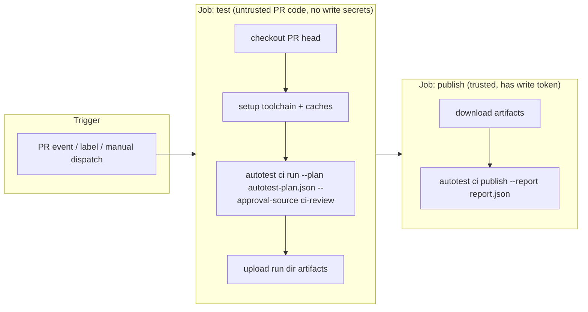

# Local and CI Execution

> **Status:** Planned design, baseline of 2026-10-22. Nothing described here is implemented yet.
>
> **Update 2026-10-24.** The local mode is implemented (v0.1 – v0.3). The CI mode (`autotest ci …`, the CI approval sources, `cleanup --ci`) was removed from scope by user decision; those sections stay as the record of the design. FVM-managed SDKs are not resolved per workspace: allowlist the SDK path itself (`autotest doctor --suggest-executables` finds FVM SDKs).

**Canonical home for:** the local Mac setup model, MCP client configuration, the repository allowlist, SDK discovery, device ownership, the artifact layout pointer, CI architecture, the CI provider comparison, caching, secrets, concurrency, cleanup, and platform constraints.

Both modes share `packages/workflow`. They differ only in **composition**, **approval sources** and **environment policy**. These differences are listed below and are not hidden.

| Aspect | Local (Mac) | CI |
|---|---|---|
| Entry point | `apps/mcp-server` (stdio, launched by Claude Code) and `apps/cli` for approvals and doctor | `apps/cli ci run` (no MCP client required) |
| Plan source | Agent-drafted through tools | A committed or attached plan file (`autotest-plan.json`) that is re-normalized and re-hashed. Optionally drafted by a headless agent job |
| Approval sources | AL2 CLI; AL1 elicitation only for scopes that policy allows; preauthorization file | AL3 org review (PR review by an authorized reviewer, or a protected-environment reviewer) or a CI-level preauthorization. **Never automatic for `needs_review`** |
| Environment id | `local:<hostId>` | `ci:<provider>:<owner>/<repo>` |
| Secrets | Keychain / user environment | Provider secrets, OIDC / Actions tokens |
| Devices | Owned simulators by default | Host tests only in v0.2/v1.0. Device jobs from v1.1 on macOS runners |
| Isolation | User account (residual risk T-02) | Ephemeral or wiped runners (required for PR code) |

## 1. Local Mac

### 1.1 Installation (planned UX)

1. Prerequisites:
   - Node.js 26 (from its Active LTS date, 2026-10-28) or Node.js 24.
   - pnpm, only for building from source.
   - Platform SDKs as needed: Flutter, plus Xcode and the Android SDK for v1.1.
2. Install the published package (REL-001). This provides two binaries, `autotest-mcp` and `autotest`.
3. `autotest init` creates `~/.autotest/` (`0700`), writes a commented `config.yaml`, and generates a cursor HMAC key.
4. `autotest doctor` checks the Node version, the data-root permissions, the executable allowlist resolution (Flutter, etc.), the SQLite driver, the keychain access for GitHub credentials, and the Claude Code configuration hints.

### 1.2 MCP client configuration (Claude Code)

A project-scoped server in `.mcp.json` uses the `command`/`args`/`env` schema with `${VAR}` expansion ([RL-007](research-log.md#rl-007--claude-code-mcp-behaviour-relevant-to-this-design)):

```json
{
  "mcpServers": {
    "autotest": {
      "command": "autotest-mcp",
      "args": [],
      "env": { "AUTOTEST_LOG_LEVEL": "info" },
      "timeout": 120000
    }
  }
}
```

- The server takes no arguments. Its data root is `AUTOTEST_HOME` (default `~/.autotest`), and the user policy is always `<data root>/config.yaml`, so no argument can point policy at another file (MCP-001).
- Until packaging lands (REL-001), a development checkout runs the entrypoint directly: `"command": "node", "args": ["<checkout>/apps/mcp-server/src/main.ts"]` on Node 24 or 26.
- The server never needs a long tool timeout, because `run_tests` returns immediately.
- The Skill is installed as a project skill (`.claude/skills/pr-mobile-autotest/`) or ships together with the server as a plugin ([agent-skill-spec](agent-skill-spec.md#packaging-for-claude-code)).
- The Claude Code permission rules recommended in [operations](operations-and-troubleshooting.md#recommended-claude-code-permission-rules) should be set.

### 1.3 Repository allowlist

`config.yaml` lists the workspaces:

```yaml
workspaces:
  - id: ws_fixture_flutter
    path: /Users/dev/src/autotest-fixture-flutter
    github: { host: github.com, owner: example, name: autotest-fixture-flutter }
  - id: ws_autotrader
    path: /Users/dev/Documents/Autotrader
    github: { host: ghe.coxautoinc.com, owner: <org>, name: <repo> }
    readOnlyReference: false   # set true to permit inspection only (no run_tests)
```

- Paths are realpath-canonicalized at load time.
- Tools may name a workspace by its `id` or by a path that canonicalizes to a listed root.
- `readOnlyReference: true` makes `run_tests` deny with `workspace_not_allowed`. Use it for reference repositories that must not be executed in.

### 1.4 SDK and runner discovery

- Executables come from `executables:` in the config. Each entry is a logical name mapped to an absolute path, with an optional SHA-256 pin.
- The `doctor` command can propose entries found on the user's `PATH`. The user confirms each one before it is saved, because the server never trusts `PATH` at spawn time ([ADR-0014](architecture-decisions/ADR-0014.md)).
- FVM-managed SDKs are recorded per workspace (`flutterSdk: fvm`). The adapter then resolves the project's FVM SDK path under policy.

### 1.5 Simulator and emulator ownership (v1.1)

- Devices that AutoTest creates are named `autotest-<runIdShort>-<type>`. Each gets a lease record, and the UDID is the source of truth for ownership.
- By default, runs use an owned device created on demand. Reusing a personal simulator requires a P2 approval if the action is destructive or changes its boot state.
- `autotest cleanup --devices` deletes owned devices whose leases have expired.

### 1.6 Environment and secret handling

- Children receive `PATH` (allowlisted directories), a run-scoped `HOME` and `TMPDIR`, locale variables, plus allowlisted variables from `env.allow` and per-workspace `env.secrets` references:

  ```yaml
  env:
    allow: [JAVA_HOME, ANDROID_HOME]
    secrets:
      - name: TEST_ACCOUNT_PASSWORD
        ref: keychain:autotest/autotrader-test-account
        workspaces: [ws_autotrader]
  ```

- Every resolved secret value is registered with the run's redactor before the spawn happens.

### 1.7 Local artifact storage

`~/.autotest/runs/<runId>/…`. The layout is canonical in [data-model §On-disk layout](data-model-and-artifacts.md#on-disk-layout). Retention follows [data-model §Retention and redaction](data-model-and-artifacts.md#retention-and-redaction).

### 1.8 Troubleshooting

See [operations-and-troubleshooting.md](operations-and-troubleshooting.md).

## 2. CI/CD

### 2.1 Architecture (provider-neutral)



1. **Plan input.** The plan comes from one of two places:
   - `autotest-plan.json` committed in the PR. It is untrusted, so the CLI re-normalizes it, recomputes the hash, and runs the gate.
   - An approved plan exported from a local session with `autotest plan export <planId>`.

   Optionally, a headless agent job may draft a plan. Its output still goes through the same gate.
2. **Authorization in CI** (`CI-003`):
   - Gate `pass` → authorized under CI policy.
   - Gate `needs_review` → requires an **AL3** approval. Two forms are accepted:
     - **(a)** A GitHub PR review in state `APPROVED` by a user in a configured reviewer team, submitted after the plan file's last commit. The review must contain the line `autotest-approve <planHash>`. The CI job verifies it through the API.
     - **(b)** A protected-environment approval in the CI provider. This depends on the provider; see DISC-004.

     Without one of these, the verdict is `blocked` and the job reports it.
   - Gate `fail` → `blocked`.
   - CI **never** auto-approves.
3. **Execution.** The same supervisor and `exec` path as local runs. The CI runner is the host. `ci run` waits for the run to reach a terminal state, because there is no client timeout to work around.
4. **Artifacts.** The run directory, after redaction, is uploaded with the provider's artifact mechanism. Quarantined files are excluded. Retention follows the provider settings, plus metadata in the report.
5. **Publication.** A separate job with a write-capable token (`checks: write` and `pull-requests: write` scoped to that job) runs `ci publish`. It uses the CI-level preauthorization defined in the org-controlled CI configuration. Publication never happens in the job that executed PR code.
6. **Cancellation and timeouts.**
   - Provider job cancellation sends SIGTERM to `autotest`, which performs the run cancellation sequence (ADR-0007).
   - The provider job timeout must be greater than the AutoTest run timeout plus the grace period.
   - Recommended defaults: a run timeout of 45 minutes and a job timeout of 60 minutes.
7. **Partial-failure recovery.**
   - If the test job fails before upload, the publish job reports `inconclusive` with reason `artifacts_missing`.
   - If publication partially fails, the result is reported per mechanism, and a re-run of the publish job is idempotent.
8. **Cleanup.** Ephemeral runners are discarded. On persistent runners, `autotest cleanup --ci` deletes `~/.autotest/runs/*` older than the job, and kills owned simulators and emulators.
9. **Parallel jobs.**
   - Sharding uses `flutter test --total-shards/--shard-index` ✅ (RL-014). Each shard produces its own run, and a final `ci merge-report` step combines the runs into one report. The plan hash is the same, and each run is listed separately.
   - Concurrency per runner is 1 run by default.

### 2.2 Dependency and SDK caching

- **Flutter.** Cache the SDK by version and `~/.pub-cache` by `pubspec.lock` hash. Autotrader's existing `setup-flutter` action already caches the SDK (RL-A03).
- **Android (v1.1).** Gradle caches and the AVD system images.
- **iOS (v1.1).** Cache DerivedData carefully, keyed by Xcode version and lockfiles.
- Caches must never contain secrets. Restored caches are treated as untrusted, so toolchains are re-verified through the executable allowlist and its hash pins.

### 2.3 Secrets management

- Use the provider's secret store. Pass `GITHUB_TOKEN` or OIDC-exchanged tokens.
- Private registry tokens (Artifactory, for example) are exposed only to the dependency-resolution step, and only on trusted triggers.
- PRs from forks get no secrets. For those PRs, AutoTest runs only what does not need private dependencies. If nothing qualifies, the verdict is `blocked` with reason `prerequisite_missing:private_deps`.

### 2.4 Linux-capable vs macOS-required workflows

See the macOS table in [platform-adapters.md](platform-adapters.md#capabilities-that-require-macos).

- v0.2/v1.0 CI needs Linux only: Flutter host tests.
- iOS simulator work (v1.1+) requires macOS runners. That means self-hosted Macs, or Bitrise or Codemagic. GitHub-hosted runners are not available on GHES ([RL-026](research-log.md#rl-026--github-hosted-runners-on-ghes)).

## CI provider comparison

**Decision status:** [ADR-0012](architecture-decisions/ADR-0012.md) is **Proposed**. This section is a structured comparison, not a final decision. Scores are 1–5 and preliminary, assigned from the evidence available on 2026-10-22. DISC-004 must revise them using the evidence listed in ADR-0012.

| Criterion (weight) | GitHub Actions on GHES, self-hosted runners | Bitrise | Codemagic | Self-hosted Mac runners (under GHA) |
|---|---|---|---|---|
| GHES compatibility (5) | 5. Same host; `GITHUB_TOKEN`, checks and statuses are native (OQ-07 to confirm the GHES version) | 3. The org already triggers GHA from Bitrise (RL-A08). GHES integration support is not stated on the pricing page (RL-027) | 2. GHES support is not stated (RL-027); unknown | 5. Same as GHA |
| macOS/iOS capability (3) | 1 on Linux runners; needs Mac runners | 5. Managed M2/M4 Pro Macs (RL-027) | 5. Managed M2/M4 Macs (RL-027) | 4. Requires operating Mac hardware; ARM64 runner support is in public preview (RL-028) |
| Flutter host tests on Linux (5) | 5. Existing `cai-standard-x86-linux` runners already run Flutter tests (RL-A06) | 4 | 4 | 3. Wasteful on Macs |
| Runner availability and concurrency (3) | 4. The org pool exists; capacity unknown | 4. Plan-based concurrency (Starter 4, Pro 10) | 3. 3 concurrencies per team plan | 2. Hardware-bound |
| Security and isolation (5) | 3. Runners must be ephemeral for PR code (the current pool's mode is unknown) | 4. Managed ephemeral VMs (assumed; verify) | 4. Managed VMs (assumed; verify) | 2. Hard to wipe Macs between jobs |
| Secret management (4) | 4. GHES secrets plus OIDC (verify OIDC on GHES) | 4 | 4 | 4 |
| Caching (3) | 3. Self-managed | 4. Dependency cache (RL-027) | 4 | 3 |
| Artifacts and retention (3) | 4 | 4 | 4 | 4 |
| Reporting integration (4) | 5. Checks and statuses directly | 3. Via API calls back to GHES | 3 | 5 |
| Maintenance effort (3) | 3 | 4 | 4 | 1 |
| Cost at workload (3) | 4. Existing infrastructure; marginal cost unknown | 3. From $89–200/mo list, enterprise custom (RL-027) | 3. $0.095–0.114/min macOS PAYG or $3,990/yr+ (RL-027) | 3. Hardware + operations |
| Org fit (4) | 5. Already used for tests | 4. Already used for builds | 2. New vendor | 3 |
| **Weighted total (preliminary)** | **≈ 4.0** | **≈ 3.8** | **≈ 3.4** | **≈ 3.3** |

**Provisional recommendation.**

- **v0.2/v1.0** (host tests only): GitHub Actions on GHES using the existing self-hosted Linux runners, configured as ephemeral runners.
- **v1.1+** (macOS): decide between Bitrise, which the org already uses for macOS, and self-hosted Mac runners.

**Evidence still needed:** see [ADR-0012](architecture-decisions/ADR-0012.md#evidence-required-to-decide) items 1–5.

The weighted totals are arithmetic over preliminary scores. They are inputs to the decision, not measurements.
