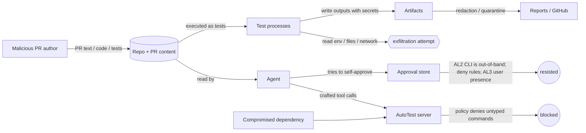

# Security Threat Model

> **Status:** Planned design, baseline of 2026-10-22. Nothing described here is implemented yet.

**This document is the canonical home for:**

- assets, actors, entry points and threats (T-NN; tool IDs use the separate `TL-NN` form)
- mitigations, mapped to task IDs
- permission tiers (P0–P3), the approval matrix and always-prohibited actions
- the GitHub credential matrix
- residual risks and deployment assumptions

**Related decisions:** [ADR-0006](architecture-decisions/ADR-0006.md) (approvals and authorization), [ADR-0013](architecture-decisions/ADR-0013.md) (GitHub), [ADR-0014](architecture-decisions/ADR-0014.md) (execution).

**Method:** STRIDE per trust boundary. Likelihood and impact are each rated L, M or H for the default local deployment (single user, macOS) and for CI.

## 1. Assets

| ID | Asset | Why it matters |
|---|---|---|
| AS-01 | Developer machine integrity: files, keychain, other repos | Test code runs locally |
| AS-02 | Credentials: GitHub tokens, App keys, CI secrets, test-account passwords, registry tokens | Leakage enables lateral movement |
| AS-03 | Approval store and policy config (`~/.autotest/`) | Controls what may execute or publish |
| AS-04 | Integrity of plans, decisions and the audit trail | Trust in reports and verdicts |
| AS-05 | GitHub PR state: comments, checks, statuses | Reviewer decisions depend on it |
| AS-06 | Devices and simulators the user owns | The developer's own environments |
| AS-07 | Evidence artifacts: logs, screenshots, source excerpts | May contain PII or secrets |
| AS-08 | CI runners and their caches | Shared infrastructure |

## 2. Trust boundaries

The TB-1 … TB-7 diagram in [architecture.md §10](architecture.md#10-trust-boundaries) is canonical. Summary:

- **TB-1: Human.** Trusted for approvals made through out-of-band channels.
- **TB-2: Agent and MCP client.** Semi-trusted. Content it has read can steer it, so its requests are validated and it can never grant approvals.
- **TB-3: AutoTest server code.** Trusted.
- **TB-4: User data root.** Trusted store. Protected only by OS permissions, which the same-user agent shell also has (see the residual risks).
- **TB-5: Executed test code and toolchains.** Untrusted code.
- **TB-6: Repository and PR content.** Untrusted data.
- **TB-7: External services.** GitHub/GHES and the CI provider. Authenticated, least privilege.

### Attack paths

## 3. Threat actors

| Actor | Capability | Goal |
|---|---|---|
| TA-1 | External PR author (fork) controls PR text, code and tests | Code execution on dev or CI hosts; secret theft; forging a "pass" |
| TA-2 | Insider with repo write access | Same as TA-1, plus approval forgery through repo config |
| TA-3 | Agent steered by injected content (not malicious by design) | Unintended actions: self-approval, broad execution, publishing |
| TA-4 | Supply-chain attacker (npm, pub, Gradle plugins, Appium drivers) | Code execution inside AutoTest or inside test runs |
| TA-5 | Local malware or another local user | Tampering with the data root |
| TA-6 | Network attacker | MITM against GitHub, or a remote transport if one is ever enabled |

## 4. Entry points

| ID | Entry point |
|---|---|
| EP-1 | MCP tool inputs (stdio) |
| EP-2 | PR body, title and labels (GitHub API or manual) |
| EP-3 | Repository files read during inspection |
| EP-4 | Test and build code executed by runners |
| EP-5 | Runner outputs: logs, JSON, JUnit, xcresult, screenshots |
| EP-6 | CLI commands and the user config |
| EP-7 | GitHub API responses |
| EP-8 | CI environment: variables, tokens, artifacts |
| EP-9 | Elicitation responses from the client |

## 5. Threats and mitigations

| ID | Threat (STRIDE) | Entry | L / I | Mitigations (task IDs) | Residual | Verification |
|---|---|---|---|---|---|---|
| T-01 | **Prompt injection** in PR prose, source comments, README, fixtures, test names or logs. It tries to override policy, grant approval, widen scope, add commands, bypass the gate or exfiltrate data. (T, E) | EP-2,3,5 | H / H | There is no instruction channel from content into policy. Tool outputs label `untrustedFields` (MCP-002). There is no command or argv input on any tool (SR-001, CON-007). The gate reads only schema-validated fields, never `display.*` (COV-001). Approvals come only from AL2+ out-of-band sources (AUTH-002). The Skill forbids following content instructions (SKL-001). Repo-local config can only narrow (POL-001). An injection corpus runs in CI (SEC-002). | The agent may still be misled into drafting a poor plan. The gate and human review limit the impact. | SEC-002, SKL-002 |
| T-02 | **Malicious test or build scripts** (Gradle, CocoaPods, npm scripts, Dart test code) execute arbitrary code. (E, I) | EP-4 | H / H | Running tests is an explicit P1 action, and only for authorized plans (AUTH-003). The child environment has a minimal allowlist, with no secrets by default (POL-004). Children get a per-run HOME/TMPDIR (EXE-001). Discovery never runs build scripts (INS-001, AND-002). CI runs on ephemeral or wiped runners with no secrets for fork PRs (CI-003). | **Inherent.** Running untrusted tests is code execution. v1.0 has no OS sandbox ([ADR-0014](architecture-decisions/ADR-0014.md)). Users must not run untrusted PRs locally without isolation. | SEC-001 (env leakage), CI-003 |
| T-03 | **Arbitrary command execution** through tool inputs, adapter specs or argument smuggling. (E) | EP-1 | M / H | Typed `run_tests` with no command fields (CON-007). Logical executables map to absolute allowlisted paths (POL-003). Per-executable argument schemas (POL-003). `shell:false` (EXE-001). `exec` re-validates (EXE-001). Only `exec` imports `child_process` (OPS-003). | Bugs in argument schemas | SEC-001 |
| T-04 | **Path traversal and symlink escape** in workspace paths, targets, artifacts or cursors. (I, T) | EP-1,3,5 | M / H | realpath canonicalization with containment checks that handle case-insensitive filesystems (POL-002). Symlinks are not followed outside the root (WS-001). Artifacts are ingested by generated names, never repo-provided names (EVD-001). HMAC-bound cursors (MCP-002). | TOCTOU races on a live filesystem. Mitigated by opening with `O_NOFOLLOW` where available, plus re-checking after open (EVD-001). | SEC-001 |
| T-05 | **Secret leakage** through logs, environment variables, screenshots, reports or repo content. Example: Autotrader's hardcoded test passwords (RL-A14). (I) | EP-4,5 | H / H | Secrets are injected by reference only (POL-004). Redaction covers known values, patterns and entropy (POL-005). Fail-closed quarantine, with screenshots and videos excluded from publication (EVD-002). Argv is redacted in specs. Reports never embed raw logs (RPT-002). Planning docs and fixtures never copy credential values (process). | Screenshots can show PII and cannot be redacted automatically. They are kept local and never published. Novel secret formats can evade the patterns. | SEC-001 (redaction canaries), SEC-004 |
| T-06 | **Unauthorized GitHub writes**: comment spam, forged checks, writes to the wrong PR. (T, S) | EP-1,7 | M / H | Read-only by default (GH-001). Writes are P3, need authorization, and are single-use per scope digest (GH-005, AUTH-003). A credential matrix applies (below). An allowlist restricts writes to comment, check and status. Idempotent markers. Writes are audited (OBS-002). | A compromised write token is outside AutoTest's control. Use App or Actions tokens with short lifetimes. | SEC-003, GH-005 tests |
| T-07 | **Malicious or oversized artifacts**: zip bombs, multi-GB logs, binaries disguised as text, symlinks. (D, T) | EP-5 | M / M | Output byte caps (EXE-002). Per-artifact and per-run size caps (EVD-001). MIME sniffing. No auto-extraction. No symlink following. Disk quota (EXE-004). | Disk pressure up to the quota | SEC-001, OPS-006 |
| T-08 | **Untrusted dependency installation** (`pub get`, `npm install`, `gradle` downloads) brings in malicious code. (E) | EP-4 | M / H | Network-resolving subcommands are off by default. When policy allows them, they run lockfile-enforced, and their network use is recorded (POL-003, SR-014). `--no-pub` is the default for Flutter (FL-003). | Gradle and CocoaPods download as part of the build when they are enabled (v1.1). This is a documented risk. | SEC-001, AND-003 |
| T-09 | **Resource exhaustion and hung processes**: infinite loops, fork bombs, log floods. (D) | EP-4 | M / M | Timeouts at three levels (EXE-002). Process-group kill escalation (EXE-002). Output caps. Disk quota. Concurrency limits (EXE-004). `cancel_pending` reporting (RUN-004). | Fork bombs before rlimits on macOS (limited `ulimit -u` support). Documented. | OPS-006 |
| T-10 | **Device or simulator state corruption**: erasing the developer's personal simulators, changing emulator snapshots. (T) | EP-1 | M / M | Ownership is tracked by lease and UDID, never by name alone (DEV-002). Non-owned or destructive actions are P2 and need an AL2 approval. Physical devices are never erased. | Runs on shared, non-owned devices can still change app state. Use owned devices by default. | DEV-002 tests |
| T-11 | **Cross-run data leakage**: one run reads another run's artifacts or temp data. (I) | EP-4 | L / M | Per-run directories (`0700`), per-run HOME/TMPDIR, cleanup at the terminal state (EXE-001, EVD-003). Concurrent runs use separate process groups. | All runs execute as the same OS user, so test code could read sibling run directories. Documented. | SEC-001 |
| T-12 | **CI credential exposure** to fork-PR code. (I) | EP-8 | M / H | Read-only tokens on untrusted triggers. Never run PR code under `pull_request_target` with secrets (RL-024). Publication runs in a separate job, after tests, using only artifacts (CI-002, CI-003). Short-lived OIDC or Actions tokens (SR-016). Ephemeral runners (RL-028). | Provider misconfiguration by the organization | CI-003 review, SEC-004 |
| T-13 | **Insecure remote MCP transport**. (S, I) | — | L / H (if enabled) | v1.0 is stdio only. HTTP is disabled until SR-017 is implemented: OAuth 2.1 resource server, RFC 9728 metadata, RFC 8707 audience binding (ADR-0001). | None while HTTP is disabled | MCP-001 (no HTTP listener test) |
| T-14 | **Supply-chain compromise of AutoTest itself.** (T) | — | M / H | Pinned lockfile, minimal dependencies, provenance and SBOM, `pnpm audit` in CI, dependency review (SEC-005, OPS-002). No install scripts unless allowlisted (`pnpm` `onlyBuiltDependencies`). | Zero-days in dependencies | SEC-005 |
| T-15 | **Stale, forged or self-granted approvals**: an agent runs `autotest approve` or edits the approval store or preauthorization file; replays an approval for an edited plan. (S, E) | EP-6,9 | M / H | Approvals are bound to hash, scope, environment and policy version (AUTH-001). Assurance levels (AUTH-002). The CLI requires an interactive TTY challenge: the user types characters of the digest (CLI-001). Recommended Claude Code deny rules (OPS docs). AL3 user-presence signing where required (DISC-003). File integrity is checked against the index (STO-004). | **Residual: an agent with an unrestricted shell as the same OS user can defeat AL2** (RK-01). Use deny rules or a sandbox, or require AL3. | SEC-003 |
| T-16 | **Process ownership confusion**: PID reuse leads to signalling a foreign process. (T, D) | — | L / M | Identity = pid + start time + pgid + marker environment variable (EXE-001). Never signal when identity cannot be verified (RUN-006). | — | RUN-006, OPS-006 |
| T-17 | **Data root tampering or SQLite access** by local processes, including test code running as the same user. (T, I) | — | M / M | Directory `0700` and files `0600` (STO-001). Approval files are authoritative and checked against index hashes. Audit hash chain (OBS-002). Test processes get a HOME other than the user's HOME, though the real HOME stays reachable by absolute path. | Same-user code can read and write the data root. Documented. | SEC-001, STO-004 |
| T-18 | **Plan tampering after the gate**: editing the stored plan or swapping the hash. (T) | — | L / H | Plan snapshots are immutable and their hash is recomputed on load and at authorization (CORE-002, AUTH-003). The decision is bound to the hash (COV-004). | — | SEC-003 |
| T-19 | **Repudiation**: denying who approved or published. (R) | — | L / M | Append-only, hash-chained audit with actor, source and assurance level (OBS-002). Approvals record the OS user and, for AL3, a signature. | Same-user tampering is detectable but not preventable. | OBS-002 tests |
| T-20 | **Repo-local configuration widening policy**: `.autotest.yaml` in a PR adds executables or disables rules. (E) | EP-3 | M / H | The repo config schema only allows narrowing keys (exclude paths, tags). Widening keys are rejected and audited (POL-001). | — | SEC-002 |
| T-21 | **Handle or cursor forgery** to read other runs or snapshots. (S, I) | EP-1 | L / L | Opaque ULIDs. Cursors are HMAC-bound. Single-user scope. | Under multi-user deployment, handles would need authorization checks (spec guidance, RL-002). | MCP-002 tests |

### Prompt injection: separating data from instructions

1. **Server.** No tool input field is ever interpreted as an instruction, an executable or a policy, so content-derived strings cannot change control flow. Untrusted strings are only:
   - stored,
   - length-capped,
   - normalized,
   - matched by deterministic rules (gate lexicons and analysis patterns),
   - rendered with Markdown escaping in reports. Raw HTML is never rendered, and auto-links are disabled for URLs that come from content.
2. **Skill.** It states that the PR, the repository and logs are *data*. It tells the agent never to call `request_approval` with self-asserted justification as a way around the gate, and to report suspected injection to the user ([agent-skill-spec](agent-skill-spec.md)).
3. **Gate.** It cannot be influenced by narrative fields, which are excluded from both the gate and the plan hash.
4. **Approvals.** They come from humans through AL2+ channels. Elicitation (AL1) is insufficient for gated scopes by default.

## Permission tiers and approval matrix

This section is canonical. MCP annotations mirror it only as hints ([RL-002](research-log.md#rl-002--tool-annotations-are-untrusted-hints)). Enforcement lives in `policy`.

| Tier | Meaning | Examples | Unattended? | Approval (minimum assurance) |
|---|---|---|---|---|
| **P0** | Read-only, or writes only inside the server's own data root | TL-01–TL-08, TL-10, TL-11, TL-13, TL-15–TL-17 | Yes | None |
| **P1** | Local execution or run-owned resource changes within policy | TL-09 `run_tests` (for a `pass` decision), TL-12 cancel, TL-14 on owned devices | Yes, within policy | None for a `pass` decision. A `needs_review` plan needs AL2 locally and AL3 in CI |
| **P2** | Device or environment mutation outside run ownership, or destructive | TL-14 erase, delete, boot or shutdown of non-owned simulators or emulators | No | AL2 locally. Not allowed in CI v1.0 |
| **P3** | External write | TL-18 publication | No | AL2 locally, or a matching preauthorization. In CI: a CI-level preauthorization (from org-controlled config, never from repo content) or AL3 |

### Always prohibited (no approval can enable these)

- Arbitrary command execution. Spawning an executable that is not on the allowlist, or passing arguments that violate its argument schema.
- Writing to the target repository's source tree. Toolchains may write only their standard build or cache outputs (`.dart_tool/`, `build/`, Gradle `build/`, DerivedData). Coverage and runner outputs are redirected to the run directory. AutoTest never edits source, tests or config files.
- Erasing, wiping or factory-resetting physical devices.
- Publishing quarantined or unredacted artifacts, screenshots, videos or raw logs.
- GitHub operations other than comment upsert, check run create/update and commit status create. That excludes merge, review approval, labels, pushes, branch changes and workflow dispatch.
- Auto-approving `needs_review` in CI (never allowed), and executing a plan whose gate decision is `fail`.
- Widening policy from repository-local configuration or from tool input.
- Reading files outside allowlisted workspaces and the data root.
- Installing dependencies from the network unless `allowDependencyResolution` is enabled in the user config. This is the only prohibited item that a configuration change can enable.

## GitHub credential matrix

| Operation | Credential | Permission | Where it is held |
|---|---|---|---|
| Read PR, files and diff stats | Fine-grained PAT **or** GitHub App installation token **or** Actions `GITHUB_TOKEN` | Pull requests: read (Contents: read for some endpoints) (RL-025) | macOS Keychain / env reference / CI secret |
| PR comment upsert | Same | Issues: write **or** Pull requests: write | Loaded only when publication is enabled |
| Check run | GitHub App token, or Actions `GITHUB_TOKEN` with `checks: write` | Checks: write. **Apps and Actions only** (RL-023, RL-024) | CI or the organization's App |
| Commit status (fallback) | PAT, App or Actions token | Commit statuses: write | Same |

Credentials are referenced by name in config (`secretRef: keychain:autotest/github-read`, `env:GITHUB_TOKEN`). They are never written to the data root, logs, reports or tool I/O.

## Secrets and sensitive information

| Item | Handling |
|---|---|
| GitHub and CI tokens | Resolved at use time from the keychain or environment. Never passed to test processes unless an explicit `envNeeds` entry and policy allow it. |
| Test-account credentials | Delivered to test processes only through allowlisted environment names configured by the user. Values are registered with the redactor for the run. |
| Environment variables | The child environment is built from an allowlist. The parent environment is never inherited wholesale. |
| Logs and screenshots | Text is redacted. Images are local-only and never published. |
| Test artifacts | Ingestion validation and redaction (data model §Retention and redaction). |
| Database contents | Contain no secrets. S1/S2 data under `0600`. |
| Approval records | No secrets. Signed for AL3. |

**Fail-closed rule.** If redaction cannot be guaranteed for an artifact type, the artifact is quarantined, or kept local and excluded from publication. Reports state this as a limitation.

## Residual risks

1. **Running tests means running untrusted code (T-02).** v1.0 provides policy, environment minimization and CI isolation guidance. It does not provide an OS sandbox. Local runs on untrusted PRs should use a disposable VM or account. That guidance appears in [operations](operations-and-troubleshooting.md).
2. **Same-user agent shell (T-15, T-17, RK-01).** AL2 resists the agent but is not agent-proof. Mitigations are Claude Code permission deny rules, sandboxing, or AL3.
3. **Network egress from tests** is not restricted in v1.0.
4. **Redaction is best effort** for novel secret formats. Screenshots cannot be redacted, so they are never published.
5. **Client-side controls** such as `requiresUserInteraction` and annotations are advisory and depend on the client.

## Deployment assumptions

- A single-user macOS workstation with FileVault. The user is an administrator of their own machine (A-01).
- CI runners are ephemeral or wiped per job. Jobs that run fork PR code receive no secrets.
- The user config and approval store live under `~/.autotest`, which is not synced to shared cloud folders.
- The GitHub organization can provide a GitHub App or Actions tokens for checks. Without them, publication is comment- and status-only.
- Claude Code permission rules are configured as recommended in [operations](operations-and-troubleshooting.md#recommended-claude-code-permission-rules).

## Verification strategy

| Area | Verification |
|---|---|
| Command, path and env restrictions | SEC-001 automated corpus (shell metacharacters, traversal, symlinks, environment smuggling, PATH hijack, oversized outputs) |
| Prompt injection | SEC-002 corpus through every content-accepting tool, plus SKL-002 agent scenarios |
| Approval and authorization | SEC-003 matrix: self-approval attempts, stale hash, expired, revoked, scope mismatch, CI auto-approval attempt, dispatch-time change |
| Supply chain | SEC-005: SBOM, audit, provenance |
| Overall review | SEC-004: threat-model walkthrough and penetration checklist before v1.0 (Phase 3) |
