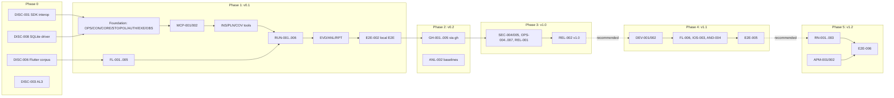

# Task Breakdown

**Canonical home for:**

- task IDs and the task schema
- task dependencies, the dependency graph, the critical path and parallel lanes

Phase objectives and exit criteria are in [implementation-roadmap.md](implementation-roadmap.md). **Status:** Phase 0 tasks and the first Phase 1 tasks (OPS-001, OPS-003, CON-001 – CON-007, CORE-001 – CORE-006, STO-001 – STO-004, POL-001 – POL-006, AUTH-001 – AUTH-003, WS-001, EXE-001 – EXE-004, OBS-001 – OBS-003, and Phase 1B's MCP-001, MCP-002, ADP-001, ADP-002, INS-001, INS-002, PLN-001 – PLN-005, COV-001 – COV-004, AUTH-004, CLI-001, E2E-001, FL-001 – FL-005, RUN-001 – RUN-006, EVD-001 – EVD-003, ANL-001, ANL-003, RPT-001 – RPT-004, CLI-002, CLI-003, SKL-001, SEC-001 – SEC-003 and E2E-002; OPS-002, SKL-002, REL-001 and SEC-005 partially) were executed on 2026-10-23; see the status tables under Phase 0. Every other task is planned and not started.

## 1. Conventions

### Task ID format

`<PREFIX>-NNN`: an uppercase prefix, a hyphen, and a three-digit zero-padded number. IDs are stable. They are never renumbered or reused. A removed task stays in the document marked `WITHDRAWN`, with a pointer to its replacement.

### Permitted prefixes

| Prefix | Area | Prefix | Area |
|---|---|---|---|
| DISC | Phase-0 discovery and spikes | INS | Inspection tools |
| OPS | Repo scaffold, CI of this repo, operations hardening | PLN | Planning tools |
| CON | Contracts (`packages/contracts`) | COV | Coverage gate |
| CORE | Core domain + `packages/workflow` | RUN | Run management tools |
| STO | Storage (`packages/storage`) *(addition)* | FL | Flutter adapter |
| POL | Policy (`packages/policy`) | RN | React Native adapter |
| AUTH | Approvals and execution authorization *(addition)* | IOS | Native iOS adapter |
| WS | Workspace (`packages/workspace`) | AND | Native Android adapter |
| EXE | Process execution (`packages/exec`, supervisor) | APM | Appium adapter |
| OBS | Logging, metrics, audit | DEV | Devices |
| MCP | MCP server app | EVD | Evidence |
| ADP | Adapter SDK | ANL | Failure analysis |
| RPT | Reporting | GH | GitHub |
| CI | CI integration | CLI | CLI app |
| SKL | Agent Skill | SEC | Security verification |
| E2E | End-to-end validation | REL | Release |

STO and AUTH were added to the base prefix list so that storage and authorization tasks stay independently verifiable.

### Canonical task schema (16 fields)

Every task has all 16 fields:

1. **Task ID**
2. **Title**
3. **Objective**
4. **Context.** Includes `Traces:` (FR/NFR/SR IDs, or an enabling rationale), the relevant ADRs, the phase, and `Size:` (S ≤ 2 engineer-days, M 3–5, L 6–10; estimates only)
5. **Scope**
6. **Non-goals**
7. **Prerequisites.** Environment or knowledge, not tasks
8. **Dependencies.** `Blocking:` task IDs that must be complete; `Recommended after:` sequencing hints that do not block
9. **Expected files/modules**
10. **Implementation notes**
11. **Acceptance criteria.** Verifiable statements
12. **Required automated tests**
13. **Security considerations**
14. **Verification.** Commands or a concrete procedure
15. **Completion evidence**
16. **Risks and rollback**

### Package names and commands

- Workspace packages are named `@autotest/<dir>`, for example `@autotest/policy`.
- Planned commands are `pnpm -r test`, `pnpm --filter @autotest/<pkg> test`, `pnpm lint`, `pnpm typecheck` and `pnpm depcruise`. OPS-001 fixes the exact scripts.
- A task is complete only when its verification has been **executed** and its evidence is recorded. Writing documentation alone never completes a task that requires executable verification.

---

## Phase 0 — Discovery and decisions

### Phase 0 execution status (2026-10-23)

| Task | Status | Evidence | Open remainder |
|---|---|---|---|
| DISC-001 | **Done** | `spikes/disc-001` (server, logging proxy, client test on Node 22.19.0, 24.22.1 and 26.12.1); RL-029; RL-030 | Re-run whenever the pinned Claude Code version changes |
| DISC-002 | **Done** (headless) | `spikes/disc-002` (hook auto-accept); RL-031; RL-032 | Optional: a human checks the interactive dialog |
| DISC-003 | **Done (accepted residual, 2026-10-24)** | `spikes/disc-003`; RL-035. The recommendation is documented in ADR-0006. With CI out of scope there is no AL3 source; local AL3 would need Developer ID signing with a provisioning profile, or FIDO hardware, which this project does not have. The verifier stays `NO_AL3` and the local maximum is AL2 (RK-01, OQ-13 closed) | No AL3 mechanism is implemented |
| DISC-004 | Not started | — | Depends on the DISC-005 remainder, plus stakeholders |
| DISC-005 | **Partial** | RL-036: GHES 3.21.6 and its documented capabilities | Instance configuration and recorded HTTP fixtures; needs an authorized GHES account |
| DISC-006 | **Done** | `fixtures/flutter-json/{3.38.4,3.38.10,3.41.9,3.47.1}` (scrubbed); RL-034 | — |
| DISC-007 | **Removed** | Removed from scope on 2026-10-24 (user decision): APM-002 only maps Autotrader's scenarios from the read-only checkout and runs nothing, so no credentials or complete checkout are needed (OQ-14 closed) | — |
| DISC-008 | **Done** | `spikes/disc-008`; RL-033; ADR-0008 updated | — |

### Phase 1 execution status (2026-10-23)

| Task | Status | Evidence | Open remainder |
|---|---|---|---|
| OPS-001 | **Done** | Root workspace; `boundaries.json`; 22 packages + 2 apps scaffolded. `pnpm install --frozen-lockfile` and `pnpm check` pass on Node 24.22.1 and 26.12.1, and Node 22 is rejected. Versions in RL-037. | Git repository not initialized (not authorized); CI comes in OPS-002 |
| CON-001 | **Done** | `packages/contracts/src/enums.ts`; `enums.docsync.test.ts` (7 tests) | — |
| CON-002 | **Done** | `errors.ts` with 45 codes; `errors.docsync.test.ts` checks codes, recoverability and categories against both docs | — |
| CON-003 | **Done** | `entities.ts` (PRContext, ProjectProfile with the FR-006 evidence rule, TestTarget, TestInventory); `entities.test.ts` | — |
| CON-004 | **Done** | `entities.ts` (Requirement with scoped AC IDs, TestCase eligibility, TestPlan without self-assessment fields); `entities.test.ts` | — |
| CON-005 | **Done** | `entities.ts` (CoverageDecision, Approval invariants: elicitation is AL1 only, AL3 needs a signature or reviewer, uses ≤ maxUses; ExecutionAuthorizationDecision is authorized only when there are no reasons) | — |
| CON-006 | **Done** | `entities.ts` (Run, RunAttempt, TestResult, EvidenceArtifact with path containment, FailureAnalysis with class/subtype integrity, KnownFailure, PRReport, AuditEvent, RunEvent union) | — |
| OPS-003 | **Done** | `.dependency-cruiser.cjs` (35 rules generated from `boundaries.json`); `scripts/check-boundaries.ts`; `scripts/check-boundaries-negative.ts` with 13 negative fixtures (every rule fires; a meta-check catches any rule never exercised; the ESLint dynamic-import rule is verified); mutation test detected package.json drift | — |
| OPS-002 | **Partial** | Git repository and GitHub remote (`chuthuong13492/mobile-autotest-mcp`, private). `.github/workflows/release.yml` (was `ci.yml` until 2026-10-24) runs **only on `vX.Y.Z` tags** or by hand: a `version` job (tag = `package.json` = `SERVER_VERSION`, CHANGELOG section present), then `pnpm check` and `pnpm audit --audit-level high --prod` on ubuntu-24.04 and macos-15 × Node 24/26, then the release job. Run 40108439007 (`v0.2.0`) is green on all six jobs; run 40108269566 (temp tag `v0.0.0-mismatch-test`, deleted) failed in `version` and skipped the rest, as intended. Actions are Node 24 releases pinned by SHA. The last push-triggered `ci.yml` run (40107833972) failed on a host-dependent setup test (a system `gh` on the Ubuntu runners), fixed in the same release | Pushes and PRs run no checks by design, so acceptance (1) "a PR with a failing test is blocked" no longer applies; `scripts/check-doc-links.mjs` not written; real-Flutter tests do not run in CI |
| CORE-001 | **Done** | `packages/core/src/ids.ts`: monotonic ULID handles, sequential IDs, stable `targetId`, path normalization; `ids.test.ts` | — |
| CORE-002 | **Done** | `canonical.ts` (RFC 8785, passes the RFC §3.2.2 and §3.2.3 examples, rejects non-I-JSON); `hash.ts` (plan hash v1, requirement-set hash, verification; moved to `packages/contracts/src/planHash.ts` in AUTH-003 so policy can recompute it); golden hash identical on Node 24.22.1 and 26.12.1; include/exclude property tests | — |
| CORE-003 | **Done** | `runState.ts`: transition table; the docs-sync test matches the data-model state diagram edge for edge; cancellation-confirmation invariants tested | — |
| CORE-004 | **Done** | `ports.ts` (11 ports, adding `ResultStore`); `testing/` entrypoint with in-memory fakes, schema-valid samples and framework-agnostic contract cases (plan immutability, decision bindings, atomic approval consume under concurrency, idempotency keys, optimistic updates, 2,000-result paging, audit chain) | STO-003 must run the same cases against SQLite |
| CORE-005 | **Done** | `verdict.ts`: rules 1–5 table tests, plus a fast-check property (2,000 runs) that the verdict is never `pass` unless every mandatory case passed, the gate was acceptable and every run completed | — |
| CORE-006 | **Done** | `packages/workflow`: `WorkflowPorts`, a typed `UseCases` mapped over all 18 tools, and `bindUseCases` enforcing the input/output contract (`E_VALIDATION` with JSON pointers; contract-violating output or a thrown error becomes `E_INTERNAL` with a correlation ID and no leaked message) | Use-case bodies land with their own tasks |
| CON-007 | **Done** | `tools.ts` (18 tools); JSON Schema snapshots in `packages/contracts/schemas/` (36 files); `tools.test.ts`, `doc-examples.test.ts` (all 36 doc examples validate), `schema-snapshots.test.ts` | The CI wiring for snapshot drift is part of OPS-002 |
| STO-001 | **Done** | `packages/storage/src/fs.ts`: data root created `0700` (a group/world-accessible or symlinked root is refused); atomic write = `O_EXCL`/`O_NOFOLLOW` temp file, fsync, rename, directory fsync; symlink targets refused; durable NDJSON append. `fs.test.ts` includes crash-before-rename fault injection | — |
| STO-002 | **Done** | `sql.ts` (`node:sqlite`: WAL, `busy_timeout=5000`, foreign keys, `synchronous=FULL`, DB file `0600`; `BEGIN IMMEDIATE` transactions); `migrations.ts` (schema v1, idempotent, refuses a newer schema). Two worker-thread connections writing 1,000 rows concurrently lose nothing. Schema deltas from the sketch are documented in data-model §SQLite | — |
| STO-003 | **Done** | `repos.ts`: SQLite plan, requirement, decision, approval, run, result and artifact stores, plus a file-backed audit sink. Every CORE-004 contract case passes against SQLite. Tampered plan snapshots and approval files fail closed (`integrity`). Approval `consume` across two worker threads never exceeds `maxUses`. The audit chain survives a reopen and detects file edits | Retention cleanup is OPS-004 |
| STO-004 | **Done** | `reconcile.ts`: removes temp leftovers, reports missing or modified plan snapshots, indexes valid orphan snapshots, quarantines invalid ones, always quarantines orphan approval files, reports approval file mismatches, marks missing artifacts. Every action is audited, and a second run repairs nothing further | The run-level `artifact_missing` limitation lands with RUN-004 |
| POL-001 | **Done** | `packages/policy/src/config.ts`: Zod schema with defaults for every section; restricted YAML (`yaml` 2.9.1: no aliases, no explicit tags, unique keys, 256 KiB cap); locked GR-01/GR-07, no GB keys; upward-only approval minimums; `policyVersion`/`gatePolicyVersion`/`riskPolicyVersion` digests; narrowing-only `parseRepoConfig` that reports rejected keys; missing or invalid config → `E_POLICY_UNAVAILABLE`. Malicious-config corpus of 9 cases | Auditing rejected repo keys happens in the caller (WS-001) |
| POL-002 | **Done** | `paths.ts`: `checkPath` through an injected `FsPort` (NFC normalization, deepest-existing-ancestor realpath, segment containment, case-insensitive on case-insensitive filesystems, encoded/backslash/NUL rejection); workspace resolution by ID or canonical root. 12-case traversal corpus | — |
| POL-003 | **Done** | `executables.ts` (registry pinned by realpath and optional SHA-256; `validateSpec` renders argv only from a matching command form); `argschemas/flutter.ts` (`test`, `--version --machine` probe, `pub get --enforce-lockfile` gated by `allowDependencyResolution`). 20 smuggling cases denied, including forbidden flags, unknown flags, dash-led values, symlink-escaping test paths and cwd escapes | Schemas for Android, iOS and React Native land with their adapters |
| POL-004 | **Done** | `env.ts`: environment built from `pathDirs`, run-scoped `HOME`/`TMPDIR`, locale and `env.allow`; secrets only when the spec needs them and they are scoped to the workspace; resolved values returned for the redactor. A canary variable, a `GITHUB_TOKEN` and `NODE_OPTIONS` in the parent do not reach the child; loader-hijacking names cannot be allowlisted | The Keychain resolver lands with CLI-001 |
| POL-005 | **Done** | `redact/` (ruleset `redact-1`: known values plus their URL/base64 encodings, private-key blocks, 8 credential patterns, high-entropy tokens with a safe-format allowlist); line-based streaming that handles chunk boundaries; counts per class, never values; `RedactionError` fails closed; coordinate coarsening and PII hashing. Property test with 300 runs (a canary split anywhere never survives). 0 false positives on the 36 Flutter fixture files (1,236 lines); about 41 MiB/s | The ruleset is TypeScript (`redact/ruleset.ts`), not `rulesets/redact-1.json` as first sketched |
| POL-006 | **Done** | `tiers.ts`: `tierFor` (TL-14 by ownership/action; physical erase is prohibited), `minAssurance` with the ADR-0006 defaults and pre-authorization for publication, upward-only override check (locked `not_allowed`), always-prohibited list. Docs-sync tests against the threat-model tier table, its prohibited list and the ADR-0006 table | — |
| AUTH-001 | **Done** | `packages/storage/src/approvals.ts` (moved out of `repos.ts`): authoritative `0600` file plus an index row with its SHA-256; lazy expiry persists `expired`; an `expireDue` sweep covers approvals and open requests; revocation only from `approved`/`pending` and immediately visible to other connections; supersession by plan hash. The port gained `expireDue`. Four new shared contract cases pass against both the in-memory fake and SQLite. A crash between the file write and the row update fails closed and is reported by reconciliation | — |
| AUTH-002 | **Done** | `packages/policy/src/approvals.ts`: scope digests for all four scope kinds; `verifyApproval` (state, expiry, uses, scope digest including a forged-params check, plan hash, environment, policy version, source-capped assurance); `selectApproval`; mapping to authorization reasons; pre-authorization file parser and matcher (publication only). 13-row usability matrix, AL1 rejected wherever AL2 is required, and a property test that any single binding change makes the approval unusable | AL3 verification is an interface; the default verifier fails closed until DISC-003/CI-003 |
| AUTH-003 | **Done** | `packages/policy/src/authorize.ts`: pure `authorizeExecution` evaluating every ADR-0006 §4 check and returning all reasons, the approval to consume and an `inputsDigest`. One fixture per reason code (all 20, checked against the enum); a gate `pass` with ineligible targets, a non-allowlisted workspace or a denied command is denied. A property test (400 runs) shows that dropping or corrupting any input never authorizes; it found and fixed a non-integer `latestPlanVersion` gap. The plan-hash code moved to `packages/contracts/src/planHash.ts` so policy can recompute hashes without depending on core | Calling it at create and dispatch is RUN-001/RUN-002 |
| WS-001 | **Done** | `packages/workspace`: `createWorkspaceReader` (bounded `readText` with `O_NOFOLLOW`, binary detection and truncation reporting; `exists`; `list` with a dependency-free glob matcher, default excluded dirs, no directory-symlink following, symlinked files only when contained, `maxFiles`/`maxScanned` limits reported as `truncatedBy`); `readGitInfo` (HEAD, loose and packed refs, remotes with credentials stripped; a `gitdir` outside the root yields no metadata). Stress test: 200,000 files listed with truncation reported in a few seconds | — |
| EXE-001 | **Done** | `packages/exec`: `ExecPort` (the only `child_process` user), `spawnSpec` (re-validates against policy, rebuilds the env with `AUTOTEST_RUN_ID`, `shell: false`, own process group, stdin closed, output to `0600` files), `identify`/`checkIdentity` with OS start time. Real-process tests: metacharacters passed literally, unvalidated specs refused before spawning, minimal environment | Linux run not yet executed (macOS only so far) |
| EXE-002 | **Done** | `terminate.ts` (SIGTERM → grace → SIGKILL → verify, identity checked before every signal, survivors reported; `verifyGone`), `limits.ts` (byte cap with one truncation marker, drained pipes, timers). A SIGTERM-ignoring child is killed after the grace period; a simulated survivor is reported; a PID-reuse simulation sends no signal. Fixed a double-close of capture file descriptors found by these tests | — |
| EXE-003 | **Done** | `packages/execution/src/supervisor/`: `runSupervisor` drives the canonical lifecycle with fsynced events, a heartbeat, `control.json`/SIGTERM/timeout/quota cancellation, `cancel_pending` back-off and `terminal.json`; `main.ts` detached entrypoint (argv = run id + data root); server-side `writeRunHeader`, `launchSupervisor`, `requestCancel`, `readRunFiles`. Tests: completed run with well-formed events, cancel via control file, timeout with SIGKILL escalation, survivors → `infra_error(cancel_unconfirmed)`, quota breach, denied dispatch, supervisor surviving its parent's SIGKILL, detached cancel with identity check | Full dispatch re-authorization is RUN-002; retries are RUN-003; evidence hooks are EVD-* |
| EXE-004 | **Done** | `packages/execution/src/queue.ts` (`admit` → `E_QUEUE_FULL`; work-conserving FIFO `selectDispatchable` with global, per-workspace and per-device limits); `packages/exec/src/quota.ts` (symlink-safe usage, `watchQuota`); new cancel reason `resource_quota`; new policy settings `maxRunsPerWorkspace`, `maxRunsPerDevice`, `queueCapacity` | rlimits unsupported in v1.0 (reported, not claimed) |
| OBS-001 | **Done** | `packages/core/src/log.ts`: `createLogger` with constant-template messages (others become `invalid_log_message`), `untrusted()` values (length only at info+, 200 characters at debug), bounded data, an injected line transform that fails closed (`log_redaction_failed`), and `AUTOTEST_LOG_LEVEL`. `apps/mcp-server/src/log.ts`: stderr and daily-capped 0600 file sinks; `serverLogTransform` = policy redactor + PII hashing; `guardConsole`. Tests: canary secrets, token patterns, URL credentials and e-mail never reach a sink; nothing is written to stdout | Wiring into the server bootstrap is MCP-001 |
| OBS-002 | **Done** | Audit sink moved to `packages/storage/src/auditSink.ts`: per-kind data rules (`packages/core/src/auditData.ts`, IDs and digests only, fail closed), chain-head recovery from files when the index is empty, `verifyAuditFiles` (file:line of the first unparsable, gapped, unlinked or mismatched event). Tests: one chain across monthly files; tampering with each line detected at that line; three worker-thread writers produce one valid 300-event chain | `doctor --audit` is CLI-002 |
| OBS-003 | **Done** | `packages/core/src/metrics.ts`: all 18 metrics of observability §4 (docs-sync test against the table, now listing label identifiers), counters/histograms/gauges, label guard (identifier-like values only, `_invalid`, 100-series cap with `_overflow`), `snapshot()` for `doctor --stats`, `emit()` as `metric` records. `packages/execution/src/importEvents.ts`: incremental run-event import with metrics and `event_log_truncated` | Persisting the import offset is RUN-004 |
| MCP-001 | **Done** | `apps/mcp-server`: `server.ts` (all 18 tools in catalog order; pass-through schemas advertising the contract JSON Schemas; `ToolError` as `structuredContent` with `isError`; `_meta` hints on TL-07/TL-18), `compose.ts` (data root, SQLite, policy load with a `config.loaded` audit event, logger, ports, workflow), `stubs.ts` (`E_CAPABILITY_UNAVAILABLE` until each tool's task lands), `main.ts` (stdio; exits on stdin close or SIGTERM/SIGINT without touching detached supervisors). SDK 2.3.1 pinned. Tests: an SDK client lists exactly 18 tools in order, with schemas, annotations and descriptions docs-synced; contract `E_VALIDATION`; no `listen`/`createServer` calls and no network imports; only JSON-RPC frames on stdout; a real stdio process serves and exits when the client closes | Supervisor survival across server exit is covered by EXE-003; tool bodies land with their tasks |
| MCP-002 | **Done** | `apps/mcp-server/src/middleware/`: `pipeline.ts` (tier check with fail-safe `E_POLICY_UNAVAILABLE` for P1+, fail-closed `tool.call` audit, idempotent replay/conflict, untrusted-field labelling, output-cap guard, `tool.result` audit, metrics), `summary.ts` (≤1,000-character summaries; `[untrusted]` prefix), `untrusted.ts` (registry docs-synced with the contract examples). `packages/core/src/cursor.ts` (HMAC cursors, `paginate`), `packages/storage/src/idempotency.ts`, `loadOrCreateKey`. Tests: an over-cap page is truncated with a cursor and paging returns every item once; forged, expired, other-key, malformed and filter-mismatched cursors → `E_CURSOR_INVALID`; every call yields paired audit events; replay and conflict; no tool runs if its `tool.call` audit cannot be written. Also fixed a SQLite pragma-order race (`busy_timeout` now set first) | Prohibited TL-14 calls on physical devices are decided with device context in DEV-*; concurrent first calls with one idempotency key rely on RUN-001's unique index |
| ADP-001 | **Done** | `packages/adapter-sdk`: `types.ts` (`PlatformAdapter`, `AdapterWorkspace`, `ProbePort`, detection, capability, inventory, execution, parsing, evidence and signal types), `specs.ts` (typed `ArgToken` builders, `runnerOutput` layout), `capabilities.ts` (`CapabilitySetSchema`, FR-014 `eligibilityOf`), `registry.ts` (deterministic, survives a throwing adapter); kit and example adapter at `@autotest/adapter-sdk/testing`. Kit self-tests: the example adapter passes; non-deterministic, throwing, out-of-contract, evidence-free and policy-denied adapters each fail exactly the relevant case. `packages/execution/test/adapterPolicy.test.ts` runs the kit with the real policy validator | The kit lives in `src/testing/` (not `testing/contractKit.ts`) to match the `./testing` export convention |
| ADP-002 | **Done** | `outcomes.ts` (`mapRunnerState` with unknown → `infra_error` plus a diagnostic, `mergeAttempts` with the flaky rule, `fillNotRun`, `countOutcomes`, `excerpt`); `junit.ts` (`toJUnit`, `xmlEscape`). Tests: a strict XML 1.0 well-formedness and JUnit-schema structure checker (counters, allowed children), an injection case, and a 300-run property test with arbitrary Unicode names; `xmllint` confirms a hostile sample is well-formed | No XSD engine in the toolchain: the schema rules are checked structurally |
| INS-001 | **Done** | `packages/inspect/src/project.ts` (`inspectProject`: budgeted adapter detection, extension-based languages, platform merge where `present` requires evidence, toolchain resolution that reports conflicts and never auto-selects), `budget.ts` (60 s default); `apps/mcp-server/src/tools/inspect.ts` (workspace resolved through policy by id or canonical path, profile persisted via the new `ProfileStore`), `probes.ts` (`flutter --version --machine` via `exec` under the `probe` class, 10 s timeout, scratch dir removed). Tests: contract-valid output, conflicts, evidence downgrade, budget with partial results, failing adapter, `E_WORKSPACE_NOT_ALLOWED`/`E_VALIDATION`/`E_POLICY_UNAVAILABLE`, probe output, timeout and missing executable | No production adapter is registered until FL-001 (`no_adapters` limitation); the malicious-`pubspec.yaml` case belongs to the Flutter adapter (FL-001) |
| INS-002 | **Done** | `packages/inspect/src/inventory.ts` (`buildInventory`: budgeted fragments merged and ordered, honest completeness for caps, failures and timeouts; `pageInventory` over HMAC cursors with adapter/level/prefix filters; escaping prefixes rejected); `InventoryStore` (fake + SQLite with `test_targets` rows). Tests: a 200-run property test of no duplicates or gaps across filters and limits; a 777-target workspace paged within the 20,000-character cap; snapshots reused by `inventoryId`; symlinked and `node_modules` tests excluded; shell-metacharacter filenames inert | Inventories are stored in SQLite rather than `.json.gz` files (data model note) |
| PLN-001 | **Done** | `packages/workflow/src/intake.ts` (control characters stripped and counted, policy redaction with counts by class, changed-file paths canonicalized, 16,000-character body pages); `apps/mcp-server/src/tools/planning.ts` (manual mode, workspace via policy recorded as `repository.localPath`, new `PrContextStore`). Tests: a token and a BEL character never stored, escaping changed files dropped, paging, `E_VALIDATION`/`E_WORKSPACE_NOT_ALLOWED`/`E_POLICY_UNAVAILABLE`/`E_CAPABILITY_UNAVAILABLE` (github) | GitHub mode: GH-002 (done) |
| PLN-002 | **Done** | `packages/planning/src/extract/` (`parsePrBody` over markdown-it tokens: requirement headings, checklists, numbered requirements, GWT and `AC:` lines; code, HTML/comments and quotes discarded; `assembleRequirementSet` with exact-text merge, ID assignment, risk, `missing_ac`/`vague_term` floors). Tests: a 7-case corpus, an injection case, merge rules, ambiguity floors, a 200-run property test of hash identity across line endings, idempotent sets per PR context | `markdown-it` 15.0.2 added (RL-037). "Named UI element" observability is not detected |
| PLN-003 | **Done** | `packages/planning/src/plan/normalize.ts` (reference/key/cycle/exception validation with JSON pointers, text normalization, `clientKey`-stable TC IDs, canonical `targetPath` resolution, per-case risk and eligibility, hash, reuse of an unchanged version); use case with an `E_REPO_MISMATCH` check, approval supersession and a `plan.versioned` audit event. Golden plan hash identical on Node 24 and 26 | Output summary trimmed to the output cap with a warning |
| PLN-004 | **Done** | `packages/planning/src/risk.ts` (`assessRisk` with rationale: factors, impact, likelihood, score, rule; overrides; `RISK_POLICY_V1`). Tests: doc examples (FI3/RL2/CS2 → R1, defaults → R2), overrides, a 1,000-run monotonicity property; docs-sync of thresholds and defaults against the doc and the policy-config defaults (in `apps/mcp-server/test/docsSync.test.ts`, because `planning` is a pure unit that may not read files) | — |
| PLN-005 | **Done** | `packages/planning/src/eligibility.ts` (structural `CapabilityView`, reasons in a fixed order: manual, no_target, policy_denied for read-only workspaces, capability_missing, platform_unavailable for host, device or platform scope, policy_denied for executables). One fixture per reason; executable availability comes from a dry `buildExecution` resolved against the policy executable registry | — |
| COV-001 | **Done** | `packages/coverage-gate/src/rules/` (GB-01 – GB-08 blockers, GR-01 – GR-10 review triggers, INF-01/02), `gate.ts` (`evaluateGate`: blocker → fail, review → needs_review, else pass; findings ordered deterministically). Tests: positive and negative fixtures per rule, rule toggles, locked GR-01/GR-07, a display-isolation test, a 200-run decision-logic property; fixtures built from contract schemas, so even tests never reach `planning` | — |
| COV-002 | **Done** | `metrics.ts` (six metrics; `null` on a zero denominator; execution counts only passed or failed mandatory cases), `status.ts` (requirement status rows in order, mandatory-case selection, `covered_elsewhere` target execution). Tests: a fixture per formula with explicit numerators and denominators, every status row, unexecuted tests never `passing` | Run data (metrics 3 and 6, post-run status) is supplied by RPT/RUN tasks |
| COV-003 | **Done** | `exceptions.ts` (rationale, human approval at the required assurance, expiry and the 30-day limit, `covered_elsewhere` evidence resolving to an inventory target, no `deferred` on R3, known requirements). Each invalid case triggers GB-02; approvals are verified through policy by scope digest in the use case | — |
| COV-004 | **Done** | `apps/mcp-server/src/tools/coverage.ts`: hash verification (`E_PLAN_NOT_FOUND`, `E_PLAN_HASH_MISMATCH`), re-evaluation on each call with reuse of an identical stored decision, `current` false for superseded versions, `coverage.decision` audit, findings paged with HMAC cursors. Tests: fail and pass plans, idempotency, plan-edit and gate-policy staleness, an exception counting only after a matching human approval, 120 findings paged without loss | The decision cache was changed from "same bindings → same record" to "same bindings and same result" (ADR-0005 update), because exception approvals and expiry are gate inputs |
| AUTH-004 | **Done** | `apps/mcp-server/src/tools/approvals.ts` (`request_approval`: scope digests over digested params only, environment must equal this server's id, a current non-`fail` coverage decision for `plan_execution`, the target set resolved like `run_tests`, idempotent on an open request with the same digest, `approval.requested` audit; `get_approval_status`: usability via `verifyApproval` against the server environment and current policy version, integrity failure → `E_STORAGE_CORRUPT`); `elicitation.ts` (legacy `elicitation/create` on the 2025-11-25 era, `inputRequired` on the 2026 era; `accept` grants AL1 only where policy's minimum is AL1, otherwise `accepted_insufficient`); `packages/workflow/src/approvals.ts` (`grantApproval`, shared with the CLI). Tests: idempotency, `E_COVERAGE_FAILED`/`E_COVERAGE_STALE`/`E_VALIDATION`/`E_CAPABILITY_UNAVAILABLE`, accept under the default policy never yields AL2+, accept under an AL1 policy, decline, not offered, status lookups | Display text moved to a new non-digested `ApprovalRequest.display` field. `coverage_exception` takes exactly one exception per request. `github_publish` is enabled by GH-005. A declined elicitation is reported as `elicitationOutcome: declined`, not as an error |
| CLI-001 | **Done** | `apps/cli/src/` (`run.ts` arg parsing with exit codes 0/1/2, `commands/{approve,revoke,approvals,init}.ts`, `context.ts`, `io.ts`, `main.ts`; `bin: autotest`). `approve` refuses unless stdin and stdout are TTYs, refuses AL3 scopes and closed or expired requests, shows summary, scope, digest, plan hash, environment, coverage findings and the untrusted justification, then asks for 6 digest characters at random positions; a correct answer creates an AL2 `cli` approval. `init` creates the data root (0700) and a commented config (0600) and never overwrites. Tests: usage, init, challenge positions, non-TTY and wrong-challenge refusal, bindings of the AL2 record, revoke, list, AL3/expired/no-policy refusal; `test/e2e/approval-flow.test.ts` drives server request → CLI approve → `authorizeExecution` → revoke → denied | Tests use an injected terminal (`Io`), not a pseudo-TTY: no pty library is in the toolchain, and adding one needs approval. The Keychain resolver noted under POL-004 is still open (no secret-backed workspace yet). Cross-app tests live in the root `test/e2e/` because apps may not import each other |
| E2E-001 | **Done** | `fixtures/fixture-flutter/` (calculator unit tests, a counter widget test, scenario files for fail, error, skip, flaky via a counter file in the run's `TMPDIR`, slow, SIGTERM-ignoring and a load-error toggle) and `fixtures/prs/*.md` (pass, needs_review and fail PRs). A direct `flutter test` (3.47.1) gives the expected outcome set; the flaky test fails on attempt 1 and passes on attempt 2 with the same `TMPDIR` | The fixture lives in this repository, not a separate public repo |
| FL-001 | **Done** | `packages/adapter-flutter/src/detect.ts`, `toolchain.ts`: Flutter SDK dependency detection with evidence; platform folders; monorepo packages and Melos reported as limitations; Flutter/Dart versions from pubspec, `.fvmrc`, `.fvm/fvm_config.json`, `.tool-versions`, CI files and the probe; exact versions that disagree are a conflict and nothing is picked; ranges are recorded only. The probe parser reads the first JSON object (Flutter prints a first-run banner after it under a run-scoped HOME). Registered as the server's built-in adapter (`builtInAdapters()`) | `inspect` now treats ranges as unresolved too. Monorepo packages are listed as a limitation, not as separate detections |
| FL-002 | **Done** | `inventory.ts`: `test/**` unit/widget by a bounded `testWidgets(` scan, `integration_test/**` as device-needing integration targets, `@Tags` → target tags, helpers and `dart_test.yaml`/`flutter_test_config.dart`; honest truncation. The fixture inventories exactly its two host test files | Autotrader-scale timing (775 files) not measured here: Autotrader is read-only and inspection is not run against it |
| FL-003 | **Done** | `execution.ts`: `flutter test --no-pub --file-reporter json:… --reporter expanded`, optional coverage and sharding, sorted paths; name selectors get a `--plain-name` spec; integration targets are never built. Every spec passes the real policy validator through the kit (`test/adapters/flutter.test.ts`); real runs of the fixture pass on the PATH SDK and on FVM 3.38.4, 3.38.10, 3.41.9 and 3.47.1 (`AUTOTEST_FLUTTER_MATRIX=1`) | The gated `pub get` prepare spec is not built yet (runs are `blocked` with `prerequisite_missing:pub_get` instead) |
| FL-004 | **Done** | `parse.ts`: outcome mapping per the platform-adapters table; error after `testDone`; load errors; `pub get` failures → `blocked`; interrupted → `cancelled`; missing `done` or `done.success == null` → `infra_error` with `runner_incomplete`; suites matched to targets by path suffix, unmatched suites reported. Every DISC-006 corpus file (4 versions) maps to its expected outcomes, and a truncated run never yields a pass | — |
| FL-005 | **Done** | `evidence.ts` (reporter JSON required, lcov optional; failure signals `flutter.missing_plugin`, `no_element`, `timeout`, `compilation_error`, `assertion`, `exception`, `pub_get_required`, `runner_incomplete`), `adapter-sdk/src/lcov.ts` (`parseLcov`, `changedFileCoverage`, `null` without a denominator) | Metric 3 is computed by the run/report tasks from these helpers |
| RUN-001 | **Done** | `packages/workflow/src/run.ts` (`gatherAuthorization` shared by creation and dispatch: plan, current decision, approvals by scope digest, workspace, inventory targets, dry-run `validateSpec`, adapter prerequisites; `createRun` persists the authorization decision and the run before answering, writes `run.json`, starts dispatch; reasons mapped to error codes with request-shape denials first), `apps/mcp-server/src/tools/runs.ts`. New `AuthorizationStore` port (fake, SQLite, contract case) and optional `PlatformAdapter.prerequisites` (Flutter: `.dart_tool/package_config.json`). Tests: pass run end to end, every denial path, prerequisites, idempotency (same key → same run, different request → `E_IDEMPOTENCY_CONFLICT`) | p95 latency not measured (OPS-005). Retry limits come from `execution.maxRetries`, the run timeout cap from `execution.defaultTimeoutMs` |
| RUN-002 | **Done** | `apps/mcp-server/src/supervisorEntry.ts` + `supervisorBoot.ts` (detached supervisor with the adapters and `dispatchAuthorize`: fresh evaluation, binding comparison, approval consumed only here), queue pump that refreshes slot holders first. Tests: revocation and a new plan version between creation and dispatch each end the run `cancelled(authorization_invalidated)`; a queued run cancelled by the user consumes no approval use; an approved run consumes exactly one use at dispatch | Dispatch compares a **binding digest** (plan id/version/hash, environment, policy version, workspace, targets, spec digests), not the decision's `inputsDigest`, which includes the phase and run id by design |
| RUN-003 | **Done** | `get_run_status` (event import, attempts, survivors, poll hints) and `get_run_results` (final snapshot, HMAC cursors, outcome/target/flaky filters). Results are imported once at terminal with ids derived from the run id, so concurrent servers cannot double-import. 2,000 results page out exactly once each | While a run is going, `get_run_results` returns no rows (`snapshotFinal: false`); progress is in `get_run_status` |
| RUN-004 | **Done** | `cancel_test_run`: queued runs cancel directly; running runs get `control.json` plus an identity-checked SIGTERM; the supervisor escalates to SIGKILL. Tests: a slow and a SIGTERM-ignoring runner both end `cancelled` within the grace period; repeat calls report `alreadyTerminal` | The survivor/`cancel_pending` path is covered by the EXE-002/003 tests, not re-tested through the tool |
| RUN-005 | **Done** | `packages/execution/src/retry.ts`, `attemptHooks.ts`, supervisor attempt loop: later attempts re-run only targets with test failures (flaky-eligible) or `infra_error`; load errors, blocked, skipped and cancelled results are never retried; each attempt writes `attempts/<n>/results.json`; `mergeAttempts` labels a pass after a failure `flaky`. Verified with the fake runner and with real Flutter 3.47.1 on the fixture (flaky test: `passed`, `flaky: true`, attempt 2) | Real test failures are retried once by default (ADR-0007 §9 treats them as flaky-eligible); `retry.maxAttempts: 1` disables it |
| RUN-006 | **Done** | `reconcileRuns` on server start (ADR-0007 §7) and dead-supervisor detection on every status poll; `packages/execution/src/reconcile.ts` (`supervisorAlive`, `stopOrphans`, identity-checked). Tests: restart mid-run reattaches and the run completes; a `kill -9` supervisor leaves a runner that is stopped and the run ends `supervisor_lost`; an unverifiable identity ends `orphan_unverified` and nothing is signalled | Found and fixed while testing: a cancel during supervisor start-up killed it silently (`supervisorBoot.ts` now installs the handler first) |
| EVD-001 | **Done** | `packages/evidence/src/ingest.ts` (paths confined to `attempts/`, symlinks and non-files quarantined by metadata, text sniffing, size cap with truncation, redaction with the policy redactor, PNG/JPEG signatures for screenshots, generated names, SHA-256 and provenance); `packages/workflow/src/evidence.ts` runs it in the supervisor's `collecting` state with a merged run JUnit file; `artifact.ingested`/`artifact.quarantined` audited. Tests: canary redacted, symlink rejected, binary-as-text quarantined, oversized text truncated, oversized and unknown binaries quarantined, end to end through a run | The redactor uses the pattern and entropy rules only; injected secret values are not passed as known values yet |
| EVD-002 | **Done** | `collect_test_evidence` (`apps/mcp-server/src/tools/evidence.ts`): metadata or redacted excerpts, kind and id filters, cursors, `E_ARTIFACT_QUARANTINED` for an excerpt of a quarantined artifact. Results link the runner output and logs of their deciding attempt | — |
| EVD-003 | **Done** | `packages/evidence/src/retention.ts`: `planRetention` (age, quarantine age, total cap oldest-first; non-terminal runs never touched), `applyRetention` deletes exactly the planned parts and keeps run records, `measureRun`. Tests for each rule and dry-run = actual | Wired into `autotest cleanup` by CLI-003 |
| ANL-001 | **Done** | `packages/analysis/rules/anl-1.json` (caps, environment and setup patterns, adapter signal mapping) and `src/classify.ts` (A1 – A10, alternatives, observations citing artifacts, "Likely" inference). Tests: a fixture per rule, a 1,000-run property test (confidence ≤ cap, alternatives ≤ primary, `supported` product defects only with every criterion), crafted log lines never change the class or raise confidence | Baselines and the known-failure registry are ANL-002 (Phase 2), so baseline is `unknown` and product defects stay hypotheses |
| ANL-003 | **Done** | `analyze_test_failures` + `packages/workflow/src/analysis.ts`: analyses keyed by run, result and ruleset version (new `AnalysisStore` port), derived ids, idempotent; `E_REPORT_NOT_READY` before the run is terminal | — |
| RPT-001 | **Done** | `packages/reporting/src/model.ts`: case outcomes from results (a never-executed case is `not_run`, never passed), verdict via `computeVerdict`, traceability, planned vs executed, failures with analyses, attention, limitations. Tests cover verdict rules 1 – 5 | — |
| RPT-002 | **Done** | `markdown.ts`: escaped untrusted text (no raw HTML, no live links, flattened table cells), analyses worded "likely"/"possibly", untrusted narrative section, length cap. Injection fixture renders inert | — |
| RPT-003 | **Done** | `json.ts` (canonical `PRReport` JSON); the merged JUnit is rendered in the workflow with the adapter SDK writer | `reporting` may depend only on `core`, so JUnit rendering lives in `workflow`; XML validity is covered by ADP-002's structural checker, not an XSD |
| RPT-004 | **Done** | `generate_pr_test_report` + `packages/workflow/src/report.ts`: runs must be terminal and of the plan hash, failures analyzed first, content-addressed report (new `ReportStore` port; same content → same report), Markdown/JSON/JUnit under the first run's `reports/<reportId>/` indexed as artifacts, `report.generated` audited. Tests: fail and pass verdicts, `blocked` with no runs, `E_REPORT_NOT_READY`, a run of another plan refused | — |
| CLI-002 | **Done** | `apps/cli/src/commands/doctor.ts`: Node ≥ 24 and `node:sqlite`, platform, `ps` process-group support (procps hint on Linux), data-root and config permissions, policy validity and versions, workspaces (missing, read-only, unresolved Flutter dependencies), executables (missing, not a file, pin mismatch), SQLite `quick_check`, audit chain, runs whose supervisor is gone or that are `cancel_pending`, Claude Code registration, the Skill and the deny rules — each problem with a remediation; exit 1 on any FAIL. `--audit` verifies the chain only; `--suggest-executables` lists Flutter SDKs from PATH, FVM and common folders with their versions and writes nothing. Tests for each failure mode | Keychain access is not checked (no Keychain secret resolver exists yet); `--stats` and `--repair` are not implemented |
| CLI-003 | **Done** | `apps/cli/src/commands/cleanup.ts`: reconciles runs left by a stopped server without starting queued runs, applies retention (EVD-003) and removes scratch directories older than 24 h of terminal or unknown runs; `--dry-run` prints exactly what a real cleanup removes (tested) | `--devices` arrives with DEV-002 (v1.1) |
| SKL-001 | **Done** | `skills/pr-mobile-autotest/SKILL.md` 0.1.0 rewritten against the implemented tools (manual PR context with `changedFiles`, `targetPath` from the inventory, `new_test_required` gaps and new plan versions, `E_PREREQUISITE_MISSING` handling, publication marked Phase 2); references updated; `plugin/` manifest and `.mcp.json`. `test/skill/skill.test.ts`: frontmatter rules, links, every tool-shaped name is a real tool, every error code exists, all Phase 1 tools covered, and the assembled plugin passes `claude plugin validate --strict`. Discovered as a project skill by headless Claude Code in every SKL-002 run | `skills-ref validate` is not installed; the frontmatter rules are checked by the test instead |
| SKL-002 | **Done** | `evals/skill/run.ts` (`--repeat N`, `arg:` checks, a mock-GitHub scenario through `apps/mcp-server/test/evalServer.ts`) with 6 scenarios × 3 runs on Skill 0.2.0 (`evals/skill/RESULTS.md`): 17 of 18 runs passed; the one failure was an API connection stall, not a Skill decision; no forbidden behavior in any run. The `needs-review-unapproved` scenario was revised after the gate correctly answered `fail` for an R3 plan with only positive cases | Not evaluated yet: an approved `needs_review` continuing, a flaky test, an `infra_error`, a baseline run |
| REL-001 | **Done** | Distribution through GitHub Releases from version tags (owner decision; no npm registry): tarball, SHA256SUMS and SBOM; the release job runs only after `check` and an install smoke on Ubuntu and macOS (`scripts/install-smoke.sh`). v0.3.0 downloaded from its Release matches SHA256SUMS and passes `scripts/verify-macos.sh` (real Flutter run, report pass, audit chain); Linux: `scripts/verify-linux.sh` in Docker with Flutter 3.44.0 passed on v0.2.0 | No provenance attestation (waived) |
| SEC-005 | **Done (with waiver)** | SBOM (CycloneDX) and third-party licenses from the bundled packages, license allowlist, SHA256SUMS; `pnpm audit --audit-level high --prod` gates every release; actions pinned by SHA; only the release job may write; `SECURITY.md`; Dependabot for npm and actions. The release job attempts a build-provenance attestation every time | Provenance waived in `release/v1.0-readiness.md`: GitHub refuses attestations for user-owned private repositories (v0.3.0 run 40136468900) |
| SEC-001 | **Done** | `security/sec-001/abuse.test.ts`, tagged by threat: no command-like field in any tool input (T-03); unknown executables, forbidden or unknown flags and extra words denied (T-03); shell metacharacters in a test file name reach the runner as one literal argument (T-03); traversal and symlink escapes denied for test paths, run paths and listings (T-04); parent tokens, secrets and loader hooks never reach children, HOME is run-scoped (T-02, T-05); five redaction canaries never reach stored evidence (T-05); output floods capped with a marker, binary/oversized/symlinked artifacts quarantined or truncated (T-07); dependency resolution gated and `--no-pub` required (T-08); private per-run directories (T-11); data root and files private, insecure root refused (T-17); a T-ID coverage report | `fixtures/fixture-malicious` is not a separate app: the malicious inputs are built inside the tests |
| SEC-002 | **Done** | `security/sec-002/injection.test.ts`: injected HTML comments, code blocks, quotes, `
` and JSON-RPC text leave the requirement-set hash unchanged and appear only as labelled discarded excerpts; plan display text cannot change a gate decision; an injected test name and failure message cannot change the outcome, the analysis class or the verdict, and render inert in the report; repository `.autotest.yaml`/`config.yaml` cannot widen policy (T-01, T-20) | — |
| SEC-003 | **Done** | `security/sec-003/bypass.test.ts` through the real server: no approval, AL1 where AL2 is required, a subset-scoped approval, expired, revoked and exhausted approvals, another environment, a changed policy version, a tampered approval file, a failed gate, an edited plan, a tampered plan snapshot, and GitHub publication — each denied with its documented code and reason (T-15, T-18, T-06). Integrity failures now surface as `E_STORAGE_CORRUPT` (centrally in `bindUseCases`) instead of `E_INTERNAL` | — |
| E2E-002 | **Done** | `test/e2e/local-flutter.test.ts` with real Flutter (3.47.1 here) on the fixture: pass with a flaky retry, coverage evidence, flaky analysis, pass report and a verified audit chain; `needs_review` refused, approved through the CLI challenge, then run and reported pass; assertion, exception and load-error failures analyzed and reported `fail`; a failed gate blocks the run; a slow run is cancelled and nothing is reported as passed. Skips with the reason when no SDK is found | Linux execution not yet verified (no Docker daemon); the CI job that would run it on Linux has no remote yet |
| GH-001 | **Done** | `packages/github/src/client.ts`: `fetch` client for `https://api.github.com` with a fixed endpoint allowlist, retries on 429/5xx/secondary rate limits (up to 5, honouring `retry-after` and `x-ratelimit-reset`), same-origin `Link` pagination, `E_GITHUB_*` errors with the token scrubbed. Credential: `gh auth token --hostname github.com` through the exec allowlist (`packages/policy/src/argschemas/gh.ts`, class `probe`), token kept in memory only and re-read after a 401 (`apps/mcp-server/src/github.ts`); `credentialRef` still works. Mock GitHub for tests in `@autotest/github/testing` | github.com only (GHES removed from scope). No Octokit |
| GH-002 | **Done** | `get_pr_context` with `source: "github"` (`apps/mcp-server/src/tools/planning.ts`, `packages/github/src/pr.ts`): PR, labels, head/base and up to 3,000 changed files with statuses, through the same redaction pipeline as manual mode. The repository is checked against `workspace.github` or the workspace `.git/config` origin (no `git` process): mismatch → `E_REPO_MISMATCH`, none → limitation `repository_unverified` | — |
| GH-003 | **Done** | `upsertComment` (`packages/github/src/publish.ts`): hidden marker per plan, matched only on comments of the authenticated identity; created, updated or `skipped` when unchanged | — |
| GH-004 | **Done** | `publishCheckRun` (check `AutoTest`, `external_id` = report id, verdict → conclusion, annotations in batches of 50) and `publishCommitStatus` (context `autotest`). A 403/404/422 from the checks API is `unavailable` (`E_GITHUB_FEATURE_UNAVAILABLE`) | A `gh` user token cannot create check runs; the publish tool falls back to a commit status |
| GH-005 | **Done** | `publish_github_report` (`packages/workflow/src/publish.ts`): publication must be enabled per mechanism in `config.yaml`, the report must come from a GitHub PR context, and a single-use `github_publish` approval (AL2 via `autotest approve`) must match host, repo, PR, head SHA, report hash and the sorted mechanism set; `dryRun` writes nothing. Publication records (`PublicationStore`, SQLite `publications`), `github.write` audit per mechanism. `request_approval` accepts `github_publish`. `autotest setup` allowlists `gh` and takes `--enable-publication`; `doctor` checks the `gh` login. Skill step 13. Tests: `apps/mcp-server/test/github.test.ts`, SEC-003 T-06 | Approving `check_run` also covers its commit-status fallback |
| ANL-002 | **Done** | Baseline runs: `run_tests` `baseline: {ref?}` (contract change, TL-09) resolves the base ref with an allowlisted `git` (`packages/policy/src/argschemas/git.ts`: rev-parse, worktree add/remove/prune, fixed `-c` options for no hooks, no transport, no LFS; ordered positional arguments added to argument schemas), checks it out at `<runDir>/baseline` (`packages/execution/src/git.ts`, `packages/workflow/src/baseline.ts`), copies resolved dependencies only when lock files match (`PlatformAdapter.baselineDependencies`), and removes the worktree at run end, on import and in `cleanup`. Known-failure registry: `KnownFailureStore` (SQLite `known_failures`), `autotest known-failures add/list/remove` with audit events. Analysis feeds both into anl-1 rules A1/A2 and recomputes when they change (`AnalysisStore.replaceForRun`). Tests: `test/e2e/baseline.test.ts` (real git, fake runner), a real-Flutter case in `test/e2e/local-flutter.test.ts`, SEC-001 git abuse case, policy git schema tests | The registry stores target ids; `--target` accepts a test path (Flutter adapter id by default) |
| OPS-006 | **Done** | `resilience/resilience.test.ts` (`pnpm test:resilience`, also in `pnpm test`): kill -9 of a real stdio server mid-run (a new server reports the completed run), client disconnect (stdin closed), kill -9 of the supervisor (`infra_error(supervisor_lost)`, runner group stopped, no invented pass), SQLite held by another writer, a corrupted event log, a server clock 2 h ahead, and a full disk under the data root (40 MiB disk image, macOS). Each checks: no acknowledged record lost, no misreported terminal state, an unrelated process left alone. Fixes from the suite: a failed `BEGIN` left the connection's transaction flag set forever (every later call failed); a ROLLBACK after SQLite's own rollback masked the original error; a torn or uncommitted audit line could make the next event reuse a seq (now truncated, only while it is the last line); disk-full and busy conditions now return the recoverable `E_STORAGE_UNAVAILABLE`; the server log file sink is best-effort | The disk-full case needs macOS (`hdiutil`) and is skipped elsewhere |
| MCP-003 | **Withdrawn (2026-10-25)** | OQ-03 re-checked for Phase 3: the installed Claude Code is still 2.1.169, the version RL-032 found without `io.modelcontextprotocol/tasks` support. As the task's own rollback says, it is closed without implementation; `run_tests` stays asynchronous through the run tools | Re-open when a Claude Code release documents the Tasks extension |
| OPS-004 | **Done** | Gap analysis of operations §3, §4 and §6 against `doctor`/`cleanup`. Added: `secrets` (a `keychain:` reference is a FAIL, this build resolves `env:` only; an unset `env:` variable is a WARN), `disk` (run data against `retention.totalCapBytes`), `worktrees` (leftover baseline checkouts), `doctor --stats`, `approvals --all`. The doc was corrected where it promised what does not exist (`doctor --repair`, `cleanup --ci`, `flutterSdk`). Test: `apps/cli/test/ops.test.ts` OPS-004 case | No automatic index rebuild: a broken index is moved aside by hand and the workflow re-run (operations §4) |
| OPS-005 | **Done** | `pnpm bench` (`bench/bench.ts`, results in `bench/RESULTS.md`): on a synthetic 10,000-file Flutter repository through the full server composition, p95 `inspect_project` 40 ms, `inspect_test_inventory` 214 ms (target 5,000), `run_tests` 38 ms (target 2,000) on an M1 Pro. Matrix: Node 24/26 × ubuntu/macOS in `release.yml`; real Flutter E2E green with 3.38.4, 3.38.10, 3.41.9 and 3.47.1 on macOS and 3.44.0 on Linux (Docker). Calibration memo `bench/CALIBRATION.md`: policy v1 kept | No pilot usage data yet: the calibration rests on fixtures and Skill evaluations; repeat after 30 real PR reports |
| OPS-007 | **Done** | `ops/drills.test.ts` (in `pnpm test`) performs each operations §4 procedure: cancel_pending listing, broken index moved aside, tampered approval revoked and re-approved, broken audit chain, invalid policy, disk over cap; two more rows are drilled in the resilience suite. Log: `ops/drills-v1.md`. The drill corrected §4 (no `doctor --repair`; audit-chain wording) and added the `audit_chain_broken` report limitation; it also found that a tampered approval could not be revoked and blocked its scope for good (`ApprovalStore.quarantine`, used by `autotest revoke`) | — |
| SEC-004 | **Done** | `security/review-v1.md`: every threat T-01 – T-21 marked verified (with its test), accepted residual or not applicable; six defects found by OPS-006/OPS-007 fixed with regression tests | Confirmed by the repository owner on 2026-10-25; no independent reviewer |
| REL-002 | **Done** | `release/v1.0-readiness.md`: every DOD-REL gate with evidence; one waiver (provenance) | Confirmed by the repository owner on 2026-10-25; v1.0.0 tagged |
| IOS-001 | **Done** | `fixtures/fixture-ios` (SwiftUI app; unit tests passing, failing and skipped; one XCUITest; hand-written project in the Xcode 16+ synchronized-folder format, checked with `xcodebuild -list -json`); corpus `fixtures/ios-corpus/xcode-26.4.1/` (summary, tests, build results, `-only-testing`, build failure); RL-017 updated; OQ-08 closed | Verified on Xcode 26.4.1 only |
| AND-001 | **Done** | `fixtures/fixture-android` (Gradle 9.3.1, AGP 9.1.0; JUnit unit tests passing, failing and ignored; two instrumented tests); corpus `fixtures/android-corpus/agp-9.1.0/` (unit and connected XML, full and selected); RL-018 updated; OQ-09 closed | Gradle Managed Devices not re-verified (optional). The emulator needs about 8 GB free disk |
| DEV-001 | **Done** | `list_devices` (`packages/workflow/src/devices.ts`, `packages/devices/src/devices.ts`): simctl JSON, `adb devices -l`, `emulator -list-avds` and `adb emu avd name`, parsed by `packages/devices/src/parse.ts` (tests on `fixtures/devices-corpus/`); argument schemas for `xcrun`, `adb` (serial through `ANDROID_SERIAL`), `emulator`, `avdmanager` (`packages/policy/src/argschemas/devices.ts`); missing tools reported as unsupported. `setup` allowlists the tools | — |
| DEV-002 | **Done** | `manage_simulator`: `DeviceLeaseStore` (SQLite `device_leases`), owned devices at P1 and others at P2 with a single-use `device_action` approval, physical devices refused, audit `device.action`; Android create/boot/shutdown/erase/delete through `avdmanager` and a detached headless emulator; `cleanup` deletes owned devices with expired leases, `doctor` warns. Tests: tier matrix with fake tools (`apps/mcp-server/test/devices.test.ts`); real devices (`test/e2e/devices.test.ts`): iOS create → boot → erase → delete and refusals on a spoofed `autotest-` simulator; Android AVD create → headless boot → shutdown → delete, all on this Mac | The real-device test needs macOS with Xcode, and the Android SDK with about 8 GB free disk |
| FL-006 | **Done** | Flutter `integration_test` on an AutoTest-owned, booted device: one inventory target per platform (iOS: simulator on macOS; Android: emulator), plan cases pick the target of their platform, `flutter test --no-pub -d <UDID|emulator serial>` (`packages/adapter-flutter/src/execution.ts`). `run_tests` takes one device: it must be owned, booted and free; the lease is bound to the run and released at import; dispatch re-checks it. Verified end to end with real Flutter 3.47 on an iOS 26.4 simulator and an API 36 emulator (`test/e2e/device-flutter.test.ts`, opt-in `AUTOTEST_E2E_DEVICES=1`). Fixes found on the way: the supervisor now passes the policy's `env.allow` variables to runs (they never reached the runner before); `autotest setup` allowlists ANDROID_HOME, JAVA_HOME, GRADLE_USER_HOME and registers their values with Claude Code | Failure screenshots are not captured yet; one device per run |
| IOS-002 | **Done** | `packages/adapter-ios`: detection of `.xcodeproj` (root or one level; a Flutter project's `ios/` is left to the Flutter adapter), shared-scheme testables, product types from `project.pbxproj`, one target per XCTestCase class (`unit` or, for UI-testing bundles, `e2e`). Static parsing only. Tests: `test/adapters/ios.test.ts` on `fixtures/fixture-ios` | Swift Testing (`@Test`) functions run but are not inventoried |
| IOS-003 | **Done** | `xcodebuild test -project -scheme -destination id=<UDID> -resultBundlePath -derivedDataPath -only-testing …` then `xcresulttool get test-results tests` and `get build-results` (their stdout is parsed: runner outputs now include `attempts/<n>/stdout-<k>.log`); pass, fail with the assertion message, skip, and build failures as `load_error`; signals for simulator and signing problems. End to end on a real simulator (`test/e2e/device-ios.test.ts`, opt-in). Fix found on the way: the disk quota counted apparent size, and Xcode's sparse 16 GB compilation cache cancelled runs; quota now counts allocated space | Verified on Xcode 26.4.1 only; xcresult bundles are kept in the run directory but not indexed as evidence |
| AND-002 | **Done** | `packages/adapter-android`: static detection (`settings.gradle(.kts)` at the root or one level down, `include` statements, Android plugin in the module build file, wrapper jar; a Flutter project's `android/` is left to the Flutter adapter) and one target per JUnit class (`src/test` → `unit`, host JVM; `src/androidTest` → `integration`, emulator). Gradle is never run for discovery. Tests: `test/adapters/android.test.ts` on `fixtures/fixture-android` | Only the debug variant; modules with product flavors and moved project directories are reported, not inventoried |
| AND-003 | **Done** | The configured JDK runs the project's Gradle wrapper jar (new `java` argument schema: the wrapper jar as the only JVM option, a fixed main class, one test task, offline, no daemon; leading-flag and workspace-path flag support in the policy validator); `:<module>:testDebugUnitTest --rerun --tests <Class>`; JUnit XML copied from `build/` by the new ExecutionSpec `collect` step in the supervisor (files written since the spawn, no symlinks, capped) and parsed without entity expansion; build failures become `load_error`; signals for SDK, offline cache and device. Real Gradle end to end through the MCP workflow (`test/e2e/device-android.test.ts`, opt-in). `autotest setup` registers `java` from `JAVA_HOME` | Gradle reads `GRADLE_USER_HOME/gradle.properties`; the wrapper may download its distribution when it is not cached |
| AND-004 | **Done** | `:<module>:connectedDebugAndroidTest --project-prop android.testInstrumentationRunnerArguments.class=<classes>` on the run's AutoTest-owned emulator, selected by `ANDROID_SERIAL` (set by the supervisor from the lease, never in argv); AGP's per-test logcat files are collected as evidence. Verified on an API 36 emulator (pass and fail mapped; device deleted afterwards) | No failure screenshots; one device per run |
| E2E-005 | **Done** | `pnpm e2e:devices` (opt-in, this Mac): 4 files, 7 tests, all passed in 569 s on Node 24 — device lifecycle, Flutter `integration_test` on an iOS 26.4 simulator and an API 36 emulator, native XCTest/XCUITest, native Android unit (host JVM) and instrumented (emulator). Each test creates its own AutoTest device and deletes it; verdicts match the fixtures' intended failures | Not run in CI (the release workflow has no simulators or emulators); one host (macOS 26.6, Xcode 26.4.1, Gradle 9.3.1, AGP 9.1.0) |
| DISC-004 | **Removed** | Removed from scope on 2026-10-24 (user decision): CI is not part of the product: AutoTest is not run inside CI (user decision 2026-10-24). ADR-0012 is withdrawn. | — |
| DISC-005 | **Removed** | Removed from scope on 2026-10-24 (user decision): Only github.com is supported, through the `gh` credential; GHES capabilities are no longer needed. | — |
| CI-001 | **Removed** | Removed from scope on 2026-10-24 (user decision): AutoTest does not run inside CI pipelines (user decision 2026-10-24). | — |
| CI-002 | **Removed** | Removed from scope on 2026-10-24 (user decision): AutoTest does not run inside CI pipelines. | — |
| CI-003 | **Removed** | Removed from scope on 2026-10-24 (user decision): No CI approval source: approvals stay local (CLI AL2). | — |
| CI-004 | **Removed** | Removed from scope on 2026-10-24 (user decision): No CI artifact integration. | — |
| CLI-004 | **Removed** | Removed from scope on 2026-10-24 (user decision): No `autotest ci` commands. | — |
| E2E-003 | **Removed** | Removed from scope on 2026-10-24 (user decision): The Autotrader credential-gated acceptance run is dropped with DISC-007 out of the release path; Autotrader stays a read-only reference. | — |
| E2E-004 | **Removed** | Removed from scope on 2026-10-24 (user decision): Replaced by the GitHub publication tests (mock server) and a live check on a draft PR of this repository. | — |

### DISC-001 — MCP SDK v2 + Claude Code interoperability spike
- **Task ID:** DISC-001
- **Title:** MCP SDK v2 + Claude Code interoperability spike
- **Objective:** Prove that a TypeScript SDK v2 stdio server works with the pinned Claude Code version, and record the exact SDK APIs.
- **Context:** Traces: NFR-010, NFR-001; ADR-0001, ADR-0003; OQ-02, OQ-05. Phase 0. Size: M.
- **Scope:** A throwaway spike server built with `@modelcontextprotocol/server` and its stdio transport. It must exercise one tool with a Zod 4 `inputSchema` and an `outputSchema`, return `structuredContent`, return one `isError` result, return one result over 20k characters, and verify `server/discover` handling. Run it on Node 24 and on Node 26 (Current/LTS).
- **Non-goals:** Production code. HTTP transport.
- **Prerequisites:** Claude Code installed (version recorded). Node 24 and Node 26 available.
- **Dependencies:** Blocking: none. Recommended after: —
- **Expected files/modules:** `spikes/disc-001/` (not shipped). `docs/research-log.md` updates (RL-005/006). ADR-0001 status note.
- **Implementation notes:** Read the SDK v2 migration guide. Record the exact `registerTool` options, the error helpers, and how `outputSchema` is derived from Zod. Record the protocol version Claude Code negotiates.
- **Acceptance criteria:** (1) Claude Code lists and calls the spike tool and receives `structuredContent`. (2) The negotiated protocol revision is recorded. (3) If interop fails, the ADR-0001 fallback (SDK v1 transport) is demonstrated and recorded. (4) The API notes are committed to the research log.
- **Required automated tests:** An in-process SDK client test for the spike tool (kept in the spike).
- **Security considerations:** The spike writes only to stderr. No secrets.
- **Verification:** Run the spike under Claude Code. Record a transcript excerpt and the `claude --version` output. Run `node spikes/disc-001/client-test.mjs` on Node 24 and Node 26.
- **Completion evidence:** Research-log entries RL-005/RL-006 updated, with a date. OQ-02 and OQ-05 closed or re-scoped.
- **Risks and rollback:** If neither SDK path works, escalate. The project is blocked until it is resolved (RK-02).

### DISC-002 — Claude Code elicitation, hooks and Tasks verification
- **Task ID:** DISC-002
- **Title:** Claude Code elicitation, hooks and Tasks verification
- **Objective:** Find out how elicitation behaves in practice, including automation by `Elicitation` hooks, and whether the Tasks extension is supported.
- **Context:** Traces: FR-021, SR-007; ADR-0006, ADR-0007; OQ-03, OQ-04. Phase 0. Size: S.
- **Scope:** Extend the spike with a form-mode elicitation and an opt-in Tasks response. Test with and without an `Elicitation` hook configured.
- **Non-goals:** Implementing approvals.
- **Prerequisites:** DISC-001 spike available.
- **Dependencies:** Blocking: DISC-001. Recommended after: —
- **Expected files/modules:** `spikes/disc-002/`. Research-log RL-004, RL-007 and RL-008 updates.
- **Implementation notes:** Confirm whether the server can tell a hook-provided answer from a human one. The expected answer is no.
- **Acceptance criteria:** (1) The elicitation round-trip works or does not work, and that is recorded. (2) The hook auto-answer behavior is recorded. (3) Tasks support is documented as yes or no, with the Claude Code version.
- **Required automated tests:** Spike client test for MRTR `input_required`.
- **Security considerations:** Confirms the AL1 classification.
- **Verification:** Manual procedure in Claude Code, with recorded steps. SDK client test run.
- **Completion evidence:** OQ-03 and OQ-04 updated with a decision.
- **Risks and rollback:** If elicitation does not work, AL1 is unavailable. The CLI path is unaffected.

### DISC-003 — AL3 approval mechanism feasibility
- **Task ID:** DISC-003
- **Title:** AL3 approval mechanism feasibility
- **Objective:** Pick a local AL3 mechanism, for example Keychain/Secure Enclave signing that requires user presence, and confirm the CI AL3 path (PR-review verification).
- **Context:** Traces: SR-007, FR-021; ADR-0006; OQ-13; RK-01. Phase 0. Size: M.
- **Scope:** Prototype signing an approval digest with a key protected by user-presence access control on macOS, and verifying it in Node. Evaluate the options: a native helper vs `security` CLI vs a Swift helper binary. Specify the GitHub PR review verification rules.
- **Non-goals:** Production implementation.
- **Prerequisites:** A macOS machine with Touch ID or a password.
- **Dependencies:** Blocking: none. Recommended after: DISC-001.
- **Expected files/modules:** `spikes/disc-003/`. ADR-0006 update.
- **Implementation notes:** Prefer mechanisms that avoid CocoaPods or native Node addons. A small signed helper is acceptable.
- **Acceptance criteria:** (1) A recommendation is documented with pros and cons. (2) The prototype demonstrates that the user-presence prompt appears and that the signature verifies. (3) The CI review-approval rules are specified: reviewer team, review timing after the last plan commit, and the `autotest-approve <planHash>` line.
- **Required automated tests:** A verification test using a test key, run on non-Mac CI with a software key.
- **Security considerations:** Key material never leaves the Keychain.
- **Verification:** Manual demonstration recorded. Unit test for signature verification.
- **Completion evidence:** OQ-13 closed. ADR-0006 updated.
- **Risks and rollback:** If infeasible, AL3 locally is "not available". Policies that require AL3 then fall back to CI-only.

### DISC-004 — CI provider evaluation and ADR-0012 decision
- **Status:** **REMOVED (2026-10-24, user decision).** CI is not part of the product: AutoTest is not run inside CI (user decision 2026-10-24). ADR-0012 is withdrawn. The ID is kept so references resolve.
- **Task ID:** DISC-004
- **Title:** CI provider evaluation and ADR-0012 decision
- **Objective:** Fill in the CI scoring sheet with real evidence, and move ADR-0012 to Accepted (planning) or Superseded.
- **Context:** Traces: G-12, FR-042, SR-016; ADR-0012; OQ-01, OQ-10. Phase 0. Size: M.
- **Scope:** Collect the evidence items 1–5 listed in ADR-0012. Measure a fixture-run duration on candidate runners. Collect pricing quotes. Obtain the org security policy on PR code.
- **Non-goals:** Building the final pipeline (CI-002).
- **Prerequisites:** Access to the GHES org and the runner pool. Bitrise account information.
- **Dependencies:** Blocking: DISC-005. Recommended after: E2E-001 (fixture available for measurement).
- **Expected files/modules:** `docs/local-and-ci-execution.md` (scores), `docs/architecture-decisions/ADR-0012.md`, `docs/research-log.md`.
- **Implementation notes:** Keep the provider-neutral design. The decision covers the v0.2 host-test provider and, separately, the v1.1 macOS provider.
- **Acceptance criteria:** (1) Every criterion is scored, with an evidence link. (2) The deciders' sign-off is recorded. (3) The ADR status is updated.
- **Required automated tests:** None. This is a decision task. A measurement script may be used.
- **Security considerations:** Confirms that ephemeral runners are used and that fork PRs get no secrets.
- **Verification:** A reviewer checks every score against the evidence links.
- **Completion evidence:** ADR-0012 updated, with a date and the deciders' sign-off.
- **Risks and rollback:** If no provider qualifies, Phase 2 CI tasks are re-planned (RK-03).

### DISC-005 — GHES capability probe
- **Status:** **REMOVED (2026-10-24, user decision).** Only github.com is supported, through the `gh` credential; GHES capabilities are no longer needed. The ID is kept so references resolve.
- **Task ID:** DISC-005
- **Title:** GHES capability probe
- **Objective:** Determine the GHES version and confirm the capabilities AutoTest needs at `ghe.coxautoinc.com`.
- **Context:** Traces: FR-002, FR-041, SR-009; ADR-0013; OQ-07. Phase 0. Size: S.
- **Scope:** Read-only API probes: `/meta` (version), PR reads, Checks API availability, GitHub App installation possibility, `GITHUB_TOKEN` `checks: write` inside an Actions job, OIDC availability. Record HTTP fixtures for the tests.
- **Non-goals:** Writes to real PRs. Use a sandbox repo only.
- **Prerequisites:** A GHES account with access to a sandbox repo.
- **Dependencies:** Blocking: none. Recommended after: —
- **Expected files/modules:** `fixtures/ghes/*.json` (recorded and scrubbed). Research log RL-023 and RL-024.
- **Implementation notes:** Scrub tokens and user data from the fixtures.
- **Acceptance criteria:** (1) The version is recorded. (2) Each capability is recorded as yes, no or unknown, with evidence. (3) The fixtures contain no secrets: the redaction scan passes.
- **Required automated tests:** A fixture scrub check (pattern scan).
- **Security considerations:** Use a least-privilege token. Use a sandbox repo only.
- **Verification:** Run the probe script. Run the scrub scan over the fixtures.
- **Completion evidence:** OQ-07 closed or narrowed.
- **Risks and rollback:** If the Checks API is unavailable, the comment and status path is used (ADR-0013).

### DISC-006 — Flutter JSON reporter corpus capture
- **Task ID:** DISC-006
- **Title:** Flutter JSON reporter corpus capture
- **Objective:** Capture real `--file-reporter json:` streams from Flutter 3.38.x for every outcome type, and confirm the flags the adapter will use.
- **Context:** Traces: FR-030; ADR-0010; RL-014, RL-015. Phase 0. Size: S.
- **Scope:** A small scratch Flutter project, not Autotrader, with pass, fail, error, skip, load-error, timeout and interrupted (SIGTERM) runs. Confirm on 3.38.x that `--no-pub`, `--file-reporter`, `--plain-name`, `--coverage-path`, `pub get --enforce-lockfile` and `flutter --version --machine` exist.
- **Non-goals:** Adapter code.
- **Prerequisites:** Flutter 3.38.4 and 3.38.10 installed (for example via FVM).
- **Dependencies:** Blocking: none. Recommended after: —
- **Expected files/modules:** `fixtures/flutter-json/<version>/*.jsonl`, `docs/platform-adapters.md` (remove "⚠ to verify" markers that are resolved).
- **Implementation notes:** Record the `protocolVersion` from the `start` event.
- **Acceptance criteria:** (1) A corpus exists for both versions and covers all 7 scenarios. (2) Each flag is marked verified or not verified in platform-adapters.md.
- **Required automated tests:** None yet. The corpus is consumed by FL-004 tests.
- **Security considerations:** The scratch project has no dependencies beyond the SDK.
- **Verification:** `ls fixtures/flutter-json/*/` shows 7 files per version. Review the platform-adapters.md diff.
- **Completion evidence:** Committed corpus. Research-log update.
- **Risks and rollback:** If the protocol differs between the two versions, the parser is versioned.

### DISC-007 — Autotrader credentialed reference profile
- **Task ID:** DISC-007
- **Title:** Autotrader credentialed reference profile
- **Objective:** Obtain a complete Autotrader checkout, with git metadata and the integration_test `package.json`, plus the credentials needed to resolve dependencies, so that acceptance testing is possible.
- **Context:** Traces: FR-005, FR-007, FR-034; ADR-0010; OQ-14, OQ-15. Phase 0. Size: S.
- **Scope:** Confirm the Flutter version source of truth with the Autotrader team. Obtain a separate clone for testing; it is never the developer's working tree. Verify that `pub get` works with the credentials. Record the integration_test package versions (Appium, driver).
- **Non-goals:** Modifying Autotrader.
- **Prerequisites:** Access granted by the Autotrader owners.
- **Dependencies:** Blocking: none. Recommended after: —
- **Expected files/modules:** `docs/research-log.md` (RL-A* updates), `docs/risks-and-open-questions.md`.
- **Implementation notes:** All work happens in a disposable clone.
- **Acceptance criteria:** (1) OQ-14 and OQ-15 are answered. (2) The clone resolves dependencies. (3) The Appium and driver versions are recorded.
- **Required automated tests:** None.
- **Security considerations:** Credentials are stored in the Keychain and never written to docs or fixtures.
- **Verification:** Documented procedure. `doctor` output from the clone (after CLI-002), or a manual `flutter pub get` log redacted before it is stored.
- **Completion evidence:** Updated OQ entries.
- **Risks and rollback:** If access is denied, E2E-003 stays deferred. This does not affect v0.1.

### DISC-008 — SQLite driver evaluation
- **Task ID:** DISC-008
- **Title:** SQLite driver evaluation
- **Objective:** Choose between `node:sqlite` and a native driver for the storage port.
- **Context:** Traces: NFR-005, NFR-001; ADR-0008; OQ-19; RL-012. Phase 0. Size: S.
- **Scope:** Benchmark and feature-check WAL, `busy_timeout`, transactions and prepared statements on Node 24 and Node 26. Measure experimental-warning behavior. Assess the supply chain of each candidate.
- **Non-goals:** Schema design (STO-002).
- **Prerequisites:** Node 24 and Node 26.
- **Dependencies:** Blocking: none. Recommended after: —
- **Expected files/modules:** `spikes/disc-008/`, ADR-0008 update.
- **Implementation notes:** Test concurrent access from two processes.
- **Acceptance criteria:** (1) A decision is recorded in ADR-0008 with evidence. (2) A concurrency test result is recorded.
- **Required automated tests:** Spike benchmark script.
- **Security considerations:** Prefer no native addons if they are viable.
- **Verification:** `node spikes/disc-008/bench.mjs` on both Node versions.
- **Completion evidence:** OQ-19 closed.
- **Risks and rollback:** The `SqlPort` abstraction allows the driver to be swapped later.

---

## Phase 1 — Foundation and Flutter host vertical slice

### OPS-001 — Monorepo scaffold
- **Task ID:** OPS-001
- **Title:** Monorepo scaffold
- **Objective:** Create the pnpm workspace with every package directory from the architecture table, TypeScript config, lint and format, and the test runner.
- **Context:** Traces: NFR-001, NFR-009; ADR-0002. Phase 1A. Size: M.
- **Scope:** Root `package.json` with `engines.node: ">=24"` and `packageManager` pinned. `pnpm-workspace.yaml`. Shared `tsconfig`. An empty `index.ts` per package. Vitest config. ESLint/Prettier, or Biome (decide here). `boundaries.json` stub.
- **Non-goals:** Feature code.
- **Prerequisites:** The DISC-001 decision on the SDK line.
- **Dependencies:** Blocking: DISC-001. Recommended after: DISC-008.
- **Expected files/modules:** `package.json`, `pnpm-workspace.yaml`, `tsconfig.base.json`, `packages/*/package.json`, `apps/*/package.json`, `vitest.workspace.ts`, `.npmrc` (`ignore-scripts` posture), `boundaries.json`.
- **Implementation notes:** Enable `onlyBuiltDependencies` so install scripts are opt-in. Lockfile committed.
- **Acceptance criteria:** (1) `pnpm install --frozen-lockfile` succeeds on Node 24 and 26. (2) `pnpm -r test` runs (zero tests pass). (3) `pnpm typecheck` passes.
- **Required automated tests:** A smoke test per package.
- **Security considerations:** Dependency install scripts are disabled by default.
- **Verification:** `pnpm install --frozen-lockfile && pnpm typecheck && pnpm -r test`.
- **Completion evidence:** CI log from OPS-002.
- **Risks and rollback:** Low. Revert the scaffold.

### OPS-002 — CI pipeline for this repository
- **Task ID:** OPS-002
- **Title:** CI pipeline for this repository
- **Objective:** Run lint, typecheck, tests, coverage thresholds, audit and boundary checks on every PR, on a Node 24/26 matrix.
- **Context:** Traces: NFR-001, NFR-009, NFR-014, SR-018. Phase 1A. Size: M.
- **Scope:** Workflow for the AutoTest repo's own host (to be decided; independent of DISC-004). Jobs: lint, typecheck, unit/contract, coverage gate, `pnpm audit`, depcruise, doc-link check. A nightly macOS job placeholder.
- **Non-goals:** CI for target apps (CI-* tasks).
- **Prerequisites:** A repository host for AutoTest.
- **Dependencies:** Blocking: OPS-001. Recommended after: OPS-003.
- **Expected files/modules:** `.github/workflows/ci.yml` (or the host equivalent), `scripts/check-doc-links.mjs`.
- **Implementation notes:** The coverage thresholds from NFR-009 are enforced per package.
- **Acceptance criteria:** (1) A PR with a failing test is blocked. (2) The Node matrix runs. (3) The audit high-severity threshold fails the build.
- **Required automated tests:** The pipeline runs the suites.
- **Security considerations:** Least-privilege workflow token (`contents: read`).
- **Verification:** Open a test PR that breaks a test and observe the failure. Revert and observe the pass.
- **Completion evidence:** Links to CI runs.
- **Risks and rollback:** Flaky jobs. Quarantine them via retry only for infrastructure failures.

### OPS-003 — Dependency-boundary enforcement
- **Task ID:** OPS-003
- **Title:** Dependency-boundary enforcement
- **Objective:** Implement the ADR-0015 rules in dependency-cruiser, with negative fixtures.
- **Context:** Traces: NFR-007, NFR-009, SR-001, SR-002; ADR-0015, ADR-0005, ADR-0004. Phase 1A. Size: S.
- **Scope:** `.dependency-cruiser.cjs` generated from `boundaries.json`. Rules: `no-circular`, `no-apps-import`, `allowed-package-deps`, `coverage-gate-not-planning`, `adapters-isolated`, `adapters-no-side-effects`, `only-exec-spawns`, `only-github-network`, `sdk-only-in-app`, `no-llm-sdks`, `no-deep-imports`. A lint rule forbidding non-literal dynamic import.
- **Non-goals:** Runtime enforcement.
- **Prerequisites:** —
- **Dependencies:** Blocking: OPS-001. Recommended after: —
- **Expected files/modules:** `.dependency-cruiser.cjs`, `boundaries.json`, `test/boundaries-negative/**`, `scripts/check-boundaries-doc.mjs` (compares against the architecture.md table).
- **Implementation notes:** The negative fixtures live outside the package graph and are checked with a separate depcruise invocation that must report errors.
- **Acceptance criteria:** (1) Each rule has a negative fixture that fails. (2) The real code base passes. (3) `boundaries.json` matches the architecture.md table (script).
- **Required automated tests:** `pnpm depcruise` plus `pnpm depcruise:negative` (expects errors).
- **Security considerations:** This is a central control for SR-001/SR-002.
- **Verification:** `pnpm depcruise && pnpm depcruise:negative`.
- **Completion evidence:** CI job green. Negative-fixture output in the log.
- **Risks and rollback:** False positives. Adjust the rules through an ADR update only.

### CON-001 — Shared enums and state definitions
- **Task ID:** CON-001
- **Title:** Shared enums and state definitions
- **Objective:** Define every canonical enum as Zod schemas: run states, test outcomes, decisions, approval states, authorization reasons, failure classes and subtypes, verdicts, risk and permission tiers, techniques, levels, platforms.
- **Context:** Traces: FR-017, FR-023, FR-038, FR-049; data-model §3; ADR-0003. Phase 1A. Size: S.
- **Scope:** `packages/contracts/src/enums.ts`, with a docs-sync test that compares the enum values with data-model-and-artifacts.md.
- **Non-goals:** Transition logic (CORE-003).
- **Prerequisites:** —
- **Dependencies:** Blocking: OPS-001. Recommended after: —
- **Expected files/modules:** `packages/contracts/src/enums.ts`, `packages/contracts/test/enums.docsync.test.ts`.
- **Implementation notes:** The docs-sync test parses the enum tables in the canonical markdown.
- **Acceptance criteria:** (1) All enums are exported. (2) The docs-sync test passes. (3) No enum value exists that is not in the canonical doc.
- **Required automated tests:** Unit test and docs-sync test.
- **Security considerations:** —
- **Verification:** `pnpm --filter @autotest/contracts test`.
- **Completion evidence:** Test report.
- **Risks and rollback:** Doc drift is caught by the test.

### CON-002 — Error code catalog
- **Task ID:** CON-002
- **Title:** Error code catalog
- **Objective:** Implement `ErrorCode` and the `ToolError` schema from the canonical catalog, including the recoverable flags and the next-step templates.
- **Context:** Traces: NFR-013; mcp-tool-contracts §3. Phase 1A. Size: S.
- **Scope:** The error enum, a metadata map (category, recoverable), and a docs-sync test.
- **Non-goals:** Mapping errors to tools (MCP-002).
- **Prerequisites:** —
- **Dependencies:** Blocking: CON-001. Recommended after: —
- **Expected files/modules:** `packages/contracts/src/errors.ts`.
- **Implementation notes:** Messages are templates. No interpolation of untrusted data into messages without truncation.
- **Acceptance criteria:** (1) Every code in the catalog is present. (2) The category matches the observability doc.
- **Required automated tests:** Docs-sync test.
- **Security considerations:** Messages never include secrets (enforced by a template lint).
- **Verification:** `pnpm --filter @autotest/contracts test`.
- **Completion evidence:** Test report.
- **Risks and rollback:** —

### CON-003 — PR, project and inventory schemas
- **Task ID:** CON-003
- **Title:** PR, project and inventory schemas
- **Objective:** Define Zod schemas for PRContext, ProjectProfile, TestInventory and TestTarget.
- **Context:** Traces: FR-001–FR-008; data-model §4. Phase 1A. Size: S.
- **Scope:** Schemas with size caps and `untrustedFields` support.
- **Non-goals:** Parsing logic.
- **Prerequisites:** —
- **Dependencies:** Blocking: CON-001. Recommended after: —
- **Expected files/modules:** `packages/contracts/src/pr.ts`, `project.ts`, `inventory.ts`.
- **Implementation notes:** Strict mode for inputs. The TestTarget ID format is validated by regex.
- **Acceptance criteria:** (1) The data-model fields are present with the documented optionality. (2) Size caps are enforced.
- **Required automated tests:** Schema unit tests for valid and invalid cases.
- **Security considerations:** Caps limit memory abuse.
- **Verification:** `pnpm --filter @autotest/contracts test`.
- **Completion evidence:** Test report.
- **Risks and rollback:** —

### CON-004 — Requirement and plan schemas
- **Task ID:** CON-004
- **Title:** Requirement and plan schemas
- **Objective:** Define schemas for RequirementSet, Requirement, AcceptanceCriterion, RiskFactors, TestPlan, TestCase, CoverageException and the draft input.
- **Context:** Traces: FR-009–FR-016, FR-020; data-model §4; test-planning §Risk model. Phase 1A. Size: M.
- **Scope:** Schemas, ID regexes, and the `display` fields marked untrusted.
- **Non-goals:** Normalization (PLN-003).
- **Prerequisites:** —
- **Dependencies:** Blocking: CON-001. Recommended after: —
- **Expected files/modules:** `packages/contracts/src/requirements.ts`, `plan.ts`.
- **Implementation notes:** The draft schema is kept separate from the persisted schema. The persisted schema has no self-assessment fields.
- **Acceptance criteria:** (1) The draft schema rejects unknown fields, including any `coverage`/`selfAssessment` field. (2) The ID formats are enforced.
- **Required automated tests:** Unit tests, including the rejection of self-assessment fields.
- **Security considerations:** Prevents generator self-approval (ADR-0005).
- **Verification:** `pnpm --filter @autotest/contracts test`.
- **Completion evidence:** Test report.
- **Risks and rollback:** —

### CON-005 — Decision, approval and authorization schemas
- **Task ID:** CON-005
- **Title:** Decision, approval and authorization schemas
- **Objective:** Define schemas for CoverageDecision, ApprovalRequest, Approval and ExecutionAuthorizationDecision.
- **Context:** Traces: FR-017, FR-021, FR-022, SR-007; ADR-0005, ADR-0006. Phase 1A. Size: S.
- **Scope:** Schemas, including the scope kinds and the assurance-level enum.
- **Non-goals:** Verification logic (AUTH-*).
- **Prerequisites:** —
- **Dependencies:** Blocking: CON-004. Recommended after: —
- **Expected files/modules:** `packages/contracts/src/decisions.ts`, `approvals.ts`.
- **Implementation notes:** The `scope.digest` is computed later. The schema only validates its format.
- **Acceptance criteria:** (1) All fields from ADR-0006 §3 are present. (2) The state enum matches the data model.
- **Required automated tests:** Unit tests.
- **Security considerations:** —
- **Verification:** `pnpm --filter @autotest/contracts test`.
- **Completion evidence:** Test report.
- **Risks and rollback:** —

### CON-006 — Run, result, evidence, analysis, report and audit schemas
- **Task ID:** CON-006
- **Title:** Run, result, evidence, analysis, report and audit schemas
- **Objective:** Define schemas for Run, RunAttempt, TestResult, EvidenceArtifact, FailureAnalysis, PRReport, AuditEvent, RunEvent and KnownFailure.
- **Context:** Traces: FR-023–FR-029, FR-037–FR-039, FR-045; data-model §4; observability §2. Phase 1A. Size: M.
- **Scope:** Schemas, plus the discriminated union for RunEvent.
- **Non-goals:** Behavior.
- **Prerequisites:** —
- **Dependencies:** Blocking: CON-001. Recommended after: —
- **Expected files/modules:** `packages/contracts/src/run.ts`, `evidence.ts`, `analysis.ts`, `report.ts`, `audit.ts`.
- **Implementation notes:** `messageExcerpt` is capped at 2 KiB.
- **Acceptance criteria:** (1) The data-model fields are present. (2) RunEvent covers every event type in observability §2.
- **Required automated tests:** Unit tests.
- **Security considerations:** Caps on excerpts.
- **Verification:** `pnpm --filter @autotest/contracts test`.
- **Completion evidence:** Test report.
- **Risks and rollback:** —

### CON-007 — Tool I/O schemas, pagination envelope and example validation
- **Task ID:** CON-007
- **Title:** Tool I/O schemas, pagination envelope and example validation
- **Objective:** Define the input and output schemas for all 18 tools, export JSON Schema snapshots, and validate every documented example.
- **Context:** Traces: SR-001, NFR-004, NFR-013; ADR-0003; mcp-tool-contracts §4. Phase 1A. Size: L.
- **Scope:** `tools/*.ts` schemas, root-object inputs only, the `ArtifactRef` and cursor envelope, a JSON Schema export script, and an example extractor that reads `docs/mcp-tool-contracts.md`.
- **Non-goals:** Handlers.
- **Prerequisites:** —
- **Dependencies:** Blocking: CON-002, CON-003, CON-004, CON-005, CON-006. Recommended after: —
- **Expected files/modules:** `packages/contracts/src/tools/*.ts`, `packages/contracts/schemas/*.json`, `scripts/validate-doc-examples.mjs`.
- **Implementation notes:** The tool list must contain exactly 18 names, and no field may carry a command or argv (a lint test enforces this).
- **Acceptance criteria:** (1) 18 tools exist, and their names match the catalog. (2) Every doc example validates. (3) The snapshot diff check is in CI. (4) A test asserts that there are no fields named `command`, `argv`, `shell` or `script`.
- **Required automated tests:** Contract tests, snapshot test, and the no-command-field test.
- **Security considerations:** This is the central SR-001 control at the schema level.
- **Verification:** `pnpm --filter @autotest/contracts test && node scripts/validate-doc-examples.mjs`.
- **Completion evidence:** Test report, plus the committed snapshots.
- **Risks and rollback:** Docs and code divergence is caught by the extractor.

### CORE-001 — ID generation
- **Task ID:** CORE-001
- **Title:** ID generation
- **Objective:** Implement prefixed ULID handles and deterministic sequential IDs (REQ, AC, TC, EXC, AMB, ASM), plus TestTarget IDs.
- **Context:** Traces: FR-010, FR-011; data-model §2. Phase 1A. Size: S.
- **Scope:** `newId(prefix)` using a monotonic ULID, `nextSeqId`, and `targetId(adapter, path, selector)`.
- **Non-goals:** Persistence.
- **Prerequisites:** —
- **Dependencies:** Blocking: CON-001. Recommended after: —
- **Expected files/modules:** `packages/core/src/ids.ts`.
- **Implementation notes:** Uses an injected clock and RNG so the functions are testable.
- **Acceptance criteria:** (1) The formats match the data model. (2) A target ID is stable for the same path and selector.
- **Required automated tests:** Unit and property tests.
- **Security considerations:** Handles are unguessable (ULID entropy).
- **Verification:** `pnpm --filter @autotest/core test`.
- **Completion evidence:** Test report.
- **Risks and rollback:** —

### CORE-002 — Canonical JSON and plan hash
- **Task ID:** CORE-002
- **Title:** Canonical JSON and plan hash
- **Objective:** Implement RFC 8785 canonicalization and `planHash` (hashVersion 1), exactly as specified.
- **Context:** Traces: FR-015, NFR-002; ADR-0005; data-model §Plan hash; RL-013. Phase 1A. Size: M.
- **Scope:** `jcs()`, `sha256()`, `planHashInput(plan)` (the include/exclude lists), the text normalization, and `planHash()`. Also covers the requirement-set hash and the scope digests.
- **Non-goals:** Storage.
- **Prerequisites:** —
- **Dependencies:** Blocking: CON-004. Recommended after: —
- **Expected files/modules:** `packages/core/src/canonical.ts`, `hash.ts`.
- **Implementation notes:** Use the RFC 8785 test vectors. Number serialization follows ECMAScript.
- **Acceptance criteria:** (1) The RFC 8785 test vectors pass. (2) Excluded fields do not change the hash. (3) Every included field changes the hash. (4) The hash is identical on Node 24 and Node 26.
- **Required automated tests:** Unit tests with the RFC vectors, property tests for include/exclude, and a cross-version CI job.
- **Security considerations:** Underpins the integrity of the gate and of approvals.
- **Verification:** `pnpm --filter @autotest/core test -- hash`.
- **Completion evidence:** Test report from both Node versions.
- **Risks and rollback:** A changed algorithm requires a `hashVersion` bump.

### CORE-003 — Run state machine
- **Task ID:** CORE-003
- **Title:** Run state machine
- **Objective:** Implement the transition function and guards for the run lifecycle, exactly as in the data model.
- **Context:** Traces: FR-023, FR-025, FR-029; ADR-0007; data-model §Run lifecycle. Phase 1A. Size: S.
- **Scope:** `transitionRun(state, event)` covering `cancelReason` → terminal mapping, status-category mapping and terminal immutability.
- **Non-goals:** Process control.
- **Prerequisites:** —
- **Dependencies:** Blocking: CON-001. Recommended after: —
- **Expected files/modules:** `packages/core/src/runState.ts`.
- **Implementation notes:** The state table is data, and a docs-sync test checks the transition list against the Mermaid diagram.
- **Acceptance criteria:** (1) Every documented transition is allowed and every other transition is rejected. (2) `cancelled` is never reached without a `confirmed` event.
- **Required automated tests:** Unit tests, exhaustive pair tests, and the docs-sync test.
- **Security considerations:** —
- **Verification:** `pnpm --filter @autotest/core test -- runState`.
- **Completion evidence:** Test report.
- **Risks and rollback:** —

### CORE-004 — Workflow ports
- **Task ID:** CORE-004
- **Title:** Workflow ports
- **Objective:** Define the port interfaces: RunStore, PlanStore, RequirementStore, DecisionStore, ApprovalStore, ArtifactIndex, AuditSink, Clock, ExecutionBackend and Publisher.
- **Context:** Traces: NFR-007; ADR-0002, ADR-0008. Phase 1A. Size: S.
- **Scope:** TypeScript interfaces plus in-memory fakes for the tests.
- **Non-goals:** SQLite implementations (STO-003).
- **Prerequisites:** —
- **Dependencies:** Blocking: CON-003, CON-004, CON-005, CON-006. Recommended after: —
- **Expected files/modules:** `packages/core/src/ports/*.ts`, `packages/core/testing/fakes.ts`.
- **Implementation notes:** The fakes are used by the gate, planning and workflow tests.
- **Acceptance criteria:** (1) Every port listed in the architecture exists. (2) The fakes pass a shared port contract test.
- **Required automated tests:** Port contract tests, which are later reused by STO-003.
- **Security considerations:** —
- **Verification:** `pnpm --filter @autotest/core test -- ports`.
- **Completion evidence:** Test report.
- **Risks and rollback:** —

### CORE-005 — Verdict rules
- **Task ID:** CORE-005
- **Title:** Verdict rules
- **Objective:** Implement `computeVerdict()` with the ordered rules 1–5 and the modifiers from the data model.
- **Context:** Traces: FR-049; data-model §PR verdict rules. Phase 1A. Size: S.
- **Scope:** A pure function that returns the verdict, the matched rule number and the attention items.
- **Non-goals:** Rendering.
- **Prerequisites:** —
- **Dependencies:** Blocking: CON-005, CON-006. Recommended after: —
- **Expected files/modules:** `packages/core/src/verdict.ts`.
- **Implementation notes:** The definition of mandatory tests comes from the glossary.
- **Acceptance criteria:** (1) Each table row has a fixture. (2) A property test: the verdict is never `pass` when any mandatory test is not `passed`.
- **Required automated tests:** Unit and property tests.
- **Security considerations:** Prevents a test that never ran from being reported as passed.
- **Verification:** `pnpm --filter @autotest/core test -- verdict`.
- **Completion evidence:** Test report.
- **Risks and rollback:** —

### CORE-006 — Shared workflow orchestration package
- **Task ID:** CORE-006
- **Title:** Shared workflow orchestration package
- **Objective:** Create `packages/workflow`, the use-case layer that both apps call. It sequences the work and contains no business rules.
- **Context:** Traces: G-12, NFR-007; architecture §Packages (elaboration). Phase 1A. Size: M.
- **Scope:** Use-case function signatures and composition types: intake, inspect, extract, plan, gate, requestApproval, authorizeAndRun, status, results, evidence, analyze, report, publish. The bodies are wired as the tasks that own them land.
- **Non-goals:** Rules. Those stay in the domain packages.
- **Prerequisites:** —
- **Dependencies:** Blocking: CORE-004. Recommended after: —
- **Expected files/modules:** `packages/workflow/src/*.ts`.
- **Implementation notes:** Each use case takes ports through a `Deps` object.
- **Acceptance criteria:** (1) The package compiles and depends only on the packages allowed by the architecture. (2) depcruise passes.
- **Required automated tests:** Type tests and fake-based smoke tests.
- **Security considerations:** No direct I/O.
- **Verification:** `pnpm --filter @autotest/workflow test && pnpm depcruise`.
- **Completion evidence:** Test report.
- **Risks and rollback:** —

### STO-001 — Data root and atomic writes
- **Task ID:** STO-001
- **Title:** Data root and atomic writes
- **Objective:** Create the data root (`0700`) and implement the atomic file-write protocol and the directory layout.
- **Context:** Traces: NFR-005, SR-019; ADR-0008; data-model §On-disk layout. Phase 1A. Size: S.
- **Scope:** `ensureDataRoot()`, `atomicWrite(path, bytes)` (tmp → fsync → rename → dir fsync), path helpers per layout, and a permission check.
- **Non-goals:** SQLite.
- **Prerequisites:** —
- **Dependencies:** Blocking: CORE-004. Recommended after: —
- **Expected files/modules:** `packages/storage/src/fs.ts`.
- **Implementation notes:** Generated names only. Refuse to work if the data root is world-readable.
- **Acceptance criteria:** (1) A crash injected between the write and the rename leaves no partial file visible. (2) Insecure permissions are reported.
- **Required automated tests:** Integration tests with fault injection.
- **Security considerations:** Permissions and no symlink following (`O_NOFOLLOW` where available).
- **Verification:** `pnpm --filter @autotest/storage test -- fs`.
- **Completion evidence:** Test report.
- **Risks and rollback:** —

### STO-002 — SQLite schema v1 and migrations
- **Task ID:** STO-002
- **Title:** SQLite schema v1 and migrations
- **Objective:** Implement `SqlPort` with the driver chosen in DISC-008, schema v1, and a forward-only migration runner.
- **Context:** Traces: NFR-005; ADR-0008; data-model §SQLite schema sketch. Phase 1A. Size: M.
- **Scope:** Migrations, WAL, `busy_timeout`, foreign keys and a schema version check.
- **Non-goals:** Repositories (STO-003).
- **Prerequisites:** The driver decision.
- **Dependencies:** Blocking: STO-001, DISC-008, CON-006. Recommended after: —
- **Expected files/modules:** `packages/storage/src/sql/*.ts`, `packages/storage/migrations/001_init.sql`.
- **Implementation notes:** Migrations are idempotent and wrapped in transactions.
- **Acceptance criteria:** (1) A fresh database gets schema v1. (2) Re-running is a no-op. (3) Two processes write concurrently without corruption.
- **Required automated tests:** Integration tests, including a two-process concurrency test.
- **Security considerations:** DB file permissions `0600`.
- **Verification:** `pnpm --filter @autotest/storage test -- sql`.
- **Completion evidence:** Test report.
- **Risks and rollback:** Driver issues are handled by swapping the `SqlPort` implementation.

### STO-003 — Repositories implementing core ports
- **Task ID:** STO-003
- **Title:** Repositories implementing core ports
- **Objective:** Implement the plan, requirement, decision, approval-index, run, result, artifact-index, report, publication and idempotency repositories.
- **Context:** Traces: NFR-005, FR-015, FR-023; ADR-0008. Phase 1A. Size: L.
- **Scope:** SQLite plus snapshot files. Plan snapshots are immutable, and the hash is re-verified on load.
- **Non-goals:** Reconciliation (STO-004).
- **Prerequisites:** —
- **Dependencies:** Blocking: STO-002, CORE-004. Recommended after: CORE-002.
- **Expected files/modules:** `packages/storage/src/repos/*.ts`.
- **Implementation notes:** Pass the shared port contract tests from CORE-004.
- **Acceptance criteria:** (1) All port contract tests pass. (2) A tampered plan snapshot is detected on load (`E_PLAN_HASH_MISMATCH`).
- **Required automated tests:** Port contract tests and tamper tests.
- **Security considerations:** Integrity checks on load.
- **Verification:** `pnpm --filter @autotest/storage test`.
- **Completion evidence:** Test report.
- **Risks and rollback:** —

### STO-004 — Filesystem/SQLite reconciliation
- **Task ID:** STO-004
- **Title:** Filesystem/SQLite reconciliation
- **Objective:** Implement startup reconciliation between files and index rows.
- **Context:** Traces: NFR-005, FR-029; ADR-0008; data-model §Consistency. Phase 1A. Size: M.
- **Scope:** Detect missing files, orphan files, `*.tmp` leftovers and approval-file hash mismatches. Quarantine and mark items as described in the data model.
- **Non-goals:** Process reconciliation (RUN-006).
- **Prerequisites:** —
- **Dependencies:** Blocking: STO-003. Recommended after: —
- **Expected files/modules:** `packages/storage/src/reconcile.ts`.
- **Implementation notes:** Emits `reconciliation.action` audit events through the AuditSink port.
- **Acceptance criteria:** (1) Each inconsistency type is detected and handled as documented. (2) The operation is idempotent.
- **Required automated tests:** Integration tests for each case.
- **Security considerations:** Tampered approval files become unusable.
- **Verification:** `pnpm --filter @autotest/storage test -- reconcile`.
- **Completion evidence:** Test report.
- **Risks and rollback:** —

### POL-001 — Policy config loader and versioning
- **Task ID:** POL-001
- **Title:** Policy config loader and versioning
- **Objective:** Validate the user config (workspaces, executables, env, risk, coverageGate, approvals, retention, GitHub) and compute policyVersion, gatePolicyVersion and riskPolicyVersion. Handle the repo-local narrowing config.
- **Context:** Traces: SR-006, FR-019; ADR-0006; T-20; architecture §12. Phase 1A. Size: M.
- **Scope:** A schema with defaults. Locked rules (GB-*, GR-01, GR-07) are rejected if disabled. The repo-local `.autotest.yaml` allows narrowing keys only. Fail-safe `E_POLICY_UNAVAILABLE`.
- **Non-goals:** File watching. A config reload requires a restart.
- **Prerequisites:** —
- **Dependencies:** Blocking: CON-001, CORE-002. Recommended after: —
- **Expected files/modules:** `packages/policy/src/config.ts`.
- **Implementation notes:** The YAML parser runs in safe mode with alias limits (to prevent a YAML bomb).
- **Acceptance criteria:** (1) Version hashes are stable. (2) Widening keys in the repo config are rejected and audited. (3) A missing or invalid config denies execution.
- **Required automated tests:** Unit tests, plus a malicious-config corpus.
- **Security considerations:** T-20.
- **Verification:** `pnpm --filter @autotest/policy test -- config`.
- **Completion evidence:** Test report.
- **Risks and rollback:** —

### POL-002 — Path guard and workspace allowlist
- **Task ID:** POL-002
- **Title:** Path guard and workspace allowlist
- **Objective:** Implement canonical path containment checks and workspace resolution.
- **Context:** Traces: SR-003, FR-003; ADR-0014; T-04. Phase 1A. Size: M.
- **Scope:** `checkPath(root, candidate)` using realpath, symlink-escape detection, case-insensitive comparison on case-insensitive filesystems, and Unicode normalization. Workspace resolution by ID or path. The `readOnlyReference` flag.
- **Non-goals:** File reading (WS-001).
- **Prerequisites:** —
- **Dependencies:** Blocking: POL-001. Recommended after: —
- **Expected files/modules:** `packages/policy/src/paths.ts`.
- **Implementation notes:** The guard is pure where it can be. The realpath step goes through an injected FS port so it can be tested.
- **Acceptance criteria:** (1) The traversal corpus (`..`, encoded, symlinks, case variants) is rejected. (2) Allowlisted paths pass.
- **Required automated tests:** Unit tests and SEC-001 cases.
- **Security considerations:** T-04.
- **Verification:** `pnpm --filter @autotest/policy test -- paths`.
- **Completion evidence:** Test report.
- **Risks and rollback:** —

### POL-003 — Executable and argument allowlist
- **Task ID:** POL-003
- **Title:** Executable and argument allowlist
- **Objective:** Map logical executables to pinned absolute paths, and validate ExecutionSpecs against per-executable argument schemas.
- **Context:** Traces: SR-002, SR-014, SR-001; ADR-0014; T-03, T-08. Phase 1A. Size: L.
- **Scope:** Executable registry (path, optional sha256, policy class `probe`, `test_runner`, `build_tool` or `device_tool`). Argument schemas for `flutter test`, the probes, and the gated `flutter pub get --enforce-lockfile`. `validateSpec()`.
- **Non-goals:** Spawning.
- **Prerequisites:** DISC-006 flag verification (for the Flutter schemas).
- **Dependencies:** Blocking: POL-001. Recommended after: DISC-006.
- **Expected files/modules:** `packages/policy/src/executables.ts`, `packages/policy/src/argschemas/flutter.ts`.
- **Implementation notes:** `--update-goldens` and debug flags are rejected. Path arguments must fall inside the workspace or the run dir.
- **Acceptance criteria:** (1) An unknown executable is denied. (2) Forbidden flags are denied. (3) Valid adapter specs pass.
- **Required automated tests:** Unit tests and SEC-001 smuggling cases.
- **Security considerations:** The central control for SR-002.
- **Verification:** `pnpm --filter @autotest/policy test -- executables`.
- **Completion evidence:** Test report.
- **Risks and rollback:** Schemas that are too strict block legitimate runs. Fix by updating the schema, with review.

### POL-004 — Environment allowlist and secret references
- **Task ID:** POL-004
- **Title:** Environment allowlist and secret references
- **Objective:** Build the child-process environment from the allowlist and resolve secret references at spawn time. Register the resolved values with the redactor.
- **Context:** Traces: SR-004, SR-013; T-05. Phase 1A. Size: M.
- **Scope:** Base environment (PATH from allowlisted directories, run-scoped HOME and TMPDIR, locale). `env.allow`. `env.secrets` resolvers (Keychain, env) behind a port.
- **Non-goals:** Keychain UI.
- **Prerequisites:** —
- **Dependencies:** Blocking: POL-001. Recommended after: POL-005.
- **Expected files/modules:** `packages/policy/src/env.ts`.
- **Implementation notes:** The parent environment is never inherited wholesale.
- **Acceptance criteria:** (1) A canary variable in the parent environment does not reach the child. (2) Each secret is scoped to its workspaces.
- **Required automated tests:** Unit tests, plus SEC-001 env leakage.
- **Security considerations:** T-05.
- **Verification:** `pnpm --filter @autotest/policy test -- env`.
- **Completion evidence:** Test report.
- **Risks and rollback:** —

### POL-005 — Redaction engine
- **Task ID:** POL-005
- **Title:** Redaction engine
- **Objective:** Implement redaction for known values, credential patterns and high-entropy tokens, with versioned rulesets and fail-closed signalling.
- **Context:** Traces: SR-005, NFR-011; T-05; data-model §Retention and redaction. Phase 1A. Size: M.
- **Scope:** Streaming text redaction, finding counts (never values), coordinate coarsening and PII hashing for logs.
- **Non-goals:** Image redaction.
- **Prerequisites:** —
- **Dependencies:** Blocking: POL-001. Recommended after: —
- **Expected files/modules:** `packages/policy/src/redact/*.ts`, `rulesets/redact-1.json`.
- **Implementation notes:** Handles secrets that span chunk boundaries in streams.
- **Acceptance criteria:** (1) The canary corpus is fully redacted. (2) The false-positive rate is measured on the fixture logs. (3) An exception in a rule signals `redaction_failed`.
- **Required automated tests:** Unit tests, property tests (canary anywhere in a stream), and benchmarks.
- **Security considerations:** T-05.
- **Verification:** `pnpm --filter @autotest/policy test -- redact`.
- **Completion evidence:** Test report with corpus results.
- **Risks and rollback:** Novel secret formats get past the patterns. Update the ruleset (RK-05).

### POL-006 — Permission tier matrix
- **Task ID:** POL-006
- **Title:** Permission tier matrix
- **Objective:** Encode the P0–P3 tiers per tool and action, the minimum assurance levels, and the always-prohibited actions.
- **Context:** Traces: SR-007, SR-009, SR-011; threat-model §Permission tiers; ADR-0006. Phase 1A. Size: S.
- **Scope:** `tierFor(tool, action, context)` and `minAssurance(scopeKind, environment)`, with the upward-only override check.
- **Non-goals:** Approval storage.
- **Prerequisites:** —
- **Dependencies:** Blocking: POL-001, CON-007. Recommended after: —
- **Expected files/modules:** `packages/policy/src/tiers.ts`.
- **Implementation notes:** A docs-sync test against the threat-model table.
- **Acceptance criteria:** (1) The matrix matches the doc. (2) A lowered assurance level without `allowWeakApprovals` is rejected.
- **Required automated tests:** Unit tests and the docs-sync test.
- **Security considerations:** —
- **Verification:** `pnpm --filter @autotest/policy test -- tiers`.
- **Completion evidence:** Test report.
- **Risks and rollback:** —

### AUTH-001 — Approval store
- **Task ID:** AUTH-001
- **Title:** Approval store
- **Objective:** Persist approval requests and records (files at `0600` plus an index), with states, expiry, use counts, revocation and supersession.
- **Context:** Traces: FR-021, SR-007, SR-019; ADR-0006. Phase 1A. Size: M.
- **Scope:** CRUD through the port, lazy expiry, `consume()` performed atomically, and the superseding hook used on new plan versions.
- **Non-goals:** Source verification (AUTH-002).
- **Prerequisites:** —
- **Dependencies:** Blocking: STO-003, CON-005. Recommended after: —
- **Expected files/modules:** `packages/storage/src/approvals.ts`.
- **Implementation notes:** The file is authoritative. The index hash is checked on every read.
- **Acceptance criteria:** (1) `consume` cannot exceed `maxUses` under concurrency. (2) A tampered file is unusable.
- **Required automated tests:** Integration tests, including concurrency.
- **Security considerations:** T-15, T-17.
- **Verification:** `pnpm --filter @autotest/storage test -- approvals`.
- **Completion evidence:** Test report.
- **Risks and rollback:** —

### AUTH-002 — Approval sources and assurance verification
- **Task ID:** AUTH-002
- **Title:** Approval sources and assurance verification
- **Objective:** Implement `verifyApproval()`, covering the source, assurance level, scope digest, environment, policyVersion, expiry, uses, revocation and AL3 signature verification.
- **Context:** Traces: FR-021, SR-007; ADR-0006; RL-008. Phase 1A. Size: M.
- **Scope:** The three source types. The elicitation → AL1 mapping. CLI → AL2. A preauthorization file parser (outside repo, scope-matching). An AL3 verification interface whose implementation follows DISC-003.
- **Non-goals:** CLI UX (CLI-001). CI review verification (CI-003).
- **Prerequisites:** —
- **Dependencies:** Blocking: AUTH-001, POL-006. Recommended after: DISC-003.
- **Expected files/modules:** `packages/policy/src/approvals.ts`.
- **Implementation notes:** Pure verification. All inputs are passed in.
- **Acceptance criteria:** (1) The usability matrix fixtures pass. (2) AL1 is rejected wherever AL2 is required.
- **Required automated tests:** Unit and property tests.
- **Security considerations:** T-15.
- **Verification:** `pnpm --filter @autotest/policy test -- approvals`.
- **Completion evidence:** Test report.
- **Risks and rollback:** —

### AUTH-003 — Execution authorization evaluator
- **Task ID:** AUTH-003
- **Title:** Execution authorization evaluator
- **Objective:** Implement `authorizeExecution()` with every check and reason code from ADR-0006 §4, plus the `inputsDigest`.
- **Context:** Traces: FR-022, SR-008; ADR-0006; architecture §6. Phase 1A. Size: M.
- **Scope:** A pure evaluator that recomputes the hash, checks decision currency, verifies approvals, checks allowlists and target eligibility, dry-run validates the specs, checks prerequisites, and denies on any unknown state.
- **Non-goals:** Calling it at dispatch (RUN-002).
- **Prerequisites:** —
- **Dependencies:** Blocking: AUTH-002, POL-002, POL-003, CORE-002, CON-005. Recommended after: —
- **Expected files/modules:** `packages/policy/src/authorize.ts`.
- **Implementation notes:** Every input is explicit. No I/O.
- **Acceptance criteria:** (1) Each reason code has a fixture. (2) A property test: authorization is never granted when any input is missing or unknown. (3) A gate `pass` alone, without allowlist-valid targets, is denied.
- **Required automated tests:** Unit and property tests.
- **Security considerations:** SR-008.
- **Verification:** `pnpm --filter @autotest/policy test -- authorize`.
- **Completion evidence:** Test report.
- **Risks and rollback:** —

### WS-001 — Workspace service
- **Task ID:** WS-001
- **Title:** Workspace service
- **Objective:** Implement the `WorkspaceReader`: bounded reads, policy-checked globbing, symlink handling and optional git metadata (read-only).
- **Context:** Traces: SR-003, SR-012, FR-008; ADR-0009. Phase 1A. Size: M.
- **Scope:** `readText(rel, maxBytes)`, `list(globs, {maxFiles})`, `exists`, `gitInfo()` (reads `.git/HEAD` and config only, never runs git with network access).
- **Non-goals:** Writes.
- **Prerequisites:** —
- **Dependencies:** Blocking: POL-002. Recommended after: —
- **Expected files/modules:** `packages/workspace/src/*.ts`.
- **Implementation notes:** Does not follow symlinks outside the root. Counts and truncates beyond the limits.
- **Acceptance criteria:** (1) Limits are enforced with the truncation reported. (2) Symlink escapes are refused.
- **Required automated tests:** Integration tests on fixtures, including a 200k-file stress test.
- **Security considerations:** T-04.
- **Verification:** `pnpm --filter @autotest/workspace test`.
- **Completion evidence:** Test report.
- **Risks and rollback:** —

### EXE-001 — Shell-free spawner and process identity
- **Task ID:** EXE-001
- **Title:** Shell-free spawner and process identity
- **Objective:** Spawn validated ExecutionSpecs with `shell: false` in their own process group, a minimal environment, run-scoped HOME/TMPDIR and output-to-file. Record each process's identity.
- **Context:** Traces: SR-002, SR-013, NFR-006; ADR-0014, ADR-0007; T-03, T-16. Phase 1A. Size: M.
- **Scope:** `spawnSpec(spec)`, `identify(pid)` (start time via an OS-specific `ExecPort`), and an `ExecPort` abstraction for Windows feasibility.
- **Non-goals:** Timeouts and cancellation (EXE-002).
- **Prerequisites:** —
- **Dependencies:** Blocking: POL-003, POL-004. Recommended after: —
- **Expected files/modules:** `packages/exec/src/spawn.ts`, `identity.ts`.
- **Implementation notes:** Re-validates the spec against policy before spawning. Stdin is closed.
- **Acceptance criteria:** (1) A spec containing shell metacharacters is passed literally. (2) An unvalidated spec is refused. (3) Identity includes the start time.
- **Required automated tests:** Integration tests with real processes, plus SEC-001 cases.
- **Security considerations:** T-03.
- **Verification:** `pnpm --filter @autotest/exec test -- spawn`.
- **Completion evidence:** Test report on macOS and Linux.
- **Risks and rollback:** —

### EXE-002 — Timeouts, output caps and cancellation escalation
- **Task ID:** EXE-002
- **Title:** Timeouts, output caps and cancellation escalation
- **Objective:** Enforce timeouts and output byte caps. Implement SIGTERM → grace → SIGKILL → verify, returning a survivors list.
- **Context:** Traces: FR-025, FR-026, SR-010; ADR-0007; T-09. Phase 1A. Size: M.
- **Scope:** `terminateGroup(identity, grace)` with an identity check before every signal, plus a cap-and-truncate marker.
- **Non-goals:** Run state (RUN-004).
- **Prerequisites:** —
- **Dependencies:** Blocking: EXE-001. Recommended after: —
- **Expected files/modules:** `packages/exec/src/terminate.ts`, `limits.ts`.
- **Implementation notes:** Never signals a PID whose identity does not match.
- **Acceptance criteria:** (1) A SIGTERM-ignoring child is killed after the grace period. (2) A simulated survivor is reported. (3) A PID-reuse simulation leads to no signal.
- **Required automated tests:** Integration tests.
- **Security considerations:** T-16.
- **Verification:** `pnpm --filter @autotest/exec test -- terminate`.
- **Completion evidence:** Test report.
- **Risks and rollback:** —

### EXE-003 — Run supervisor
- **Task ID:** EXE-003
- **Title:** Run supervisor
- **Objective:** Implement the detached supervisor entrypoint: event log, heartbeat, control-file cancellation, terminal record and dispatch hook.
- **Context:** Traces: FR-023, FR-029, NFR-005; ADR-0007. Phase 1A. Size: L.
- **Scope:** `supervisorMain(runId)`. Writes events (fsync per line) and heartbeat. Watches `control.json` and SIGTERM. Runs attempts through injected adapter specs. Writes the terminal record.
- **Non-goals:** Re-authorization logic (RUN-002 supplies it through a hook).
- **Prerequisites:** —
- **Dependencies:** Blocking: EXE-002, CORE-003, STO-001. Recommended after: —
- **Expected files/modules:** `packages/execution/src/supervisor/*.ts`.
- **Implementation notes:** Kept small. It has no MCP dependency and logs to its own file.
- **Acceptance criteria:** (1) A run survives the death of its parent process. (2) Events are well-formed. (3) A cancel via the control file reaches a confirmed terminal state.
- **Required automated tests:** Integration tests (parent killed mid-run).
- **Security considerations:** The supervisor's argv contains only the runId and the data root path.
- **Verification:** `pnpm --filter @autotest/execution test -- supervisor`.
- **Completion evidence:** Test report.
- **Risks and rollback:** —

### EXE-004 — Resource limits and quotas
- **Task ID:** EXE-004
- **Title:** Resource limits and quotas
- **Objective:** Enforce the global, per-workspace and per-device concurrency limits, the queue capacity, the per-run disk quota and rlimits where supported.
- **Context:** Traces: FR-027, SR-010; T-07, T-09. Phase 1A. Size: M.
- **Scope:** A semaphore and FIFO queue, a periodic disk-usage check, and `ulimit`-equivalents behind ExecPort.
- **Non-goals:** Containers.
- **Prerequisites:** —
- **Dependencies:** Blocking: EXE-002. Recommended after: —
- **Expected files/modules:** `packages/exec/src/quota.ts`, `packages/execution/src/queue.ts`.
- **Implementation notes:** Exceeding the quota triggers cancellation with the infra reason recorded.
- **Acceptance criteria:** (1) The (N+1)th run waits in the queue. (2) A full queue returns `E_QUEUE_FULL`. (3) A disk-quota breach cancels the run.
- **Required automated tests:** Integration tests.
- **Security considerations:** T-07, T-09.
- **Verification:** `pnpm --filter @autotest/exec test -- quota`.
- **Completion evidence:** Test report.
- **Risks and rollback:** —

### OBS-001 — Structured logger
- **Task ID:** OBS-001
- **Title:** Structured logger
- **Objective:** Emit stderr JSON logs with correlation IDs, redaction applied and level control.
- **Context:** Traces: NFR-008, NFR-011, SR-005; observability §1. Phase 1A. Size: S.
- **Scope:** A logger factory, a redaction hook, and enforcement of the no-stdout rule.
- **Non-goals:** Remote sinks.
- **Prerequisites:** —
- **Dependencies:** Blocking: POL-005. Recommended after: —
- **Expected files/modules:** `packages/core/src/log.ts` (interfaces), `apps/mcp-server/src/log.ts` (sink).
- **Implementation notes:** Messages are constant templates.
- **Acceptance criteria:** (1) A canary secret never appears in the logs. (2) Nothing is written to stdout.
- **Required automated tests:** Unit tests.
- **Security considerations:** T-05.
- **Verification:** `pnpm --filter @autotest/core test -- log`.
- **Completion evidence:** Test report.
- **Risks and rollback:** —

### OBS-002 — Audit log with hash chain
- **Task ID:** OBS-002
- **Title:** Audit log with hash chain
- **Objective:** Implement an append-only, hash-chained audit with monthly files, plus chain verification.
- **Context:** Traces: FR-045, SR-015; T-19; observability §5. Phase 1A. Size: M.
- **Scope:** An `AuditSink` implementation, `verifyChain()`, and the mandatory event kinds.
- **Non-goals:** Remote audit export.
- **Prerequisites:** —
- **Dependencies:** Blocking: CORE-002, STO-001. Recommended after: —
- **Expected files/modules:** `packages/core/src/audit.ts`, `packages/storage/src/auditSink.ts`.
- **Implementation notes:** The chain continues across monthly files.
- **Acceptance criteria:** (1) Tampering with any line is detected at that line. (2) Appends from concurrent writers are serialized.
- **Required automated tests:** Unit and integration tests.
- **Security considerations:** T-19.
- **Verification:** `pnpm --filter @autotest/storage test -- audit`.
- **Completion evidence:** Test report.
- **Risks and rollback:** —

### OBS-003 — Metrics and lifecycle events
- **Task ID:** OBS-003
- **Title:** Metrics and lifecycle events
- **Objective:** Implement the metric registry and its emission, together with the run lifecycle event import.
- **Context:** Traces: NFR-008; observability §4. Phase 1A. Size: S.
- **Scope:** Counters and histograms, and `doctor --stats` aggregation data.
- **Non-goals:** Dashboards.
- **Prerequisites:** —
- **Dependencies:** Blocking: OBS-001. Recommended after: —
- **Expected files/modules:** `packages/core/src/metrics.ts`.
- **Implementation notes:** Labels never carry values from untrusted content.
- **Acceptance criteria:** (1) Every metric from observability §4 is defined. (2) A label-cardinality guard is in place.
- **Required automated tests:** Unit tests.
- **Security considerations:** No PII in labels.
- **Verification:** `pnpm --filter @autotest/core test -- metrics`.
- **Completion evidence:** Test report.
- **Risks and rollback:** —

### MCP-001 — MCP server bootstrap
- **Task ID:** MCP-001
- **Title:** MCP server bootstrap
- **Objective:** Create the SDK v2 stdio server, identity and discovery, a composition root, a graceful shutdown that leaves supervisors running, and no HTTP listener.
- **Context:** Traces: NFR-010, SR-017; ADR-0001. Phase 1B. Size: M.
- **Scope:** `apps/mcp-server` entry, config loading, dependency wiring, tool registration from CON-007 (handlers stubbed until their tasks land), and a deterministic tool ordering.
- **Non-goals:** Tool logic.
- **Prerequisites:** The DISC-001 API notes.
- **Dependencies:** Blocking: CON-007, OBS-001, DISC-001. Recommended after: —
- **Expected files/modules:** `apps/mcp-server/src/main.ts`, `server.ts`.
- **Implementation notes:** The stdio transport comes from `@modelcontextprotocol/server/stdio` (RL-005). Exact APIs per DISC-001.
- **Acceptance criteria:** (1) An SDK client lists exactly 18 tools in a deterministic order. (2) No TCP port is opened. (3) Stdout carries only protocol frames.
- **Required automated tests:** Contract tests with the SDK client, plus a no-listener test.
- **Security considerations:** T-13.
- **Verification:** `pnpm --filter @autotest/mcp-server test -- bootstrap`.
- **Completion evidence:** Test report.
- **Risks and rollback:** SDK fallback per ADR-0001.

### MCP-002 — Tool middleware
- **Task ID:** MCP-002
- **Title:** Tool middleware
- **Objective:** Wrap every tool with input validation, the tier check, error mapping (`isError`), untrusted-field labelling, the output-size cap and pagination, idempotency keys, audit events and `_meta` hints.
- **Context:** Traces: SR-001, SR-006, NFR-004, NFR-013, FR-045; mcp-tool-contracts §2. Phase 1B. Size: L.
- **Scope:** A generic handler wrapper, an HMAC cursor service, an idempotency store, an output cap enforcer, and the text summary.
- **Non-goals:** Domain logic.
- **Prerequisites:** —
- **Dependencies:** Blocking: MCP-001, OBS-002, POL-006. Recommended after: —
- **Expected files/modules:** `apps/mcp-server/src/middleware/*.ts`.
- **Implementation notes:** Uses `_meta["anthropic/requiresUserInteraction"]` on TL-07 and TL-18 only.
- **Acceptance criteria:** (1) Output over 20k characters is truncated with a cursor. (2) Forged or expired cursors are rejected. (3) Every call produces audit events.
- **Required automated tests:** Unit and contract tests.
- **Security considerations:** T-01, T-21.
- **Verification:** `pnpm --filter @autotest/mcp-server test -- middleware`.
- **Completion evidence:** Test report.
- **Risks and rollback:** —

### ADP-001 — Adapter SDK and contract test kit
- **Task ID:** ADP-001
- **Title:** Adapter SDK and contract test kit
- **Objective:** Define the `PlatformAdapter` interface, the capability model, the ExecutionSpec builders, the registry and the reusable contract test kit.
- **Context:** Traces: NFR-007, FR-014; ADR-0009. Phase 1B. Size: M.
- **Scope:** The interfaces from platform-adapters.md, the WorkspaceReader and ProbePort types, and the contract test kit.
- **Non-goals:** Concrete adapters.
- **Prerequisites:** —
- **Dependencies:** Blocking: CON-003, CON-006, CORE-004. Recommended after: —
- **Expected files/modules:** `packages/adapter-sdk/src/*.ts`, `packages/adapter-sdk/testing/contractKit.ts`.
- **Implementation notes:** The kit checks determinism, spec validity against POL-003 schemas, and parser robustness.
- **Acceptance criteria:** (1) A dummy adapter passes the kit. (2) A deliberately non-deterministic adapter fails it.
- **Required automated tests:** Kit self-tests.
- **Security considerations:** Adapters get ports only (ADR-0015 rules).
- **Verification:** `pnpm --filter @autotest/adapter-sdk test`.
- **Completion evidence:** Test report.
- **Risks and rollback:** —

### ADP-002 — Result normalization and JUnit writer
- **Task ID:** ADP-002
- **Title:** Result normalization and JUnit writer
- **Objective:** Provide shared helpers that map runner states to normalized outcomes, and write JUnit XML.
- **Context:** Traces: FR-030, FR-039; RL-016. Phase 1B. Size: S.
- **Scope:** `toJUnit(results)` with XML escaping, plus outcome mapping utilities.
- **Non-goals:** Platform parsing.
- **Prerequisites:** —
- **Dependencies:** Blocking: ADP-001. Recommended after: —
- **Expected files/modules:** `packages/adapter-sdk/src/junit.ts`.
- **Implementation notes:** Validate the output against a JUnit XSD as a test fixture.
- **Acceptance criteria:** (1) The output validates. (2) Control characters are escaped.
- **Required automated tests:** Unit tests.
- **Security considerations:** XML injection through test names is escaped.
- **Verification:** `pnpm --filter @autotest/adapter-sdk test -- junit`.
- **Completion evidence:** Test report.
- **Risks and rollback:** —

### INS-001 — inspect_project
- **Task ID:** INS-001
- **Title:** inspect_project tool
- **Objective:** Implement TL-02. Run adapter detection, resolve toolchains with conflict reporting, and persist the profile.
- **Context:** Traces: FR-005, FR-006, FR-007; TL-02 contract. Phase 1B. Size: M.
- **Scope:** Orchestration in `packages/inspect`, the workflow use case and the tool handler.
- **Non-goals:** Running build scripts.
- **Prerequisites:** —
- **Dependencies:** Blocking: ADP-001, WS-001, MCP-002, STO-003, CORE-006. Recommended after: FL-001.
- **Expected files/modules:** `packages/inspect/src/project.ts`, `apps/mcp-server/src/tools/inspectProject.ts`.
- **Implementation notes:** A 60 s budget, with probes through `exec` under the probe policy class.
- **Acceptance criteria:** (1) The contract examples pass. (2) A platform reported as `present` always has evidence. (3) The budget is enforced.
- **Required automated tests:** Contract and integration tests on fixtures.
- **Security considerations:** No build-script execution.
- **Verification:** `pnpm --filter @autotest/inspect test`.
- **Completion evidence:** Test report.
- **Risks and rollback:** —

### INS-002 — inspect_test_inventory
- **Task ID:** INS-002
- **Title:** inspect_test_inventory tool
- **Objective:** Implement TL-03, which produces an immutable inventory snapshot with paged targets and helper detection.
- **Context:** Traces: FR-008, NFR-004. Phase 1B. Size: M.
- **Scope:** Snapshot creation and paging.
- **Non-goals:** Running tests.
- **Prerequisites:** —
- **Dependencies:** Blocking: INS-001. Recommended after: FL-002.
- **Expected files/modules:** `packages/inspect/src/inventory.ts`, the tool handler.
- **Implementation notes:** Pages are drawn from the snapshot.
- **Acceptance criteria:** (1) The pagination invariants hold. (2) The completeness flags are correct when limits are hit.
- **Required automated tests:** Contract and property tests.
- **Security considerations:** Filenames are inert.
- **Verification:** `pnpm --filter @autotest/inspect test -- inventory`.
- **Completion evidence:** Test report.
- **Risks and rollback:** —

### PLN-001 — get_pr_context (manual mode)
- **Task ID:** PLN-001
- **Title:** get_pr_context tool, manual mode
- **Objective:** Implement TL-01 for manual input: workspace validation, caps, untrusted labelling and persistence.
- **Context:** Traces: FR-001, FR-003, SR-006. Phase 1B. Size: S.
- **Scope:** The manual branch, plus body paging through `bodyOffset`.
- **Non-goals:** The GitHub branch (GH-002).
- **Prerequisites:** —
- **Dependencies:** Blocking: MCP-002, POL-002, STO-003, CORE-006. Recommended after: —
- **Expected files/modules:** `packages/workflow/src/intake.ts`, `apps/mcp-server/src/tools/getPrContext.ts`.
- **Implementation notes:** Control characters are stripped and counted.
- **Acceptance criteria:** (1) The contract examples pass. (2) A non-allowlisted workspace is denied.
- **Required automated tests:** Contract and security tests.
- **Security considerations:** T-01.
- **Verification:** `pnpm --filter @autotest/mcp-server test -- getPrContext`.
- **Completion evidence:** Test report.
- **Risks and rollback:** —

### PLN-002 — extract_requirements
- **Task ID:** PLN-002
- **Title:** extract_requirements tool
- **Objective:** Implement TL-04: deterministic parsing, merging of agent items, IDs, ambiguity floors, risk tiers and the set hash.
- **Context:** Traces: FR-009, FR-010, FR-013, FR-016; test-planning §Requirement extraction. Phase 1B. Size: L.
- **Scope:** A Markdown parser (CommonMark-compliant library, pinned), the extraction rules, the merge, and persistence.
- **Non-goals:** Fuzzy deduplication.
- **Prerequisites:** —
- **Dependencies:** Blocking: PLN-001, PLN-004, CORE-001. Recommended after: —
- **Expected files/modules:** `packages/planning/src/extract/*.ts`, the tool handler.
- **Implementation notes:** Code blocks, quotes and HTML comments are ignored.
- **Acceptance criteria:** (1) The corpus produces the expected sets. (2) Identical input gives an identical hash. (3) Injection text is inert.
- **Required automated tests:** Unit tests (corpus), property tests and SEC-002 cases.
- **Security considerations:** T-01.
- **Verification:** `pnpm --filter @autotest/planning test -- extract`.
- **Completion evidence:** Test report.
- **Risks and rollback:** —

### PLN-003 — generate_test_plan
- **Task ID:** PLN-003
- **Title:** generate_test_plan tool
- **Objective:** Implement TL-05: validation, normalization, IDs (keeping `clientKey` stable), target resolution, risk and eligibility, the hash, versioning and supersession.
- **Context:** Traces: FR-011, FR-012, FR-014, FR-015, NFR-002; ADR-0004, ADR-0005. Phase 1B. Size: L.
- **Scope:** `normalizePlan()`, persistence, and approval supersession through the AUTH-001 hook.
- **Non-goals:** Coverage judgment.
- **Prerequisites:** —
- **Dependencies:** Blocking: PLN-002, INS-002, CORE-002, PLN-005. Recommended after: AUTH-001.
- **Expected files/modules:** `packages/planning/src/plan/*.ts`, the tool handler.
- **Implementation notes:** If the normalized content gives the same hash, the existing version is returned.
- **Acceptance criteria:** (1) The contract examples pass. (2) The hash is identical across Node versions. (3) Old approvals become `superseded` when a new version is created.
- **Required automated tests:** Unit, property, contract and SEC-002 tests.
- **Security considerations:** T-04, T-18.
- **Verification:** `pnpm --filter @autotest/planning test -- plan`.
- **Completion evidence:** Test report.
- **Risks and rollback:** —

### PLN-004 — Risk model engine
- **Task ID:** PLN-004
- **Title:** Risk model engine
- **Objective:** Implement the R0–R3 computation, overrides, defaults and `riskPolicyVersion`.
- **Context:** Traces: FR-013; test-planning §Risk model. Phase 1B. Size: S.
- **Scope:** `riskTier(factors, policy)` returning the rationale (factor values and the rule applied).
- **Non-goals:** Calibration (OPS-005).
- **Prerequisites:** —
- **Dependencies:** Blocking: CON-004, POL-001. Recommended after: —
- **Expected files/modules:** `packages/planning/src/risk.ts`.
- **Implementation notes:** A docs-sync test checks the thresholds against the canonical doc.
- **Acceptance criteria:** (1) The doc examples compute as documented, for example FI3/RL2/CS2 → R1 and the defaults → R2. (2) The overrides apply.
- **Required automated tests:** Unit and property tests (monotonicity: raising any factor never lowers the tier).
- **Security considerations:** Missing factors never lower the risk.
- **Verification:** `pnpm --filter @autotest/planning test -- risk`.
- **Completion evidence:** Test report.
- **Risks and rollback:** —

### PLN-005 — Eligibility determination
- **Task ID:** PLN-005
- **Title:** Eligibility determination
- **Objective:** Compute per-case eligibility from adapter capabilities, host, devices, policy and automation kind.
- **Context:** Traces: FR-014; ADR-0009. Phase 1B. Size: S.
- **Scope:** `eligibility(case, target, capabilities, policy)` returning a reason enum.
- **Non-goals:** Execution.
- **Prerequisites:** —
- **Dependencies:** Blocking: ADP-001, CON-004. Recommended after: —
- **Expected files/modules:** `packages/planning/src/eligibility.ts`.
- **Implementation notes:** `readOnlyReference` workspaces make every case ineligible.
- **Acceptance criteria:** (1) Each reason has a fixture.
- **Required automated tests:** Unit tests.
- **Security considerations:** —
- **Verification:** `pnpm --filter @autotest/planning test -- eligibility`.
- **Completion evidence:** Test report.
- **Risks and rollback:** —

### COV-001 — Gate rules engine
- **Task ID:** COV-001
- **Title:** Gate rules engine
- **Objective:** Implement rules GB-01…GB-08 and GR-01…GR-10 plus the info findings, independently of `planning`.
- **Context:** Traces: FR-017, FR-018, FR-019; ADR-0005; test-planning §Gate rules. Phase 1B. Size: L.
- **Scope:** Rule implementations, lexicon configuration, and decision logic.
- **Non-goals:** Metrics (COV-002) and exceptions (COV-003).
- **Prerequisites:** —
- **Dependencies:** Blocking: CON-004, CON-005, CORE-004. Recommended after: —
- **Expected files/modules:** `packages/coverage-gate/src/rules/*.ts`.
- **Implementation notes:** Reads only the persisted entities. Never reads `display.*`.
- **Acceptance criteria:** (1) Every rule has positive and negative fixtures. (2) depcruise confirms there is no planning import. (3) A blocker always yields `fail`.
- **Required automated tests:** Unit and property tests.
- **Security considerations:** Display-field isolation test.
- **Verification:** `pnpm --filter @autotest/coverage-gate test && pnpm depcruise`.
- **Completion evidence:** Test report.
- **Risks and rollback:** —

### COV-002 — Coverage metrics
- **Task ID:** COV-002
- **Title:** Coverage metrics
- **Objective:** Compute the six metrics with null handling, and the requirement verification status.
- **Context:** Traces: FR-048; test-planning §Coverage metrics. Phase 1B. Size: M.
- **Scope:** Pre-execution metrics (1, 2, 4, 5). Execution and source coverage (3, 6) are computed from run data when it is available.
- **Non-goals:** Producing lcov (that is the adapter's job).
- **Prerequisites:** —
- **Dependencies:** Blocking: COV-001. Recommended after: —
- **Expected files/modules:** `packages/coverage-gate/src/metrics.ts`, `status.ts`.
- **Implementation notes:** A denominator of 0 gives `null`.
- **Acceptance criteria:** (1) Each formula has a fixture with the expected numerator and denominator. (2) Unexecuted tests never count as passing.
- **Required automated tests:** Unit and property tests.
- **Security considerations:** —
- **Verification:** `pnpm --filter @autotest/coverage-gate test -- metrics`.
- **Completion evidence:** Test report.
- **Risks and rollback:** —

### COV-003 — Exception handling
- **Task ID:** COV-003
- **Title:** Exception handling
- **Objective:** Validate exceptions: approval at AL2 or above, expiry, a `covered_elsewhere` link to an existing target, and no `deferred` for R3.
- **Context:** Traces: FR-020; test-planning §Exception and expiry policy. Phase 1B. Size: S.
- **Scope:** GB-02 evaluation, using the approval verifier through a port.
- **Non-goals:** Approval capture.
- **Prerequisites:** —
- **Dependencies:** Blocking: COV-001, AUTH-002. Recommended after: —
- **Expected files/modules:** `packages/coverage-gate/src/exceptions.ts`.
- **Implementation notes:** The approval verifier is injected, so there is no direct import of policy internals.
- **Acceptance criteria:** (1) Each invalid-exception case triggers GB-02.
- **Required automated tests:** Unit tests.
- **Security considerations:** An exception cannot be approved by the agent.
- **Verification:** `pnpm --filter @autotest/coverage-gate test -- exceptions`.
- **Completion evidence:** Test report.
- **Risks and rollback:** —

### COV-004 — validate_test_coverage tool
- **Task ID:** COV-004
- **Title:** validate_test_coverage tool
- **Objective:** Implement TL-06: hash verification, decision persistence with its bindings, currency reporting and findings paging.
- **Context:** Traces: FR-017; ADR-0005. Phase 1B. Size: M.
- **Scope:** Handler, workflow use case, and the staleness computation.
- **Non-goals:** Authorization.
- **Prerequisites:** —
- **Dependencies:** Blocking: COV-002, COV-003, PLN-003, MCP-002. Recommended after: —
- **Expected files/modules:** `apps/mcp-server/src/tools/validateCoverage.ts`.
- **Implementation notes:** Returns the existing decision for identical bindings.
- **Acceptance criteria:** (1) The contract examples pass. (2) A plan edit or policy change makes the old decision stale.
- **Required automated tests:** Contract tests and SEC-003 staleness cases.
- **Security considerations:** T-18.
- **Verification:** `pnpm --filter @autotest/mcp-server test -- validateCoverage`.
- **Completion evidence:** Test report.
- **Risks and rollback:** —

### AUTH-004 — request_approval and get_approval_status tools
- **Task ID:** AUTH-004
- **Title:** request_approval and get_approval_status tools
- **Objective:** Implement TL-07 and TL-08, including optional elicitation that can produce at most AL1, and the CLI instructions.
- **Context:** Traces: FR-021, SR-007; ADR-0006. Phase 1B. Size: M.
- **Scope:** Handlers, scope digests, elicitation round-trip through the SDK per DISC-002, and the usability report.
- **Non-goals:** The CLI (CLI-001).
- **Prerequisites:** —
- **Dependencies:** Blocking: AUTH-002, COV-004, MCP-002. Recommended after: DISC-002.
- **Expected files/modules:** `apps/mcp-server/src/tools/approvals.ts`.
- **Implementation notes:** Sets `anthropic/requiresUserInteraction`.
- **Acceptance criteria:** (1) The contract examples pass. (2) An elicitation `accept` never produces AL2+. (3) A gate `fail` is refused.
- **Required automated tests:** Contract and SEC-003 tests.
- **Security considerations:** T-15.
- **Verification:** `pnpm --filter @autotest/mcp-server test -- approvals`.
- **Completion evidence:** Test report.
- **Risks and rollback:** —

### CLI-001 — CLI skeleton with approve, revoke and approvals
- **Task ID:** CLI-001
- **Title:** CLI skeleton with approve, revoke and approvals
- **Objective:** Implement `autotest approve|revoke|approvals` with an interactive TTY challenge, and `init`.
- **Context:** Traces: FR-043, SR-007; ADR-0006. Phase 1B. Size: M.
- **Scope:** Arg parsing. The approve flow: show the scope summary, plan hash, findings and required level; require a TTY on stdin and stdout; the user types 6 characters of the digest shown at random offsets; create an AL2 record. Revoke and list. `init` creates the data root and config.
- **Non-goals:** CI commands (CLI-004).
- **Prerequisites:** —
- **Dependencies:** Blocking: AUTH-002, STO-003, CORE-006. Recommended after: AUTH-004.
- **Expected files/modules:** `apps/cli/src/commands/{approve,revoke,approvals,init}.ts`.
- **Implementation notes:** Refuses with a clear message when stdin is not a TTY. Documents that this resists agents but does not prove a human acted (RK-01).
- **Acceptance criteria:** (1) A non-TTY invocation fails. (2) A wrong challenge fails. (3) The record has AL2 and the correct bindings.
- **Required automated tests:** Integration tests with a pseudo-TTY harness, and SEC-003.
- **Security considerations:** T-15.
- **Verification:** `pnpm --filter @autotest/cli test -- approve`.
- **Completion evidence:** Test report.
- **Risks and rollback:** —

### RUN-001 — run_tests (create)
- **Task ID:** RUN-001
- **Title:** run_tests tool (create phase)
- **Objective:** Implement TL-09 creation: compute the authorization, persist the run as `queued` together with its AuthorizationDecision, enqueue it, and return its runId. Support idempotency keys.
- **Context:** Traces: FR-022, FR-023, FR-027, SR-001, SR-008; ADR-0006, ADR-0007. Phase 1B. Size: M.
- **Scope:** Use case, handler, and the request digest.
- **Non-goals:** Dispatch (RUN-002).
- **Prerequisites:** —
- **Dependencies:** Blocking: AUTH-003, COV-004, EXE-003, MCP-002. Recommended after: EXE-004.
- **Expected files/modules:** `packages/workflow/src/run.ts`, `packages/execution/src/runManager.ts`, `apps/mcp-server/src/tools/runTests.ts`.
- **Implementation notes:** The run row is committed before the response is sent. The approval use is consumed at dispatch, not at create.
- **Acceptance criteria:** (1) p95 latency ≤ 2 s on the fixture. (2) Every denial reason maps to its documented error code. (3) Idempotency conflicts are detected.
- **Required automated tests:** Contract tests, integration tests, and the SEC-003 matrix.
- **Security considerations:** No command fields reach execution (SR-001).
- **Verification:** `pnpm --filter @autotest/execution test -- create && pnpm --filter @autotest/mcp-server test -- runTests`.
- **Completion evidence:** Test report.
- **Risks and rollback:** —

### RUN-002 — Dispatch with re-authorization
- **Task ID:** RUN-002
- **Title:** Dispatch with re-authorization
- **Objective:** When a slot frees, spawn the supervisor. The supervisor re-evaluates authorization and compares the inputsDigest. On a mismatch it cancels the run with reason `authorization_invalidated`. Consume the approval use.
- **Context:** Traces: FR-022, SR-008; ADR-0006, ADR-0007. Phase 1B. Size: M.
- **Scope:** The queue → supervisor handoff, the dispatch hook into AUTH-003, and building specs through the adapters.
- **Non-goals:** Retry (RUN-005).
- **Prerequisites:** —
- **Dependencies:** Blocking: RUN-001. Recommended after: —
- **Expected files/modules:** `packages/execution/src/dispatch.ts`.
- **Implementation notes:** The dispatch-phase decision is persisted and audited.
- **Acceptance criteria:** (1) Revoking the approval between create and dispatch cancels the run. (2) Editing the plan between create and dispatch cancels the run. (3) Normal runs proceed.
- **Required automated tests:** Integration tests and SEC-003.
- **Security considerations:** Closes the TOCTOU window.
- **Verification:** `pnpm --filter @autotest/execution test -- dispatch`.
- **Completion evidence:** Test report.
- **Risks and rollback:** —

### RUN-003 — get_run_status and get_run_results
- **Task ID:** RUN-003
- **Title:** get_run_status and get_run_results tools
- **Objective:** Implement TL-10 and TL-11: event import, status category mapping, poll hints, and paged results from immutable snapshots.
- **Context:** Traces: FR-024, NFR-004. Phase 1B. Size: M.
- **Scope:** Handlers and the snapshot mechanism.
- **Non-goals:** Classification.
- **Prerequisites:** —
- **Dependencies:** Blocking: RUN-002. Recommended after: —
- **Expected files/modules:** `apps/mcp-server/src/tools/runStatus.ts`, `runResults.ts`.
- **Implementation notes:** `not_run` cases are always included.
- **Acceptance criteria:** (1) Paging 2,000 results returns each one exactly once. (2) The category mapping matches the data model.
- **Required automated tests:** Contract and property tests.
- **Security considerations:** Excerpts are redacted.
- **Verification:** `pnpm --filter @autotest/mcp-server test -- runStatus runResults`.
- **Completion evidence:** Test report.
- **Risks and rollback:** —

### RUN-004 — cancel_test_run
- **Task ID:** RUN-004
- **Title:** cancel_test_run tool
- **Objective:** Implement TL-12 using control-file and signal cancellation, verified termination, `cancel_pending`, and the verification window.
- **Context:** Traces: FR-025; ADR-0007. Phase 1B. Size: M.
- **Scope:** Handler, supervisor cancel path, and verification back-off.
- **Non-goals:** —
- **Prerequisites:** —
- **Dependencies:** Blocking: RUN-002, EXE-002. Recommended after: —
- **Expected files/modules:** `packages/execution/src/cancel.ts`, the tool handler.
- **Implementation notes:** Cancelling a `queued` run moves it directly to `cancelled`.
- **Acceptance criteria:** (1) A fixture that ignores SIGTERM ends `cancelled`. (2) A simulated survivor gives `cancel_pending`, then `infra_error(cancel_unconfirmed)` after the window. (3) A forged PID is never signalled.
- **Required automated tests:** Integration tests.
- **Security considerations:** T-16.
- **Verification:** `pnpm --filter @autotest/execution test -- cancel`.
- **Completion evidence:** Test report.
- **Risks and rollback:** —

### RUN-005 — Bounded retry and flaky labelling
- **Task ID:** RUN-005
- **Title:** Bounded retry and flaky labelling
- **Objective:** Retry retryable failures up to maxAttempts and record every attempt. Label a pass that follows a failure as `flaky`.
- **Context:** Traces: FR-028. Phase 1B. Size: S.
- **Scope:** Retry policy evaluation, a per-target retry spec, and merging of results across attempts.
- **Non-goals:** Cross-run flakiness statistics.
- **Prerequisites:** —
- **Dependencies:** Blocking: RUN-002, ADP-002. Recommended after: ANL-001.
- **Expected files/modules:** `packages/execution/src/retry.ts`.
- **Implementation notes:** By default, retry only environment-signal failures and failures in the flaky-eligible set. Deterministic assertion failures are not retried unless policy says so.
- **Acceptance criteria:** (1) The flaky fixture ends `passed` with `flaky: true` and two attempts. (2) Deterministic failures are not retried by default.
- **Required automated tests:** Integration tests on the fixture.
- **Security considerations:** Retries are bounded (T-09).
- **Verification:** `pnpm --filter @autotest/execution test -- retry`.
- **Completion evidence:** Test report.
- **Risks and rollback:** —

### RUN-006 — Restart reconciliation
- **Task ID:** RUN-006
- **Title:** Restart reconciliation of runs and processes
- **Objective:** On startup, handle every non-terminal run in one of four ways: reattach to it, import its terminal record, kill its orphans and mark it `infra_error(supervisor_lost)`, or mark it `orphan_unverified`.
- **Context:** Traces: FR-029, NFR-005; ADR-0007. Phase 1B. Size: M.
- **Scope:** Reconciler using identity checks, heartbeat freshness, and partial evidence.
- **Non-goals:** File and index reconciliation (STO-004).
- **Prerequisites:** —
- **Dependencies:** Blocking: RUN-002, STO-004. Recommended after: —
- **Expected files/modules:** `packages/execution/src/reconcile.ts`.
- **Implementation notes:** Never signals a process whose identity cannot be verified.
- **Acceptance criteria:** (1) Each of the four paths has a test. (2) A kill -9 of the server mid-run, followed by a restart, reattaches.
- **Required automated tests:** Integration and resilience tests.
- **Security considerations:** T-16.
- **Verification:** `pnpm --filter @autotest/execution test -- reconcile`.
- **Completion evidence:** Test report.
- **Risks and rollback:** —

### FL-001 — Flutter detection and SDK resolution
- **Task ID:** FL-001
- **Title:** Flutter detection and SDK resolution
- **Objective:** Detect Flutter projects and collect SDK versions from every source, reporting conflicts between them.
- **Context:** Traces: FR-005, FR-006, FR-007; ADR-0010; RL-A01–A03. Phase 1C. Size: M.
- **Scope:** `detect()`, `capabilities()`, toolchain resolution (pubspec, `.fvmrc`, `.tool-versions`, CI hint patterns, probe), and per-package detection in monorepos.
- **Non-goals:** Running tests.
- **Prerequisites:** —
- **Dependencies:** Blocking: ADP-001, DISC-006. Recommended after: —
- **Expected files/modules:** `packages/adapter-flutter/src/detect.ts`, `toolchain.ts`.
- **Implementation notes:** Static parsing only. YAML is parsed safely.
- **Acceptance criteria:** (1) A fixture with an Autotrader-like conflict reports both sources. (2) Monorepo packages are listed separately.
- **Required automated tests:** Unit tests and the contract kit.
- **Security considerations:** YAML bomb protection.
- **Verification:** `pnpm --filter @autotest/adapter-flutter test -- detect`.
- **Completion evidence:** Test report.
- **Risks and rollback:** —

### FL-002 — Flutter test inventory
- **Task ID:** FL-002
- **Title:** Flutter test inventory
- **Objective:** Discover unit, widget and integration test files, helpers, config and tags.
- **Context:** Traces: FR-008. Phase 1C. Size: M.
- **Scope:** Globbing through the WorkspaceReader, a bounded scan for `testWidgets(`, helper classification, and `dart_test.yaml` tags.
- **Non-goals:** Per-test-name extraction beyond a lightweight scan.
- **Prerequisites:** —
- **Dependencies:** Blocking: FL-001. Recommended after: —
- **Expected files/modules:** `packages/adapter-flutter/src/inventory.ts`.
- **Implementation notes:** Each file is read up to 256 KiB at most.
- **Acceptance criteria:** (1) The fixture counts match the ground truth. (2) An Autotrader-scale fixture (775 files) completes within the time budget.
- **Required automated tests:** Unit and integration tests.
- **Security considerations:** Bounded reads.
- **Verification:** `pnpm --filter @autotest/adapter-flutter test -- inventory`.
- **Completion evidence:** Test report.
- **Risks and rollback:** —

### FL-003 — Flutter execution spec construction
- **Task ID:** FL-003
- **Title:** Flutter execution spec construction
- **Objective:** Build `flutter test` ExecutionSpecs: file-reporter json, `--no-pub`, selection, timeout, optional coverage, and an optional gated pub-get prepare spec.
- **Context:** Traces: FR-030, SR-014; ADR-0014. Phase 1C. Size: S.
- **Scope:** `buildExecution()`, plus a POL-003 argument schema update if needed.
- **Non-goals:** Spawning.
- **Prerequisites:** DISC-006 flag verification.
- **Dependencies:** Blocking: FL-002, POL-003. Recommended after: —
- **Expected files/modules:** `packages/adapter-flutter/src/execution.ts`.
- **Implementation notes:** `--update-goldens` can never be produced.
- **Acceptance criteria:** (1) Every spec passes `validateSpec`. (2) Builds are deterministic. (3) No network subcommand is produced unless allowed.
- **Required automated tests:** Unit tests and the contract kit.
- **Security considerations:** T-08.
- **Verification:** `pnpm --filter @autotest/adapter-flutter test -- execution`.
- **Completion evidence:** Test report.
- **Risks and rollback:** —

### FL-004 — Flutter JSON reporter parser
- **Task ID:** FL-004
- **Title:** Flutter JSON reporter parser
- **Objective:** Parse the DISC-006 corpus into normalized results, following the mapping table in platform-adapters.md.
- **Context:** Traces: FR-030; RL-015. Phase 1C. Size: M.
- **Scope:** A streaming parser that handles a late `error` after `testDone`, hidden tests, load errors and incomplete runs.
- **Non-goals:** Classification.
- **Prerequisites:** —
- **Dependencies:** Blocking: ADP-002, DISC-006. Recommended after: —
- **Expected files/modules:** `packages/adapter-flutter/src/parse.ts`.
- **Implementation notes:** It never throws. Malformed lines produce diagnostics.
- **Acceptance criteria:** (1) Every corpus file maps to the expected outcomes. (2) Truncated input yields `infra_error` for the remaining tests.
- **Required automated tests:** Corpus tests and fuzz tests on malformed lines.
- **Security considerations:** Bounded memory.
- **Verification:** `pnpm --filter @autotest/adapter-flutter test -- parse`.
- **Completion evidence:** Test report.
- **Risks and rollback:** Protocol changes are handled with versioned parsers (RK-07).

### FL-005 — Flutter evidence hints and coverage ingestion
- **Task ID:** FL-005
- **Title:** Flutter evidence hints and coverage ingestion
- **Objective:** Declare the artifacts to collect (jsonl, junit, stdout/stderr, lcov) and compute source-code coverage for changed files.
- **Context:** Traces: FR-037, FR-048. Phase 1C. Size: S.
- **Scope:** `evidenceHints()` and an lcov parser that intersects with changed files.
- **Non-goals:** Screenshots.
- **Prerequisites:** —
- **Dependencies:** Blocking: FL-004. Recommended after: —
- **Expected files/modules:** `packages/adapter-flutter/src/evidence.ts`, `packages/adapter-sdk/src/lcov.ts`.
- **Implementation notes:** Granularity is reported as `file` when diff hunks are unknown.
- **Acceptance criteria:** (1) Metric 3 is computed on the fixture. (2) It is `null` when coverage is disabled.
- **Required automated tests:** Unit tests.
- **Security considerations:** —
- **Verification:** `pnpm --filter @autotest/adapter-flutter test -- evidence`.
- **Completion evidence:** Test report.
- **Risks and rollback:** —

### EVD-001 — Evidence store and ingestion
- **Task ID:** EVD-001
- **Title:** Evidence store and ingestion
- **Objective:** Ingest runner outputs. Validate path, symlink, size and sniffed MIME type. Redact supported types, quarantine unsupported or failed ones, and record SHA-256 and provenance.
- **Context:** Traces: FR-037, SR-005, SR-012; T-05, T-07. Phase 1C. Size: L.
- **Scope:** `EvidenceStore.ingest(runDir, hints)`, MIME sniffing, size caps and the quarantine flow.
- **Non-goals:** Retention (EVD-003).
- **Prerequisites:** —
- **Dependencies:** Blocking: POL-005, WS-001, STO-003. Recommended after: —
- **Expected files/modules:** `packages/evidence/src/*.ts`.
- **Implementation notes:** Uses generated names, `O_NOFOLLOW`, and a re-check after open.
- **Acceptance criteria:** (1) Symlinked artifacts are rejected. (2) Oversized artifacts are truncated or rejected per policy. (3) A canary is redacted. (4) Binary disguised as text is quarantined.
- **Required automated tests:** Integration tests and SEC-001.
- **Security considerations:** T-05, T-07.
- **Verification:** `pnpm --filter @autotest/evidence test`.
- **Completion evidence:** Test report.
- **Risks and rollback:** —

### EVD-002 — collect_test_evidence tool
- **Task ID:** EVD-002
- **Title:** collect_test_evidence tool
- **Objective:** Implement TL-15: metadata listing and bounded, redacted excerpts, with ingestion triggered for terminal runs.
- **Context:** Traces: FR-037, SR-005. Phase 1C. Size: S.
- **Scope:** Handler and paging.
- **Non-goals:** Returning raw logs.
- **Prerequisites:** —
- **Dependencies:** Blocking: EVD-001, RUN-003. Recommended after: —
- **Expected files/modules:** `apps/mcp-server/src/tools/collectEvidence.ts`.
- **Implementation notes:** Excerpts are returned only for text MIME types.
- **Acceptance criteria:** (1) The contract examples pass. (2) A quarantined artifact returns `E_ARTIFACT_QUARANTINED`.
- **Required automated tests:** Contract and security tests.
- **Security considerations:** T-05.
- **Verification:** `pnpm --filter @autotest/mcp-server test -- collectEvidence`.
- **Completion evidence:** Test report.
- **Risks and rollback:** —

### EVD-003 — Retention and cleanup policy engine
- **Task ID:** EVD-003
- **Title:** Retention and cleanup policy engine
- **Objective:** Apply the retention defaults and the size cap, and protect non-terminal runs.
- **Context:** Traces: NFR-012; data-model §Retention. Phase 1C. Size: S.
- **Scope:** `planCleanup()` (dry-run) and `applyCleanup()`, with audit events.
- **Non-goals:** CLI UX (CLI-003).
- **Prerequisites:** —
- **Dependencies:** Blocking: EVD-001. Recommended after: —
- **Expected files/modules:** `packages/evidence/src/retention.ts`.
- **Implementation notes:** Oldest terminal runs are removed first.
- **Acceptance criteria:** (1) A non-terminal run is never deleted. (2) The cap is enforced. (3) The dry-run output equals what is actually deleted.
- **Required automated tests:** Integration tests.
- **Security considerations:** —
- **Verification:** `pnpm --filter @autotest/evidence test -- retention`.
- **Completion evidence:** Test report.
- **Risks and rollback:** —

### ANL-001 — Failure classification rules
- **Task ID:** ANL-001
- **Title:** Failure classification rules
- **Objective:** Implement ruleset anl-1 (rules A1–A10, confidence caps, evidence criteria for `product_defect`), plus the initial platform signal patterns.
- **Context:** Traces: FR-038; observability §Failure classification. Phase 1C. Size: M.
- **Scope:** `classifyFailures(results, signals, traceability, baseline?)`, with the rules stored as data files.
- **Non-goals:** Baseline runs (ANL-002).
- **Prerequisites:** —
- **Dependencies:** Blocking: CON-006, ADP-001. Recommended after: —
- **Expected files/modules:** `packages/analysis/src/*.ts`, `packages/analysis/rules/anl-1.json`.
- **Implementation notes:** Never emits `confirmed`. A `supported` product defect requires every criterion to hold.
- **Acceptance criteria:** (1) Each rule has a fixture. (2) Property test: confidence ≤ the cap. (3) A crafted log line cannot change the class.
- **Required automated tests:** Unit, property and SEC-002 tests.
- **Security considerations:** Treats log content as untrusted.
- **Verification:** `pnpm --filter @autotest/analysis test`.
- **Completion evidence:** Test report.
- **Risks and rollback:** —

### ANL-003 — analyze_test_failures tool
- **Task ID:** ANL-003
- **Title:** analyze_test_failures tool
- **Objective:** Implement TL-16, including persistence keyed by ruleset version.
- **Context:** Traces: FR-038. Phase 1C. Size: S.
- **Scope:** Handler and paging.
- **Non-goals:** —
- **Prerequisites:** —
- **Dependencies:** Blocking: ANL-001, EVD-002. Recommended after: —
- **Expected files/modules:** `apps/mcp-server/src/tools/analyzeFailures.ts`.
- **Implementation notes:** Returns `E_REPORT_NOT_READY` for runs that have not reached a terminal state.
- **Acceptance criteria:** (1) The contract examples pass.
- **Required automated tests:** Contract tests.
- **Security considerations:** —
- **Verification:** `pnpm --filter @autotest/mcp-server test -- analyzeFailures`.
- **Completion evidence:** Test report.
- **Risks and rollback:** —

### RPT-001 — Report model and verdict assembly
- **Task ID:** RPT-001
- **Title:** Report model and verdict assembly
- **Objective:** Assemble the structured report: traceability, metrics, planned vs. executed, limitations, attention items, and the verdict from CORE-005.
- **Context:** Traces: FR-039, FR-049. Phase 1C. Size: M.
- **Scope:** `buildReport(inputs)` and `reportHash`.
- **Non-goals:** Rendering.
- **Prerequisites:** —
- **Dependencies:** Blocking: CORE-005, COV-002. Recommended after: ANL-001.
- **Expected files/modules:** `packages/reporting/src/model.ts`.
- **Implementation notes:** Quarantined artifacts are excluded. The narrative is labelled as such.
- **Acceptance criteria:** (1) Every row of the verdict table is covered. (2) A test that never executed is never listed as passed.
- **Required automated tests:** Unit and property tests.
- **Security considerations:** —
- **Verification:** `pnpm --filter @autotest/reporting test -- model`.
- **Completion evidence:** Test report.
- **Risks and rollback:** —

### RPT-002 — Markdown renderer
- **Task ID:** RPT-002
- **Title:** Markdown renderer
- **Objective:** Render the report sections to Markdown with escaping, no raw HTML, and length caps for the comment variant.
- **Context:** Traces: FR-039, SR-006. Phase 1C. Size: S.
- **Scope:** Full and comment-length variants.
- **Non-goals:** —
- **Prerequisites:** —
- **Dependencies:** Blocking: RPT-001. Recommended after: —
- **Expected files/modules:** `packages/reporting/src/markdown.ts`.
- **Implementation notes:** Auto-links from content are disabled.
- **Acceptance criteria:** (1) Snapshot tests pass. (2) An injection fixture renders inert.
- **Required automated tests:** Snapshot and security tests.
- **Security considerations:** T-01.
- **Verification:** `pnpm --filter @autotest/reporting test -- markdown`.
- **Completion evidence:** Test report.
- **Risks and rollback:** —

### RPT-003 — JSON and JUnit renderers
- **Task ID:** RPT-003
- **Title:** JSON and JUnit renderers
- **Objective:** Render the JSON report, schema-valid against contracts, and a merged JUnit file.
- **Context:** Traces: FR-039, G-10. Phase 1C. Size: S.
- **Scope:** Renderers.
- **Non-goals:** —
- **Prerequisites:** —
- **Dependencies:** Blocking: RPT-001, ADP-002. Recommended after: —
- **Expected files/modules:** `packages/reporting/src/json.ts`, `junit.ts`.
- **Implementation notes:** —
- **Acceptance criteria:** (1) The JSON validates against the contracts schema. (2) The JUnit validates against the XSD.
- **Required automated tests:** Unit tests.
- **Security considerations:** —
- **Verification:** `pnpm --filter @autotest/reporting test`.
- **Completion evidence:** Test report.
- **Risks and rollback:** —

### RPT-004 — generate_pr_test_report tool
- **Task ID:** RPT-004
- **Title:** generate_pr_test_report tool
- **Objective:** Implement TL-17: check that the referenced runs are terminal, persist the report, and return the preview and artifact references.
- **Context:** Traces: FR-039, FR-049. Phase 1C. Size: S.
- **Scope:** Handler and use case.
- **Non-goals:** Publication.
- **Prerequisites:** —
- **Dependencies:** Blocking: RPT-002, RPT-003, ANL-003. Recommended after: —
- **Expected files/modules:** `apps/mcp-server/src/tools/generateReport.ts`.
- **Implementation notes:** Returns the existing report when the `reportHash` matches.
- **Acceptance criteria:** (1) The contract examples pass. (2) Empty `runIds` gives `blocked`.
- **Required automated tests:** Contract tests.
- **Security considerations:** —
- **Verification:** `pnpm --filter @autotest/mcp-server test -- generateReport`.
- **Completion evidence:** Test report.
- **Risks and rollback:** —

### CLI-002 — doctor
- **Task ID:** CLI-002
- **Title:** autotest doctor
- **Objective:** Run prerequisite diagnostics: Node version, data root permissions, config validity, executable resolution and pins, SQLite, Keychain access, audit chain, orphans, and Claude Code configuration hints.
- **Context:** Traces: FR-044, NFR-013. Phase 1C. Size: M.
- **Scope:** Checks with remediation text, plus the `--audit`, `--stats` and `--repair` (safe subset) flags.
- **Non-goals:** Installing SDKs.
- **Prerequisites:** —
- **Dependencies:** Blocking: CLI-001, POL-001, OBS-002. Recommended after: RUN-006.
- **Expected files/modules:** `apps/cli/src/commands/doctor.ts`.
- **Implementation notes:** Proposes executable entries from PATH. The user must confirm them.
- **Acceptance criteria:** (1) Each failure mode in operations.md is detected and its remediation is printed.
- **Required automated tests:** Integration tests with broken setups.
- **Security considerations:** Never writes config without confirmation.
- **Verification:** `pnpm --filter @autotest/cli test -- doctor`.
- **Completion evidence:** Test report.
- **Risks and rollback:** —

### CLI-003 — cleanup
- **Task ID:** CLI-003
- **Title:** autotest cleanup
- **Objective:** Apply retention, remove orphaned temp directories, and remove owned devices whose leases have expired (v1.1). Supports dry-run.
- **Context:** Traces: FR-044, NFR-012. Phase 1C. Size: S.
- **Scope:** Command wrapping EVD-003 and RUN-006 outputs.
- **Non-goals:** —
- **Prerequisites:** —
- **Dependencies:** Blocking: CLI-001, EVD-003, RUN-006. Recommended after: —
- **Expected files/modules:** `apps/cli/src/commands/cleanup.ts`.
- **Implementation notes:** `--ci` mode for persistent runners.
- **Acceptance criteria:** (1) The dry-run listing equals the actual deletions.
- **Required automated tests:** Integration tests.
- **Security considerations:** Never deletes outside the data root.
- **Verification:** `pnpm --filter @autotest/cli test -- cleanup`.
- **Completion evidence:** Test report.
- **Risks and rollback:** —

### SKL-001 — Skill packaging and validation
- **Task ID:** SKL-001
- **Title:** Skill packaging and validation
- **Objective:** Finalize `skills/pr-mobile-autotest` against the implemented tool names, validate the frontmatter, and package it as a project skill and inside a Claude Code plugin.
- **Context:** Traces: FR-046, SR-020; agent-skill-spec. Phase 1C. Size: S.
- **Scope:** Validate with `skills-ref`, verify the plugin manifest format, and include a `.mcp.json` in the plugin.
- **Non-goals:** Behavior evaluation (SKL-002).
- **Prerequisites:** The skills-ref tool is available.
- **Dependencies:** Blocking: CON-007. Recommended after: MCP-002.
- **Expected files/modules:** `skills/pr-mobile-autotest/**`, `plugin/` (manifest and `.mcp.json`).
- **Implementation notes:** Keep the frontmatter to the six spec fields only.
- **Acceptance criteria:** (1) `skills-ref validate` passes. (2) Claude Code discovers the skill as a project skill and as a plugin skill.
- **Required automated tests:** A frontmatter lint in CI.
- **Security considerations:** No `allowed-tools`.
- **Verification:** `skills-ref validate skills/pr-mobile-autotest`, then a manual discovery check in Claude Code.
- **Completion evidence:** Validator output and a screenshot or transcript of discovery.
- **Risks and rollback:** —

### SKL-002 — Skill behavior evaluation
- **Task ID:** SKL-002
- **Title:** Skill behavior evaluation
- **Objective:** Run the evaluation scenarios from agent-skill-spec §7 and assert on tool-call traces.
- **Context:** Traces: FR-046, SR-006, SR-020; testing-strategy §6. Phase 1C. Size: M.
- **Scope:** A stub MCP server with scripted responses, a headless agent runner, and trace assertions.
- **Non-goals:** Testing model quality beyond the forbidden and required behaviors.
- **Prerequisites:** Headless Claude Code is available.
- **Dependencies:** Blocking: SKL-001, MCP-002. Recommended after: E2E-002.
- **Expected files/modules:** `evals/skill/*.ts`, `evals/skill/scenarios/*.json`.
- **Implementation notes:** 3 runs per scenario. Variance is reported.
- **Acceptance criteria:** (1) 100% of forbidden behaviors are absent. (2) At least 90% of required behaviors are present.
- **Required automated tests:** The eval suite.
- **Security considerations:** Includes the injection scenarios.
- **Verification:** `pnpm eval:skill`.
- **Completion evidence:** Eval report with traces.
- **Risks and rollback:** Model variance is mitigated by tightening the Skill wording.

### E2E-001 — Synthetic Flutter fixture repository
- **Task ID:** E2E-001
- **Title:** Synthetic Flutter fixture repository
- **Objective:** Create the public `fixture-flutter` app with deterministic pass, fail, error, skip, flaky, slow and SIGTERM-ignoring tests, plus a load-error toggle.
- **Context:** Traces: FR-030, FR-028, FR-025; ADR-0010; testing-strategy §3.1. Phase 1C. Size: M.
- **Scope:** The fixture repo and its sample PR descriptions, including vague and malicious variants.
- **Non-goals:** Realism beyond what the tests need.
- **Prerequisites:** Flutter SDK.
- **Dependencies:** Blocking: DISC-006. Recommended after: —
- **Expected files/modules:** `fixtures/fixture-flutter/**`, `fixtures/prs/*.md`.
- **Implementation notes:** The flaky test uses a counter file in the run's TMPDIR. It must not depend on wall time.
- **Acceptance criteria:** (1) A direct `flutter test` produces the expected outcome set. (2) The flaky test fails on attempt 1 and passes on attempt 2, deterministically.
- **Required automated tests:** The fixture self-check script.
- **Security considerations:** The malicious PR texts are clearly labelled and contain no real secrets.
- **Verification:** `node fixtures/fixture-flutter/selfcheck.mjs`.
- **Completion evidence:** Self-check output.
- **Risks and rollback:** —

### E2E-002 — Local end-to-end (Phase 1 exit)
- **Task ID:** E2E-002
- **Title:** Local end-to-end on the fixture
- **Objective:** Drive the whole workflow through MCP on the fixture: manual PR, inspection, requirements, plan, gate (`pass`, `needs_review` with CLI approval, `fail`), run, evidence, analysis, report.
- **Context:** Traces: G-01–G-10, G-12, FR-001–FR-030, FR-037–FR-039, FR-043, FR-049. Phase 1C exit. Size: M.
- **Scope:** A scripted MCP client test, with the CLI approval done via the pty harness.
- **Non-goals:** GitHub and CI.
- **Prerequisites:** Flutter SDK on the test host.
- **Dependencies:** Blocking: E2E-001, RPT-004, RUN-004, RUN-005, FL-003, FL-005, AUTH-004, CLI-001. Recommended after: CLI-002, CLI-003.
- **Expected files/modules:** `e2e/local-flutter.test.ts`.
- **Implementation notes:** Asserts the verdicts for scenarios: all-pass → `pass`; an assertion failure → `fail`; a timeout → `inconclusive`; a gate `fail` → `blocked`.
- **Acceptance criteria:** (1) Every scenario produces the expected verdict and artifacts. (2) No test that did not run is reported as passed. (3) Audit chain verification passes.
- **Required automated tests:** This E2E suite.
- **Security considerations:** Runs against the fixture only.
- **Verification:** `pnpm e2e:local` on macOS and on Linux.
- **Completion evidence:** CI logs and the archived reports.
- **Risks and rollback:** —

### SEC-001 — Command, path, environment and artifact security suite
- **Task ID:** SEC-001
- **Title:** Command, path, environment and artifact security suite
- **Objective:** Run automated abuse cases against the policy, exec, workspace and evidence packages.
- **Context:** Traces: SR-001–SR-005, SR-010, SR-012, SR-013; threats T-02–T-05, T-07, T-11, T-17. Phase 1C. Size: M.
- **Scope:**
  - Shell metacharacters in names and paths
  - Traversal and symlink escapes
  - Environment smuggling and canary leakage
  - PATH hijack attempts
  - Oversized and binary-disguised artifacts
  - Sibling run directory access
- **Non-goals:** Prompt injection (SEC-002).
- **Prerequisites:** —
- **Dependencies:** Blocking: EXE-001, POL-002, EVD-001. Recommended after: —
- **Expected files/modules:** `security/sec-001/*.test.ts`, `fixtures/fixture-malicious/**`.
- **Implementation notes:** Each case is tagged with its T-ID.
- **Acceptance criteria:** (1) Every case is blocked, or produces its documented residual-risk note. (2) A T-ID coverage report is generated.
- **Required automated tests:** This suite.
- **Security considerations:** Uses fake canaries only.
- **Verification:** `pnpm test:security -- sec-001`.
- **Completion evidence:** Report by T-ID.
- **Risks and rollback:** —

### SEC-002 — Prompt-injection corpus
- **Task ID:** SEC-002
- **Title:** Prompt-injection corpus
- **Objective:** Show that injected content in the PR, repo files, test names, logs and repo config cannot change policy, gate results, approvals or classifications.
- **Context:** Traces: SR-006, SR-020; T-01, T-20. Phase 1C. Size: M.
- **Scope:** A corpus run through every content-accepting tool, plus repo-config widening attempts.
- **Non-goals:** Agent-level tests (SKL-002).
- **Prerequisites:** —
- **Dependencies:** Blocking: PLN-003, COV-004, MCP-002. Recommended after: ANL-001.
- **Expected files/modules:** `security/sec-002/**`.
- **Implementation notes:** Compares decisions with and without the injected text.
- **Acceptance criteria:** (1) Decisions are identical except for the documented `untrustedFields` content.
- **Required automated tests:** This suite.
- **Security considerations:** —
- **Verification:** `pnpm test:security -- sec-002`.
- **Completion evidence:** Report.
- **Risks and rollback:** —

### SEC-003 — Approval and authorization bypass suite
- **Task ID:** SEC-003
- **Title:** Approval and authorization bypass suite
- **Objective:** Verify that approval and authorization cannot be bypassed.
- **Context:** Traces: SR-007, SR-008, FR-021, FR-022; T-15, T-18; ADR-0006. Phase 1C. Size: M.
- **Scope:** Each of these cases must be denied:
  - Agent self-approval through tools
  - Elicitation at AL1 used for an AL2 scope
  - A stale hash after a plan edit
  - A policy change after approval
  - Expired, revoked or exhausted approvals
  - A scope or environment mismatch
  - A change between create and dispatch
  - A tampered approval file
  - A gate `fail`
- **Non-goals:** —
- **Prerequisites:** —
- **Dependencies:** Blocking: RUN-002, AUTH-004, CLI-001. Recommended after: —
- **Expected files/modules:** `security/sec-003/**`.
- **Implementation notes:** The CI variant is extended in CI-003.
- **Acceptance criteria:** (1) Every case is denied with its documented error or reason code.
- **Required automated tests:** This suite.
- **Security considerations:** —
- **Verification:** `pnpm test:security -- sec-003`.
- **Completion evidence:** Report.
- **Risks and rollback:** —

---

## Phase 2 — GitHub via gh (github.com)

> **Scope change (2026-10-24, user decision).** Phase 2 is GitHub on github.com only, authenticated through the `gh` CLI: GH-001 – GH-005 and ANL-002. AutoTest is **not** run inside CI, so CI-001 – CI-004, CLI-004 and E2E-004 are removed, together with DISC-004 (CI provider), DISC-005 (GHES probe) and E2E-003 (Autotrader credential-gated run). This repository's own CI/CD (release on tag, `.github/workflows/release.yml`) is separate and stays.

### GH-001 — GitHub client
- **Task ID:** GH-001
- **Title:** GitHub client
- **Objective:** Build an Octokit-based client with a GHES `baseUrl`, credential resolution by reference, rate-limit and backoff handling, and capability probing.
- **Context:** Traces: FR-002, SR-009; ADR-0013. Phase 2. Size: M.
- **Scope:** Read operations and probes. Write primitives are gated behind the Publisher interface.
- **Non-goals:** Publication logic (GH-003–GH-005).
- **Prerequisites:** —
- **Dependencies:** Blocking: POL-004. Recommended after: — (DISC-005 removed: github.com only)
- **Expected files/modules:** `packages/github/src/client.ts`.
- **Implementation notes:** Pin the Octokit version. Run the DISC-005 fixtures through a mock server.
- **Acceptance criteria:** (1) 429 and 5xx responses back off and retry, up to 5 times. (2) No token appears in logs or errors.
- **Required automated tests:** Integration tests with recorded fixtures.
- **Security considerations:** T-06.
- **Verification:** `pnpm --filter @autotest/github test`.
- **Completion evidence:** Test report.
- **Risks and rollback:** —

### GH-002 — get_pr_context GitHub mode
- **Task ID:** GH-002
- **Title:** get_pr_context GitHub mode
- **Objective:** Fetch the PR, its files (paginated, capped at 3,000) and its diff statistics. Validate the repo against the workspace remote. Return partial context, with limitations, on failure.
- **Context:** Traces: FR-002, FR-003, FR-004. Phase 2. Size: M.
- **Scope:** The github branch of TL-01.
- **Non-goals:** Writes.
- **Prerequisites:** —
- **Dependencies:** Blocking: GH-001, PLN-001. Recommended after: —
- **Expected files/modules:** `packages/workflow/src/intake.ts`, `packages/github/src/pr.ts`.
- **Implementation notes:** A workspace without git metadata (as Autotrader currently is) skips the remote comparison and records the limitation.
- **Acceptance criteria:** (1) The fixture fields are populated. (2) Truncation is reported. (3) A repo mismatch returns `E_REPO_MISMATCH`.
- **Required automated tests:** Integration tests.
- **Security considerations:** The host must be on the allowlist.
- **Verification:** `pnpm --filter @autotest/github test -- pr`.
- **Completion evidence:** Test report.
- **Risks and rollback:** —

### GH-003 — Comment upsert
- **Task ID:** GH-003
- **Title:** PR comment upsert
- **Objective:** Create or update a single marked comment authored by the same identity, idempotently.
- **Context:** Traces: FR-040. Phase 2. Size: S.
- **Scope:** Marker search (paginated) and create or update.
- **Non-goals:** Authorization (GH-005).
- **Prerequisites:** —
- **Dependencies:** Blocking: GH-001. Recommended after: —
- **Expected files/modules:** `packages/github/src/comment.ts`.
- **Implementation notes:** The comment body comes from the RPT-002 comment variant.
- **Acceptance criteria:** (1) Publishing twice leaves one comment.
- **Required automated tests:** Integration tests.
- **Security considerations:** T-06.
- **Verification:** `pnpm --filter @autotest/github test -- comment`.
- **Completion evidence:** Test report.
- **Risks and rollback:** —

### GH-004 — Check run and commit status
- **Task ID:** GH-004
- **Title:** Check run and commit status fallback
- **Objective:** Create or update a check run (`external_id`, annotations in batches of up to 50). Fall back to a commit status when checks are unavailable.
- **Context:** Traces: FR-041; ADR-0013; RL-023. Phase 2. Size: M.
- **Scope:** Both mechanisms and capability detection.
- **Non-goals:** —
- **Prerequisites:** —
- **Dependencies:** Blocking: GH-001. Recommended after: —
- **Expected files/modules:** `packages/github/src/checks.ts`, `status.ts`.
- **Implementation notes:** The summary is trimmed and links to the artifacts.
- **Acceptance criteria:** (1) The fallback path is reported. (2) Annotation batching is correct.
- **Required automated tests:** Integration tests.
- **Security considerations:** —
- **Verification:** `pnpm --filter @autotest/github test -- checks`.
- **Completion evidence:** Test report.
- **Risks and rollback:** —

### GH-005 — publish_github_report tool
- **Task ID:** GH-005
- **Title:** publish_github_report tool
- **Objective:** Implement TL-18 with P3 authorization, single-use scope digests, dry-run, partial-failure reporting and audit.
- **Context:** Traces: FR-040, FR-041, SR-009; ADR-0006, ADR-0013. Phase 2. Size: M.
- **Scope:** Handler, authorization check and publication records.
- **Non-goals:** —
- **Prerequisites:** —
- **Dependencies:** Blocking: GH-003, GH-004, AUTH-004, RPT-004. Recommended after: —
- **Expected files/modules:** `apps/mcp-server/src/tools/publish.ts`.
- **Implementation notes:** Sets `anthropic/requiresUserInteraction`.
- **Acceptance criteria:** (1) There is no write without authorization. (2) The approval is consumed. (3) A republish is `updated` or `skipped`.
- **Required automated tests:** Contract, integration and SEC-003 extension tests.
- **Security considerations:** T-06.
- **Verification:** `pnpm --filter @autotest/mcp-server test -- publish`.
- **Completion evidence:** Test report.
- **Risks and rollback:** —

### ANL-002 — Baseline runs and known-failure registry
- **Task ID:** ANL-002
- **Title:** Baseline runs and known-failure registry
- **Objective:** Support optional baseline runs of selected targets at the base ref, and a user-owned known-failure registry, so that `pre_existing` failures can be detected.
- **Context:** Traces: FR-047, FR-038. Phase 2. Size: L.
- **Scope:** A baseline run in a separate worktree. This requires git metadata, and a missing `.git` is reported as a limitation. Includes registry CRUD in the CLI.
- **Non-goals:** Automatic flakiness learning.
- **Prerequisites:** A git checkout of the target.
- **Dependencies:** Blocking: ANL-001, RUN-002. Recommended after: GH-002.
- **Expected files/modules:** `packages/analysis/src/baseline.ts`, `apps/cli/src/commands/known-failures.ts`.
- **Implementation notes:** A baseline run is a separate authorized run with the same plan hash and `baseline: true`. Worktree creation uses an allowlisted `git worktree` spec with no network access.
- **Acceptance criteria:** (1) A fixture test failing on both base and head is classified `pre_existing/baseline_failure`.
- **Required automated tests:** Integration tests on a git fixture.
- **Security considerations:** The worktree lives under the data root.
- **Verification:** `pnpm --filter @autotest/analysis test -- baseline`.
- **Completion evidence:** Test report.
- **Risks and rollback:** If baseline runs prove too costly, keep the registry only (OQ-16).

### CI-001 — Provider-neutral CI environment abstraction
- **Status:** **REMOVED (2026-10-24, user decision).** AutoTest does not run inside CI pipelines (user decision 2026-10-24). The ID is kept so references resolve.
- **Task ID:** CI-001
- **Title:** Provider-neutral CI environment abstraction
- **Objective:** Define `CiEnvironmentPort` (detection, run identity, artifact export, token access, PR metadata) and a generic implementation.
- **Context:** Traces: G-12, FR-042; ADR-0012. Phase 2. Size: S.
- **Scope:** The port and its generic implementation, configured through environment variables.
- **Non-goals:** Provider-specific modules (CI-002).
- **Prerequisites:** —
- **Dependencies:** Blocking: CORE-006. Recommended after: —
- **Expected files/modules:** `apps/cli/src/ci/port.ts`, `generic.ts`.
- **Implementation notes:** The core never imports provider modules.
- **Acceptance criteria:** (1) The generic environment drives `ci run` in tests.
- **Required automated tests:** Unit tests.
- **Security considerations:** —
- **Verification:** `pnpm --filter @autotest/cli test -- ci-port`.
- **Completion evidence:** Test report.
- **Risks and rollback:** —

### CLI-004 — CI commands
- **Status:** **REMOVED (2026-10-24, user decision).** No `autotest ci` commands. The ID is kept so references resolve.
- **Task ID:** CLI-004
- **Title:** CI commands (ci run, ci publish, plan export, ci merge-report)
- **Objective:** Execute an approved or committed plan deterministically in CI, wait for the run to finish, export artifacts, publish in a separate step, and merge sharded reports.
- **Context:** Traces: FR-042, G-12. Phase 2. Size: L.
- **Scope:** The commands, their exit codes (verdict mapping), and SIGTERM forwarding to run cancellation.
- **Non-goals:** Provider YAML (CI-002).
- **Prerequisites:** —
- **Dependencies:** Blocking: CI-001, RUN-006, RPT-004, GH-005. Recommended after: CI-003.
- **Expected files/modules:** `apps/cli/src/commands/ci/*.ts`, `plan-export.ts`.
- **Implementation notes:** The plan file is re-normalized and re-hashed. A `needs_review` plan without an AL3 approval yields `blocked` with exit code 3.
- **Acceptance criteria:** (1) A committed plan produces the same hash as the local session. (2) The job never auto-approves. (3) A SIGTERM cancels the run cleanly.
- **Required automated tests:** Integration tests.
- **Security considerations:** T-12.
- **Verification:** `pnpm --filter @autotest/cli test -- ci`.
- **Completion evidence:** Test report.
- **Risks and rollback:** —

### CI-003 — CI approval source and no-auto-approve enforcement
- **Status:** **REMOVED (2026-10-24, user decision).** No CI approval source: approvals stay local (CLI AL2). The ID is kept so references resolve.
- **Task ID:** CI-003
- **Title:** CI approval source and no-auto-approve enforcement
- **Objective:** Verify AL3 approvals from GitHub PR reviews (by a reviewer team, submitted after the last plan commit, containing the `autotest-approve <planHash>` line). Enforce that CI never auto-approves, and apply the fork-PR secret rules.
- **Context:** Traces: SR-007, SR-016, FR-021; ADR-0006; DISC-003. Phase 2. Size: M.
- **Scope:** A review verifier, a CI policy profile (P2 disallowed, publication only by CI preauthorization), and a guard that detects untrusted triggers.
- **Non-goals:** Provider-specific environment approvals (to be evaluated as part of CI-002).
- **Prerequisites:** The org reviewer team is defined.
- **Dependencies:** Blocking: AUTH-002, GH-001, CI-001. Recommended after: DISC-003.
- **Expected files/modules:** `packages/policy/src/ciApproval.ts`, `apps/cli/src/ci/guards.ts`.
- **Implementation notes:** A review submitted before the latest plan-file commit does not count.
- **Acceptance criteria:** (1) Each review-verification case passes. (2) An attempt to set an auto-approve flag is rejected at config load.
- **Required automated tests:** Unit, integration and SEC-003 CI cases.
- **Security considerations:** T-12, T-15.
- **Verification:** `pnpm --filter @autotest/policy test -- ciApproval`.
- **Completion evidence:** Test report.
- **Risks and rollback:** —

### CI-002 — Reference pipeline for the selected provider
- **Status:** **REMOVED (2026-10-24, user decision).** AutoTest does not run inside CI pipelines. The ID is kept so references resolve.
- **Task ID:** CI-002
- **Title:** Reference pipeline for the selected provider
- **Objective:** Provide a reference pipeline definition and documentation for the provider chosen in DISC-004, with test and publish jobs split as specified.
- **Context:** Traces: G-12, FR-042, SR-016; ADR-0012. Phase 2. Size: M.
- **Scope:** The provider module (behind CiEnvironmentPort), example workflow YAML, caching and sharding.
- **Non-goals:** Supporting a second provider.
- **Prerequisites:** DISC-004 decision.
- **Dependencies:** Blocking: DISC-004, CLI-004, CI-003. Recommended after: —
- **Expected files/modules:** `apps/cli/src/ci/<provider>.ts`, `examples/ci/<provider>/*.yml`, `docs/local-and-ci-execution.md` update.
- **Implementation notes:** The test job gets no write token. The publish job gets scoped write permissions.
- **Acceptance criteria:** (1) The example pipeline runs on a sandbox repo. (2) A fork-PR simulation receives no secrets.
- **Required automated tests:** Covered by E2E-004.
- **Security considerations:** T-12.
- **Verification:** Run the example on a sandbox repo and record the run links.
- **Completion evidence:** Run links.
- **Risks and rollback:** —

### CI-004 — Artifact upload and retention integration
- **Status:** **REMOVED (2026-10-24, user decision).** No CI artifact integration. The ID is kept so references resolve.
- **Task ID:** CI-004
- **Title:** Artifact upload and retention integration
- **Objective:** Upload the redacted run directory without quarantined files, set provider retention, and reference the artifacts in the report.
- **Context:** Traces: FR-037, NFR-012. Phase 2. Size: S.
- **Scope:** Export manifest and provider upload integration.
- **Non-goals:** —
- **Prerequisites:** —
- **Dependencies:** Blocking: CI-002. Recommended after: —
- **Expected files/modules:** `apps/cli/src/ci/artifacts.ts`.
- **Implementation notes:** The export manifest lists hashes so the publish job can verify them.
- **Acceptance criteria:** (1) No quarantined file is uploaded. (2) The publish job verifies the hashes.
- **Required automated tests:** Integration tests.
- **Security considerations:** T-05.
- **Verification:** Sandbox pipeline run.
- **Completion evidence:** Artifact listing.
- **Risks and rollback:** —

### E2E-003 — Autotrader credential-gated acceptance
- **Status:** **REMOVED (2026-10-24, user decision).** The Autotrader credential-gated acceptance run is dropped with DISC-007 out of the release path; Autotrader stays a read-only reference. The ID is kept so references resolve.
- **Task ID:** E2E-003
- **Title:** Autotrader credential-gated acceptance
- **Objective:** Validate inspection and inventory against Autotrader's reference profile, and run a host unit and widget subset in a disposable clone.
- **Context:** Traces: G-02, G-03, FR-005–FR-008, FR-030; testing-strategy §3.2. Phase 2. Size: M.
- **Scope:** The reference-profile assertions and a run of up to 20 test files.
- **Non-goals:** Modifying Autotrader. Running inside a developer's working tree.
- **Prerequisites:** Credentials (from DISC-007).
- **Dependencies:** Blocking: DISC-007, E2E-002. Recommended after: GH-002.
- **Expected files/modules:** `e2e/autotrader-acceptance.test.ts` (skipped unless the flag is set).
- **Implementation notes:** Controlled by `AUTOTEST_E2E_AUTOTRADER=1`.
- **Acceptance criteria:** (1) The profile facts are within tolerance. (2) The subset runs and is reported. (3) The clone's source files are unchanged afterwards (checksum).
- **Required automated tests:** This suite.
- **Security considerations:** Credentials come only from the Keychain.
- **Verification:** Manual or nightly run with the flag set. Evidence archived.
- **Completion evidence:** The report and the checksum diff.
- **Risks and rollback:** If access is unavailable, the task stays deferred with OQ-14 open. This does not block v0.2.

### E2E-004 — CI end-to-end with publication
- **Status:** **REMOVED (2026-10-24, user decision).** Replaced by the GitHub publication tests (mock server) and a live check on a draft PR of this repository. The ID is kept so references resolve.
- **Task ID:** E2E-004
- **Title:** CI end-to-end with publication
- **Objective:** Exercise the full CI flow on a sandbox GH(ES) repo: plan file, gate, AL3 review approval, run, artifacts, publish (comment, check or status).
- **Context:** Traces: G-11, G-12, FR-040–FR-042. Phase 2 exit. Size: M.
- **Scope:** Sandbox repo scenarios: pass; `needs_review` without approval → `blocked`; with approval → executed; republish is idempotent.
- **Non-goals:** Production repos.
- **Prerequisites:** A sandbox repo and a provider.
- **Dependencies:** Blocking: CI-004, GH-005. Recommended after: —
- **Expected files/modules:** `e2e/ci/*`.
- **Implementation notes:** —
- **Acceptance criteria:** (1) Every scenario behaves as specified. (2) Exactly one comment exists after a republish.
- **Required automated tests:** This suite.
- **Security considerations:** Sandbox only.
- **Verification:** Pipeline run links.
- **Completion evidence:** Run links and the published artifacts.
- **Risks and rollback:** —

---

## Phase 3 — Production hardening and Release 1 (v1.0)

### SEC-004 — Threat-model verification review
- **Task ID:** SEC-004
- **Title:** Threat-model verification review
- **Objective:** Walk through every T-NN with evidence, run the penetration checklist, and update the residual risks.
- **Context:** Traces: SR-001–SR-020; security-threat-model. Phase 3. Size: M.
- **Scope:** A review against the implementation, an independent reviewer, and a findings log.
- **Non-goals:** An external pentest. Optional, and an organization decision.
- **Prerequisites:** —
- **Dependencies:** Blocking: SEC-001, SEC-002, SEC-003, GH-005. Recommended after: SEC-005. (E2E-004 removed 2026-10-24.)
- **Expected files/modules:** `docs/security-threat-model.md` (verification column), `security/review-v1.md`.
- **Implementation notes:** Any T-NN without a passing verification blocks release.
- **Acceptance criteria:** (1) Every threat is marked verified or accepted-residual by the Security Engineer.
- **Required automated tests:** —
- **Security considerations:** —
- **Verification:** Review sign-off.
- **Completion evidence:** The signed review document.
- **Risks and rollback:** —

### SEC-005 — Supply-chain controls
- **Task ID:** SEC-005
- **Title:** Supply-chain controls
- **Objective:** Add SBOM generation, provenance, audit gating and a dependency review policy for AutoTest.
- **Context:** Traces: SR-018; T-14. Phase 3. Size: S.
- **Scope:** CI steps and the release checklist.
- **Non-goals:** —
- **Prerequisites:** —
- **Dependencies:** Blocking: OPS-002. Recommended after: —
- **Expected files/modules:** CI workflow updates, `SECURITY.md`.
- **Implementation notes:** Pin the GitHub Actions used to commit SHAs.
- **Acceptance criteria:** (1) An SBOM is attached to the release build. (2) An audit failure blocks the build.
- **Required automated tests:** CI job.
- **Security considerations:** T-14.
- **Verification:** A release dry run.
- **Completion evidence:** SBOM artifact.
- **Risks and rollback:** —

### OPS-004 — Retention, quota and doctor hardening
- **Task ID:** OPS-004
- **Title:** Retention, quota and doctor hardening
- **Objective:** Make `doctor` and `cleanup` cover every failure mode in operations-and-troubleshooting.md. Tune the defaults.
- **Context:** Traces: NFR-012, FR-044, NFR-013. Phase 3. Size: S.
- **Scope:** Gap analysis against the operations doc, then fixes.
- **Non-goals:** —
- **Prerequisites:** —
- **Dependencies:** Blocking: CLI-002, CLI-003. Recommended after: OPS-006.
- **Expected files/modules:** `apps/cli/**`, `docs/operations-and-troubleshooting.md`.
- **Implementation notes:** —
- **Acceptance criteria:** (1) Every documented failure mode has a detection and a remediation.
- **Required automated tests:** Integration tests.
- **Security considerations:** —
- **Verification:** `pnpm --filter @autotest/cli test`.
- **Completion evidence:** Test report.
- **Risks and rollback:** —

### OPS-005 — Performance, compatibility matrix and risk calibration
- **Task ID:** OPS-005
- **Title:** Performance, compatibility matrix and risk calibration
- **Objective:** Benchmark against NFR-003. Run the full Node 24/26 × macOS/Linux × Flutter matrix. Review the risk thresholds using pilot data.
- **Context:** Traces: NFR-001, NFR-003, FR-013. Phase 3. Size: M.
- **Scope:** Benchmark suite, matrix CI and a calibration memo.
- **Non-goals:** —
- **Prerequisites:** Pilot usage data.
- **Dependencies:** Blocking: E2E-002, OPS-002. Recommended after: —
- **Expected files/modules:** `bench/**`, CI matrix, `docs/test-planning-and-coverage.md` (if the thresholds change, as a new policy version).
- **Implementation notes:** —
- **Acceptance criteria:** (1) The p95 targets are met or have documented exceptions. (2) The matrix is green.
- **Required automated tests:** Benchmarks.
- **Security considerations:** —
- **Verification:** `pnpm bench` and the matrix run.
- **Completion evidence:** Benchmark report.
- **Risks and rollback:** —

### OPS-006 — Resilience suite
- **Task ID:** OPS-006
- **Title:** Resilience suite
- **Objective:** Exercise failure handling through fault injection:
  - kill -9 of the server or the supervisor
  - disk full
  - SQLite locked
  - a corrupted event log
  - clock skew
  - a client disconnect
- **Context:** Traces: NFR-005, FR-029; ADR-0007. Phase 3. Size: M.
- **Scope:** Automated scenarios.
- **Non-goals:** —
- **Prerequisites:** —
- **Dependencies:** Blocking: RUN-006, STO-004, E2E-002. Recommended after: —
- **Expected files/modules:** `resilience/**`.
- **Implementation notes:** —
- **Acceptance criteria:** (1) No acknowledged record is lost. (2) No terminal state is misreported. (3) No foreign process is signalled.
- **Required automated tests:** This suite.
- **Security considerations:** T-16.
- **Verification:** `pnpm test:resilience`.
- **Completion evidence:** Report.
- **Risks and rollback:** —

### OPS-007 — Operations runbook drills
- **Task ID:** OPS-007
- **Title:** Operations runbook drills
- **Objective:** Perform every recovery procedure in operations-and-troubleshooting.md on a test machine and correct the doc.
- **Context:** Traces: NFR-013, NFR-014. Phase 3. Size: S.
- **Scope:** A manual drill with recorded outcomes.
- **Non-goals:** —
- **Prerequisites:** —
- **Dependencies:** Blocking: OPS-004, OPS-006. Recommended after: —
- **Expected files/modules:** `docs/operations-and-troubleshooting.md`, `ops/drills-v1.md`.
- **Implementation notes:** —
- **Acceptance criteria:** (1) Every procedure succeeds as written.
- **Required automated tests:** —
- **Security considerations:** —
- **Verification:** The drill log.
- **Completion evidence:** The drill log.
- **Risks and rollback:** —

### MCP-003 — Optional Tasks-extension adapter
- **Task ID:** MCP-003
- **Title:** Optional Tasks-extension adapter
- **Objective:** If DISC-002 confirms client support, expose `run_tests` as an `io.modelcontextprotocol/tasks` task backed by the same run manager.
- **Context:** Traces: FR-023, NFR-010; ADR-0007; OQ-03. Phase 3 (conditional). Size: M.
- **Scope:** Capability negotiation, `tasks/get`/`update`/`cancel` mapped to the run tools.
- **Non-goals:** Making Tasks required.
- **Prerequisites:** OQ-03 answered "supported".
- **Dependencies:** Blocking: DISC-002, RUN-003. Recommended after: RUN-004.
- **Expected files/modules:** `apps/mcp-server/src/tasks/*.ts`.
- **Implementation notes:** A task is returned only when the client declares the extension.
- **Acceptance criteria:** (1) Clients without the extension see unchanged behavior. (2) With the extension, the states map correctly.
- **Required automated tests:** Contract tests.
- **Security considerations:** Handles stay opaque.
- **Verification:** `pnpm --filter @autotest/mcp-server test -- tasks`.
- **Completion evidence:** Test report, or a recorded decision not to implement.
- **Risks and rollback:** Skip if unsupported. The task is then closed as WITHDRAWN with a reference to OQ-03.

### REL-001 — Release packaging
- **Task ID:** REL-001
- **Title:** Release packaging
- **Objective:** Publish the npm package (registry chosen by the org) with both binaries, the bundled Skill and plugin, the SBOM and provenance.
- **Context:** Traces: SR-018, FR-046. Phase 3. Size: M.
- **Scope:** Packaging, versioning, changelog and install docs.
- **Non-goals:** Auto-update.
- **Prerequisites:** Registry access.
- **Dependencies:** Blocking: SEC-005, OPS-005. Recommended after: SKL-001.
- **Expected files/modules:** `apps/*/package.json`, `CHANGELOG.md`, `docs/operations-and-troubleshooting.md` (install).
- **Implementation notes:** —
- **Acceptance criteria:** (1) A clean install on a fresh Mac followed by `autotest doctor` passes. (2) Claude Code discovers the Skill.
- **Required automated tests:** An install smoke test in CI.
- **Security considerations:** Provenance.
- **Verification:** Fresh-machine install procedure.
- **Completion evidence:** Install log.
- **Risks and rollback:** Unpublish or deprecate the version.

### REL-002 — v1.0 release readiness review
- **Task ID:** REL-002
- **Title:** v1.0 release readiness review
- **Objective:** Verify every release gate in definition-of-done.md, with evidence.
- **Context:** Traces: all v1.0 requirements; definition-of-done. Phase 3 exit. Size: S.
- **Scope:** The checklist review and sign-offs.
- **Non-goals:** —
- **Prerequisites:** —
- **Dependencies:** Blocking: REL-001, SEC-004, OPS-007, SKL-002. Recommended after: MCP-003. (E2E-003 and E2E-004 removed 2026-10-24.)
- **Expected files/modules:** `release/v1.0-readiness.md`.
- **Implementation notes:** E2E-003 may be recorded as "deferred — access unavailable" only with a sign-off.
- **Acceptance criteria:** (1) Every release gate is PASS, or has an approved waiver.
- **Required automated tests:** —
- **Security considerations:** —
- **Verification:** Sign-off review.
- **Completion evidence:** The signed readiness document.
- **Risks and rollback:** —

---

## Phase 4 — Device-level and native platforms (v1.1)

### DEV-001 — list_devices
- **Task ID:** DEV-001
- **Title:** list_devices tool
- **Objective:** Implement TL-13: parse the simctl, adb and emulator listings and report host capability. Verify the commands used for screenshots and logcat capture.
- **Context:** Traces: FR-035. Phase 4. Size: M.
- **Scope:** Probe specs, parsers and the handler.
- **Non-goals:** Mutations.
- **Prerequisites:** A macOS host with Xcode, and the Android SDK.
- **Dependencies:** Blocking: EXE-001, MCP-002. Recommended after: REL-002.
- **Expected files/modules:** `packages/devices/src/list.ts`, the tool handler.
- **Implementation notes:** Uses the `xcrun simctl list devices --json` and `adb devices -l` formats, to be verified in this task.
- **Acceptance criteria:** (1) The parser fixtures pass. (2) A missing tool is reported as unsupported, not as an error.
- **Required automated tests:** Unit tests, and integration tests (macOS nightly).
- **Security considerations:** Serials are hashed in the logs.
- **Verification:** `pnpm --filter @autotest/devices test -- list`.
- **Completion evidence:** Test report.
- **Risks and rollback:** —

### DEV-002 — manage_simulator with ownership
- **Task ID:** DEV-002
- **Title:** manage_simulator tool with ownership
- **Objective:** Implement TL-14: lease-based ownership, the tier matrix, the P2 approval path, and owned-device cleanup.
- **Context:** Traces: FR-036, SR-011; T-10. Phase 4. Size: L.
- **Scope:** Create, boot, shutdown, erase and delete for simulators and emulators. Device leases.
- **Non-goals:** Physical devices.
- **Prerequisites:** —
- **Dependencies:** Blocking: DEV-001, AUTH-002, STO-003. Recommended after: —
- **Expected files/modules:** `packages/devices/src/manage.ts`, the tool handler.
- **Implementation notes:** Ownership is determined by the lease and UDID, never by name alone.
- **Acceptance criteria:** (1) Erasing a non-owned device without approval is denied. (2) Owned devices complete the full lifecycle.
- **Required automated tests:** Unit tests, macOS integration tests, and security tests.
- **Security considerations:** T-10.
- **Verification:** `pnpm --filter @autotest/devices test -- manage`.
- **Completion evidence:** Test report.
- **Risks and rollback:** —

### FL-006 — Flutter integration_test on devices
- **Task ID:** FL-006
- **Title:** Flutter integration_test on simulators and emulators
- **Objective:** Run `integration_test` on owned devices, with screenshots on failure.
- **Context:** Traces: FR-030, FR-035, FR-036; ADR-0010. Phase 4. Size: M.
- **Scope:** Spec construction with a device argument, lease use, and failure screenshots.
- **Non-goals:** Appium-based Flutter tests (APM-*).
- **Prerequisites:** —
- **Dependencies:** Blocking: DEV-002, FL-005. Recommended after: —
- **Expected files/modules:** `packages/adapter-flutter/src/integration.ts`.
- **Implementation notes:** Verify the exact flags in this task.
- **Acceptance criteria:** (1) The fixture's integration tests run on an iOS simulator (macOS) and an Android emulator.
- **Required automated tests:** Integration tests (nightly).
- **Security considerations:** Screenshots are never published.
- **Verification:** `pnpm e2e:devices device-flutter`.
- **Completion evidence:** CI logs.
- **Risks and rollback:** —

### IOS-001 — xcresult and xcodebuild verification spike
- **Task ID:** IOS-001
- **Title:** xcresult and xcodebuild verification spike
- **Objective:** Verify the `xcodebuild` flags and the `xcresulttool get test-results` subcommands and schema on the target Xcode version, and capture a corpus.
- **Context:** Traces: FR-032; OQ-08; RL-017. Phase 4. Size: S.
- **Scope:** A sample project, captured outputs and research-log updates.
- **Non-goals:** Adapter code.
- **Prerequisites:** macOS with Xcode 26.x.
- **Dependencies:** Blocking: none. Recommended after: REL-002.
- **Expected files/modules:** `fixtures/xcresult/<xcode>/**`.
- **Implementation notes:** Record the `help` output too.
- **Acceptance criteria:** (1) OQ-08 is closed. (2) The flags in platform-adapters.md are marked verified.
- **Required automated tests:** —
- **Security considerations:** —
- **Verification:** Captured corpus plus the doc diff.
- **Completion evidence:** Updated research log.
- **Risks and rollback:** —

### IOS-002 — iOS detection and inventory
- **Task ID:** IOS-002
- **Title:** iOS detection and inventory
- **Objective:** Detect Xcode projects and discover schemes, test plans and test targets statically.
- **Context:** Traces: FR-005, FR-008, FR-032. Phase 4. Size: M.
- **Scope:** Parse `.xcscheme` and `.xctestplan`, with an optional `xcodebuild -list -json` probe.
- **Non-goals:** Execution.
- **Prerequisites:** —
- **Dependencies:** Blocking: ADP-001, IOS-001. Recommended after: —
- **Expected files/modules:** `packages/adapter-ios/src/detect.ts`, `inventory.ts`.
- **Implementation notes:** Static XML parsing with entity expansion disabled.
- **Acceptance criteria:** (1) The fixture inventory matches.
- **Required automated tests:** Unit tests and the contract kit.
- **Security considerations:** XXE protection.
- **Verification:** `pnpm --filter @autotest/adapter-ios test`.
- **Completion evidence:** Test report.
- **Risks and rollback:** —

### IOS-003 — iOS execution and result parsing
- **Task ID:** IOS-003
- **Title:** iOS execution and result parsing
- **Objective:** Build `xcodebuild test` specs on owned simulators and parse xcresult through a version-probed strategy.
- **Context:** Traces: FR-032; RL-017. Phase 4. Size: L.
- **Scope:** Specs, parser and attachments extraction.
- **Non-goals:** Physical devices.
- **Prerequisites:** —
- **Dependencies:** Blocking: IOS-002, DEV-002, ADP-002. Recommended after: —
- **Expected files/modules:** `packages/adapter-ios/src/execution.ts`, `parse.ts`.
- **Implementation notes:** A legacy fallback is recorded when it is used.
- **Acceptance criteria:** (1) The fixture outcomes map correctly on the verified Xcode version.
- **Required automated tests:** Corpus tests and macOS integration tests.
- **Security considerations:** Build scripts execute. This is covered by T-02.
- **Verification:** `pnpm --filter @autotest/adapter-ios test`.
- **Completion evidence:** Test report.
- **Risks and rollback:** —

### AND-001 — Android result-path verification spike
- **Task ID:** AND-001
- **Title:** Android result-path verification spike
- **Objective:** Verify the JUnit XML locations per AGP version and variant, the Gradle flags, logcat capture and the GMD options.
- **Context:** Traces: FR-031; OQ-09; RL-018, RL-019. Phase 4. Size: S.
- **Scope:** A sample app, captured outputs and research-log updates.
- **Non-goals:** Adapter code.
- **Prerequisites:** Android SDK and JDK.
- **Dependencies:** Blocking: none. Recommended after: REL-002.
- **Expected files/modules:** `fixtures/android-results/**`.
- **Implementation notes:** —
- **Acceptance criteria:** (1) OQ-09 is closed.
- **Required automated tests:** —
- **Security considerations:** —
- **Verification:** Corpus plus the doc diff.
- **Completion evidence:** Updated research log.
- **Risks and rollback:** —

### AND-002 — Android detection and inventory
- **Task ID:** AND-002
- **Title:** Android detection and inventory
- **Objective:** Detect Gradle Android modules statically and discover unit and instrumented tests without running Gradle.
- **Context:** Traces: FR-005, FR-008, FR-031; T-02. Phase 4. Size: M.
- **Scope:** Parse the build files heuristically, plus the source-set scan.
- **Non-goals:** Gradle configuration execution.
- **Prerequisites:** —
- **Dependencies:** Blocking: ADP-001, AND-001. Recommended after: —
- **Expected files/modules:** `packages/adapter-android/src/detect.ts`, `inventory.ts`.
- **Implementation notes:** Variants that cannot be determined statically are reported as limitations.
- **Acceptance criteria:** (1) The fixture inventory matches.
- **Required automated tests:** Unit tests and the contract kit.
- **Security considerations:** No build-script execution during discovery.
- **Verification:** `pnpm --filter @autotest/adapter-android test`.
- **Completion evidence:** Test report.
- **Risks and rollback:** —

### AND-003 — Gradle unit test execution
- **Task ID:** AND-003
- **Title:** Gradle unit test execution
- **Objective:** Build `test<Variant>UnitTest` specs and parse the JUnit XML.
- **Context:** Traces: FR-031. Phase 4. Size: M.
- **Scope:** Specs, the argument schema (POL-003 extension) and the parser.
- **Non-goals:** Instrumented tests.
- **Prerequisites:** —
- **Dependencies:** Blocking: AND-002, ADP-002. Recommended after: —
- **Expected files/modules:** `packages/adapter-android/src/unit.ts`.
- **Implementation notes:** The Gradle offline mode is the default where policy forbids network access (to be verified in AND-001).
- **Acceptance criteria:** (1) The fixture outcomes map correctly.
- **Required automated tests:** Unit and integration tests.
- **Security considerations:** T-02, T-08.
- **Verification:** `pnpm --filter @autotest/adapter-android test -- unit`.
- **Completion evidence:** Test report.
- **Risks and rollback:** —

### AND-004 — Instrumented test execution
- **Task ID:** AND-004
- **Title:** Instrumented test execution
- **Objective:** Run `connected<Variant>AndroidTest`, or `am instrument` for class selection, on owned emulators. Capture logcat.
- **Context:** Traces: FR-031, FR-036. Phase 4. Size: L.
- **Scope:** Specs, device lease use and parsing.
- **Non-goals:** Physical devices.
- **Prerequisites:** —
- **Dependencies:** Blocking: AND-003, DEV-002. Recommended after: —
- **Expected files/modules:** `packages/adapter-android/src/instrumented.ts`.
- **Implementation notes:** —
- **Acceptance criteria:** (1) The fixture's instrumented outcomes map correctly.
- **Required automated tests:** Integration tests (nightly).
- **Security considerations:** —
- **Verification:** `pnpm e2e:devices device-android`.
- **Completion evidence:** CI logs.
- **Risks and rollback:** —

### E2E-005 — Device-level end-to-end (v1.1 exit)
- **Task ID:** E2E-005
- **Title:** Device-level end-to-end
- **Objective:** Run the full workflow on fixture apps using Flutter integration, native Android and native iOS targets.
- **Context:** Traces: FR-030–FR-032, FR-035, FR-036. Phase 4 exit. Size: M.
- **Scope:** Scenarios per platform.
- **Non-goals:** —
- **Prerequisites:** A macOS runner.
- **Dependencies:** Blocking: FL-006, IOS-003, AND-004. Recommended after: —
- **Expected files/modules:** `e2e/devices/**`.
- **Implementation notes:** —
- **Acceptance criteria:** (1) Each platform's scenario produces the expected verdict. (2) Owned devices are cleaned up.
- **Required automated tests:** This suite.
- **Security considerations:** —
- **Verification:** `pnpm e2e:devices`.
- **Completion evidence:** CI logs.
- **Risks and rollback:** —

---

## Phase 5 — React Native and optional Appium (v1.2)

### RN-001 — React Native detection and inventory
- **Task ID:** RN-001
- **Title:** React Native detection and inventory
- **Objective:** Detect RN and Expo projects, and discover Jest, Detox and Maestro tests.
- **Context:** Traces: FR-005, FR-008, FR-033; RL-020. Phase 5. Size: M.
- **Scope:** Detection and inventory.
- **Non-goals:** Execution.
- **Prerequisites:** —
- **Dependencies:** Blocking: ADP-001. Recommended after: E2E-005.
- **Expected files/modules:** `packages/adapter-react-native/src/detect.ts`, `inventory.ts`.
- **Implementation notes:** —
- **Acceptance criteria:** (1) The fixture inventory matches.
- **Required automated tests:** Unit tests and the contract kit.
- **Security considerations:** —
- **Verification:** `pnpm --filter @autotest/adapter-react-native test`.
- **Completion evidence:** Test report.
- **Risks and rollback:** —

### RN-002 — Jest execution and parsing
- **Task ID:** RN-002
- **Title:** Jest execution and parsing
- **Objective:** Run the local Jest binary directly (no npx) with JSON output, and parse the results.
- **Context:** Traces: FR-033; SR-014. Phase 5. Size: M.
- **Scope:** Spec construction, flag verification and the parser.
- **Non-goals:** Installing node_modules.
- **Prerequisites:** —
- **Dependencies:** Blocking: RN-001, ADP-002. Recommended after: —
- **Expected files/modules:** `packages/adapter-react-native/src/jest.ts`.
- **Implementation notes:** Verify the `--json --outputFile` flags in this task.
- **Acceptance criteria:** (1) The fixture outcomes map correctly.
- **Required automated tests:** Unit and integration tests.
- **Security considerations:** T-02, T-08.
- **Verification:** `pnpm --filter @autotest/adapter-react-native test -- jest`.
- **Completion evidence:** Test report.
- **Risks and rollback:** —

### RN-003 — Detox and Maestro E2E
- **Task ID:** RN-003
- **Title:** Detox and Maestro E2E
- **Objective:** Run Maestro flows with JUnit output and Detox configs on owned devices.
- **Context:** Traces: FR-033; RL-020. Phase 5. Size: L.
- **Scope:** Specs and parsers for both.
- **Non-goals:** —
- **Prerequisites:** —
- **Dependencies:** Blocking: RN-002, DEV-002. Recommended after: —
- **Expected files/modules:** `packages/adapter-react-native/src/maestro.ts`, `detox.ts`.
- **Implementation notes:** Verify the Detox CLI in this task.
- **Acceptance criteria:** (1) Fixture E2E runs on Android, and on iOS (macOS).
- **Required automated tests:** Integration tests (nightly).
- **Security considerations:** —
- **Verification:** `pnpm e2e:devices device-react-native`.
- **Completion evidence:** CI logs.
- **Risks and rollback:** —

### APM-001 — Appium adapter with version pinning
- **Task ID:** APM-001
- **Title:** Appium adapter with version pinning
- **Objective:** Manage the Appium server lifecycle and run scenario suites with pinned server and driver versions. First resolve OQ-06.
- **Context:** Traces: FR-034; ADR-0011; OQ-06; RL-021, RL-022. Phase 5. Size: L.
- **Scope:** A version probe and a compatibility check, server start and stop as managed processes, a scenario runner map, and exit-code and log parsing.
- **Non-goals:** Device farms.
- **Prerequisites:** The Appium and driver compatibility pair has been determined.
- **Dependencies:** Blocking: ADP-001, DEV-002. Recommended after: RN-003.
- **Expected files/modules:** `packages/adapter-appium/src/*.ts`.
- **Implementation notes:** The granularity is per scenario, and this limitation is recorded.
- **Acceptance criteria:** (1) Mismatched versions result in `blocked:prerequisite_mismatch`. (2) The fixture scenario runs.
- **Required automated tests:** Unit and integration tests.
- **Security considerations:** The server binds to localhost only, on a run-allocated port.
- **Verification:** `pnpm --filter @autotest/adapter-appium test`.
- **Completion evidence:** Test report, plus OQ-06 closed.
- **Risks and rollback:** —

### APM-002 — Autotrader scenario mapping (reference)
- **Task ID:** APM-002
- **Title:** Autotrader scenario mapping (reference integration)
- **Objective:** Map Autotrader's camelCase scenarios to its kebab-case spec files, and run one scenario in a disposable clone.
- **Context:** Traces: FR-034; RL-A09–A13. Phase 5. Size: M.
- **Scope:** A mapping heuristic and a credential-gated acceptance run.
- **Non-goals:** LambdaTest.
- **Prerequisites:** DISC-007 credentials, and the complete integration_test package files.
- **Dependencies:** Blocking: APM-001, DISC-007. Recommended after: —
- **Expected files/modules:** `packages/adapter-appium/src/mapping.ts`, `e2e/autotrader-appium.test.ts`.
- **Implementation notes:** Uses the test credentials from the Keychain only.
- **Acceptance criteria:** (1) The mapping covers at least 90% of the scenarios. (2) One scenario runs and is reported.
- **Required automated tests:** Unit tests. The E2E test is gated.
- **Security considerations:** T-05. Never copies the repo's hardcoded credentials.
- **Verification:** A gated run.
- **Completion evidence:** The report.
- **Risks and rollback:** —

### E2E-006 — React Native and Appium end-to-end (v1.2 exit)
- **Task ID:** E2E-006
- **Title:** React Native and Appium end-to-end
- **Objective:** Run the full workflow on the RN and Appium fixtures.
- **Context:** Traces: FR-033, FR-034. Phase 5 exit. Size: M.
- **Scope:** The scenarios.
- **Non-goals:** —
- **Prerequisites:** —
- **Dependencies:** Blocking: RN-003, APM-001. Recommended after: —
- **Expected files/modules:** `e2e/rn-appium/**`.
- **Implementation notes:** —
- **Acceptance criteria:** (1) The expected verdicts are produced.
- **Required automated tests:** This suite.
- **Security considerations:** —
- **Verification:** `pnpm e2e:rn-appium`.
- **Completion evidence:** CI logs.
- **Risks and rollback:** —

---

## Dependency graph, critical path and parallel lanes

The figures below were **computed** on 2026-10-22 by a throwaway script that parsed the `Dependencies: Blocking:` lines of every task in this document. The full validation run is recorded in [plan-validation.md](plan-validation.md). Results:

- 130 tasks.
- Every dependency resolves to an existing task.
- The graph is **acyclic**.

The effort figures use the S/M/L ranges. They are estimates, not measurements.

### Milestone-level graph

### Critical path to Release 1 (REL-002)

The critical path has 24 tasks (recomputed 2026-10-24 after the scope change; it was 27). With effort taken at the upper bound of each task's S/M/L range, the serial chain is **67–114 engineer-days**:

`DISC-001 → OPS-001 → CON-001 → CON-004 → CORE-002 → POL-001 → POL-005 → OBS-001 → MCP-001 → MCP-002 → PLN-001 → PLN-002 → PLN-003 → COV-004 → RUN-001 → RUN-002 → RUN-003 → EVD-002 → ANL-003 → RPT-004 → E2E-002 → OPS-005 → REL-001 → REL-002`

**Update 2026-10-24.** CLI-004, CI-002, CI-004 and E2E-004 were removed from scope, and REL-002 no longer waits for E2E-003/E2E-004, so Phase 2 left the critical path: it now ends `RPT-004 → E2E-002 → OPS-005 → REL-001 → REL-002`. The v0.2 milestone is GH-005 with its publication tests.
Intermediate milestones on the same chain:

| Milestone | Tasks on the path | Serial effort (eng-days) |
|---|---|---|
| v0.1 (E2E-002) | 21 | 60–102 |
| v0.2 (GH-005; E2E-004 removed) | off the critical path | — |

Off the main chain, **DISC-004** (CI decision) blocked CI-002 and **DISC-007** (Autotrader access) blocked E2E-003; DISC-004, CI-002 and E2E-003 were removed on 2026-10-24. Both are Phase-0 items with an external dependency, so they should start immediately.

### Parallel lanes

The lanes below are derived from the dependency levels the script computed. Tasks in the same lane can proceed in parallel once their blocking dependencies are done.

| Lane | Tasks | Can start after |
|---|---|---|
| A — Discovery | DISC-001, DISC-003, DISC-006, DISC-007, DISC-008 (DISC-004/005 removed) | immediately (all independent) |
| B — Repo and contracts | OPS-001 → OPS-002/OPS-003, CON-001 → CON-002/003/004/006, CORE-001/003 | DISC-001 |
| C — Policy and security core | POL-001 → POL-002…POL-006, WS-001, EXE-001…EXE-004 | CON-001, CORE-002 |
| D — Storage and approvals | STO-001…STO-004, AUTH-001…AUTH-003, OBS-002 | CORE-004 |
| E — Flutter adapter | ADP-001/002, FL-001…FL-005, E2E-001 | ADP-001 needs CON-003/006 and CORE-004; FL-001 and E2E-001 need DISC-006 |
| F — Gate, analysis and reporting | COV-001…COV-003, ANL-001, RPT-001…RPT-003, PLN-004/005 | CON-004/005, CORE-004 |
| G — MCP surface | MCP-001/002, then the INS-*, PLN-001…003, COV-004, AUTH-004 tool handlers | Lanes B and C |
| H — Runs | RUN-001…RUN-006, EVD-001…EVD-003, CLI-001…CLI-003 | Lanes C, D and G |
| I — Security verification | SEC-001 (after EXE-001/POL-002/EVD-001), SEC-002 (after PLN-003), SEC-003 (after RUN-002) | as listed |
| J — GitHub (Phase 2) | GH-001 – GH-005 (github.com via `gh`); ANL-002 | POL-004, AUTH-004, RPT-004 |
| K — Native spikes (Phase 4) | IOS-001, AND-001 have no blocking dependencies and may run early on spare capacity | — |

**Effort totals per phase** (estimates, S/M/L sums; assumptions are in [implementation-roadmap.md](implementation-roadmap.md#effort-assumptions)):

| Phase | Tasks | Effort (eng-days) |
|---|---|---|
| 0 | 8 | 14–25 |
| 1 | 83 | 218–373 |
| 2 | 6 (13 planned; 7 removed 2026-10-24) | 16–28 (estimate for the remaining tasks) |
| 3 | 9 | 19–33 |
| 4 | 11 | 38–64 |
| 5 | 6 | 24–40 |
