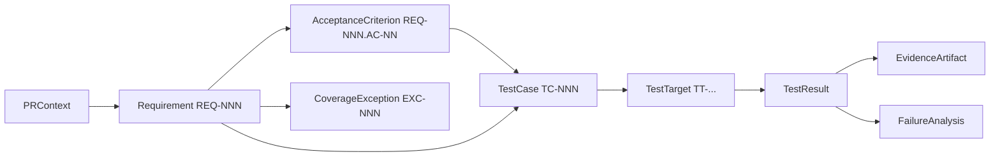

# Test Planning and Coverage

> **Status:** Planned design, baseline of 2026-10-22. Nothing described here is implemented yet.

**Canonical home for:**

- requirement extraction rules and the ambiguity taxonomy
- test-design techniques and when each applies
- the risk model (R0–R3)
- the traceability model
- the coverage gate rules (GB and GR), thresholds and configuration
- the exception and expiry policy
- the six coverage metrics
- requirement verification status

Entity shapes are defined in [data-model-and-artifacts.md](data-model-and-artifacts.md). Tool I/O is defined in [mcp-tool-contracts.md](mcp-tool-contracts.md).

## Requirement extraction

`extract_requirements` (TL-04) works in two layers. Both are deterministic given the same input.

### 1. Structured parsing of the PR body

| Pattern | Recognized as |
|---|---|
| A heading matching `/^(#+)\s*(acceptance criteria\|requirements?\|AC\b\|test plan\|expected behaviou?r)/i` | Opens a requirement section. Every list item under it, up to the next heading of the same or higher level, becomes an AC. |
| Checklist items `- [ ]` / `- [x]` within a requirement section | ACs, with format `checklist` |
| `Given … When … Then …` blocks (multi-line, case-insensitive keywords) | One AC each, with format `given_when_then` |
| Lines starting with `AC:` / `AC-n:` anywhere | One AC each |
| Numbered lists directly under a requirements heading | One requirement per top-level item, with nested items as its ACs |
| Fenced code blocks, HTML comments, and quoted reply blocks (`>`) | **Ignored**. Their text is never parsed as requirements, which limits injection by embedding. |

**Grouping and IDs.**

- ACs found under one heading are grouped into one parsed requirement titled after the heading. When a heading carries no other text, the title is the PR title plus a section index.
- IDs are assigned in document order: `REQ-001`, `REQ-002`, … and `REQ-001.AC-01`, …

**Normalization.** Text is converted to Unicode NFC, whitespace is collapsed, Markdown emphasis is stripped, and the result is trimmed.

### 2. Merging agent-supplied items

1. Each agent requirement is compared against the parsed requirements by **exact normalized text** of the title and statement. Each agent AC is compared against the parsed ACs by exact normalized text.
   - A match merges the items. The parsed provenance wins, and the agent's risk factors are attached.
   - Anything without a match is added with `provenance: agent`.
2. Fuzzy de-duplication is **not** done on the server, because it would not be deterministic. The Skill is told to reuse the parsed wording ([agent-skill-spec](agent-skill-spec.md)).
3. A requirement marked testable with no ACs gets an automatic ambiguity, `AMB-NN missing_ac`, with severity `high`.

**Implementation notes (PLN-002, 2026-10-23).**

- **Parser:** `markdown-it` 15.0.2 with raw HTML recognized, so HTML blocks and comments can be excluded.
- **Merge rule:** "exact normalized text" is implemented as follows. An agent requirement merges when its normalized title equals a parsed title, *or* its normalized statement equals a parsed statement. A parsed requirement's statement is its title.
- **Server-raised ambiguities:**
  - `missing_ac` (high) for a testable requirement with no ACs.
  - `vague_term` (medium; high for R2/R3) for an AC that uses the GR-02 vague-term lexicon.
- **Agent ambiguities:** they carry no type, so the agent's severity is kept as given. Their `relatedKeys` are kept only when they name existing REQ or AC IDs.
- **Observable heuristic:** an AC counts as observable when it has a quoted value, a number or an observable verb. "Named UI element or state" is not detected, so such ACs may be flagged for GR-02 review.

### Discarded content

The `parseReport.discarded[]` field lists text the parser ignored, together with the reason: code block, quote, comment, or over the length cap.

## Ambiguity taxonomy

| Type | Example | Default severity |
|---|---|---|
| `missing_ac` | A requirement with no acceptance criteria | high |
| `vague_term` | "fast", "properly", "user-friendly", "works" | medium (high if the requirement is R2/R3) |
| `conflicting_statements` | Two ACs contradict each other | high |
| `undefined_platform_scope` | No platform named while the app ships on several | medium |
| `unspecified_error_behavior` | No statement of behavior on failure or empty input | medium (high if R2/R3) |
| `unspecified_data` | Boundaries or values not given ("large lists") | medium |
| `unknown_baseline` | Says "changes X" without saying the old behavior | low |

The Skill proposes ambiguities, and the server assigns IDs and enforces the severity floors above. An ambiguity in state `open` with severity `high` triggers **GR-01**. Ambiguities are resolved by a new requirement-set version, which happens after a human clarifies. They can also be marked `accepted`, which means a human has acknowledged them. An `accepted` ambiguity is recorded in the report under Limitations.

## Test-design techniques and applicability

| Technique | Apply when | Required by tier |
|---|---|---|
| `positive` | Every testable AC | All tiers: ≥1 per AC |
| `negative` | The AC involves validation, permissions, or input rejection | R1+: when applicable; R2+: ≥1 per requirement |
| `boundary` | The AC has numeric, length, count, or date ranges, or a zero/empty state | R1+: when applicable |
| `state_transition` | Multi-step flows, lifecycle or status changes, navigation state | R2+: when applicable |
| `error_handling` | Network, IO, or dependency failures can occur | R2+: ≥1 per requirement (GB-03 for R3) |
| `regression` | Existing behavior next to the change could break | R2+: ≥1 per requirement (GB-04) |
| `accessibility` | UI-visible changes: semantics labels, contrast, touch targets, focus order | Should for UI changes (GR-10 info if missing). Required where the repo policy demands it (e.g. WCAG AA) |
| `security` | Auth, PII, payments, deep links, storage of secrets | R3 with security/privacy impact ≥3 (GB-03) |
| `platform_specific` | Behavior differs per platform (permissions, back navigation, notches) | When `platformSpecificity = 2` |

**Relevance rule.** The Skill must not add techniques just to fill a checklist. A technique is "applicable" only if the AC text or the risk factors give a reason for it. The gate checks *required* techniques (the right-hand column) and does not check that every technique is present.

## Risk model

Risk tiers apply to **requirements**. A test case inherits the highest tier among the requirements it covers. Risk policy v1 is defined by the `risk` section of the user config. `riskPolicyVersion` is the SHA-256 of the canonical form of that section.

### Factors

| Factor | Scale | Meaning |
|---|---|---|
| `functionalImpact` (FI) | 1–4 | 1 cosmetic, 2 minor feature, 3 core feature, 4 critical or blocking |
| `securityPrivacyImpact` (SPI) | 1–4 | 1 none, 2 indirect, 3 touches PII or auth flows, 4 can expose credentials, PII or payments |
| `dataIntegrityImpact` (DII) | 1–4 | Includes financial impact. 1 none, 4 data or money loss or corruption |
| `criticalJourney` (CJ) | boolean | On a configured critical journey (e.g. login, search, contact dealer, checkout) |
| `regressionLikelihood` (RL) | 1–4 | From complexity, change history and known fragility |
| `changeSurface` (CS) | 1–3 | 1 local (single file), 2 module, 3 shared or cross-cutting component |
| `uncertainty` (U) | 1–3 | 1 clear ACs, 2 some ambiguity, 3 major ambiguity |
| `platformSpecificity` (PS) | 1–2 | 2 if behavior differs per platform |

**Defaults.** When the agent supplies no factors, these conservative values are used: FI 3, SPI 2, DII 2, CJ false, RL 3, CS 2, U 2, PS 1. They produce R2 (score 24). Missing factors therefore never *lower* risk.

### Computation

```
Impact      I = max(FI, SPI, DII, CJ ? 3 : 1)
Likelihood  L = min(4, RL + (U − 1) + (PS − 1))
Score       S = I × L × CS          (1 … 48)
Tier        R0: S ≤ 4   R1: 5 ≤ S ≤ 12   R2: 13 ≤ S ≤ 24   R3: S ≥ 25
Overrides   SPI = 4 or DII = 4  → at least R3
            SPI = 3 or DII = 3  → at least R2
            CJ = true           → at least R2
```

**Rationale.**

- The multiplication lets a narrow change surface or a low likelihood reduce the tier. It also lets high impact combined with broad surface escalate it.
- The thresholds are set so that one maximal dimension, with the others low, lands at R1 or R2. Three high dimensions are needed for R3, unless an override applies.
- The overrides make security, privacy, data integrity and critical journeys dominate, whatever the arithmetic says.
- Uncertainty and platform specificity raise likelihood, because they increase the chance of an unverified behavior.

**Test availability and reliability.** These do **not** change the tier. They change *verification confidence*, so they feed eligibility and gate rules GB-06, GR-05 and GR-06. That keeps "how risky is the change" separate from "how well can we verify it".

**Calibration.** The thresholds above are policy v1. OPS-005 records a calibration review based on accumulated reports (Phase 3). Any change produces a new `riskPolicyVersion`, which changes plan hashes.

### Consequences by tier

| Tier | Minimum test design (enforced by gate) | Mandatory? | Approval / evidence |
|---|---|---|---|
| R0 | Positive test per testable AC (an uncovered AC triggers GR-04) | Only if priority `must` | Unattended. Reports list evidence when available. |
| R1 | R0 plus negative/boundary where applicable (heuristic, GR-02 review) | Only if priority `must` | Unattended |
| R2 | Every AC covered (GB-05); ≥1 negative or error_handling (GR); ≥1 regression (GB-04); platform coverage for each in-scope platform (GB-07); an eligible test or an exception (GB-06) | **Yes** | Artifacts required in the report for mandatory tests |
| R3 | R2 plus error_handling (GB-03), plus security (if SPI ≥ 3), plus data-integrity boundary/error tests (if DII ≥ 3) | **Yes** | Always `needs_review` (GR-07): a human reviews the plan at AL2+ |

## Traceability model



**Rules.**

- Every test case references ≥1 requirement.
- Every non-regression test case references ≥1 AC of those requirements.
- Results map back to test cases through `targetRef`. One target can serve several test cases. When a runner cannot isolate tests at a finer level than a file, a file-level result maps to every test case on that target. The report states this granularity limitation.
- The report includes a traceability table with these columns: REQ → AC → TC → result outcome → evidence IDs → classification.

## Independent coverage gate

This is implemented in `packages/coverage-gate` ([ADR-0005](architecture-decisions/ADR-0005.md)).

**Inputs:**
- the persisted `RequirementSet`
- the persisted `TestPlan` version
- the `coverageGate` config section
- the approval index, used only to check exception approvals

**Output:** a `CoverageDecision` bound to `planHash`, `requirementSetHash` and `gatePolicyVersion`.

### Decision logic

```
if any blocker finding  → fail
elif any review finding → needs_review
else                    → pass
```

`pass` means only that the coverage criteria are satisfied. **It does not authorize execution** ([ADR-0006](architecture-decisions/ADR-0006.md#4-execution-authorization)).

### Blockers (GB). These cannot be disabled.

| ID | Condition |
|---|---|
| GB-01 | A testable requirement has no test case and no valid exception. |
| GB-02 | An exception is invalid in any of these ways: its rationale is shorter than 20 characters; it lacks a usable approval at ≥AL2; it is expired; it uses `covered_elsewhere` without an `evidenceLink` that resolves to an existing inventory TestTarget (an executable assertion); or it is a `deferred` exception on an R3 requirement. |
| GB-03 | An R3 requirement lacks an `error_handling` test case. Or it lacks a `security` test case when SPI ≥ 3. Or it lacks a `boundary`/`error_handling` case targeting data integrity when DII ≥ 3. |
| GB-04 | An R2 or R3 requirement has no `regression` test case. |
| GB-05 | An AC of an R2 or R3 requirement has no test case. |
| GB-06 | An R2 or R3 requirement has no eligible test case and no valid exception. |
| GB-07 | An R2 or R3 requirement names an in-scope platform that no test case covers. |
| GB-08 | Structural integrity failure: a dangling reference, a duplicate ID, or a cyclic `dependsOn`. This is defense in depth on top of TL-05 validation. |

### Review triggers (GR). These are configurable unless marked locked.

| ID | Condition | Configurable |
|---|---|---|
| GR-01 | An ambiguity with severity `high` is `open`. | locked |
| GR-02 | Weak assertion: an expected result matches the vague-term lexicon (default: `works`, `correctly`, `properly`, `as expected`, `is fine`, `no issues`, `looks good`). Or it lacks an observable: none of a quoted value, a number, a named UI element or state, or a verb from the observable lexicon (`shows`, `hides`, `returns`, `navigates`, `emits`, `equals`, `contains`, `is disabled`). | lexicons, on/off |
| GR-03 | Duplicate test cases: the same `targetRef` with the same normalized steps and expected results. | on/off |
| GR-04 | A threshold is below its minimum. Defaults: `requirementCoverageMin` 1.0, `testCaseCoverageMin` 1.0, `platformCoverageMin` 0.8, `regressionCoverageMin` 1.0. A metric whose value is `null` (denominator 0) is not compared. | values |
| GR-05 | An R0 or R1 requirement has no eligible test case and no exception. | on/off |
| GR-06 | A mandatory test case is `new_test_required` or `manual`. | on/off |
| GR-07 | Any R3 requirement is present. | locked |
| GR-08 | An assumption is linked to an R2 or R3 requirement. | on/off |
| GR-09 | `changedFiles` are known, but no selected test target shares a directory prefix (configurable depth, default 2) with any changed source file under `lib/` or `src/`. This is a regression-scope heuristic. | on/off, depth |
| GR-10 | Info only, not review: a UI change without an `accessibility` case. It is promoted to review when `accessibilityRequired: true`. | promote |

**Info findings** do not affect the decision. Examples:
- `INF-01`: source-code coverage unavailable
- `INF-02`: changed files unknown
- `INF-03`: file-level result granularity

**Implementation notes (COV-001 – COV-003, 2026-10-23).**

- **GR-02 observability** also accepts a named UI element, approximated as a CamelCase identifier such as `SavedSearchBadge`.
- **GR-09** compares directories after dropping the root segment on both sides (`lib/`, `src/` for sources; `test/` etc. for targets) and a `_test` suffix. With depth 2, `lib/widgets/badge.dart` therefore matches `test/widgets/badge_test.dart`.
- **GR-10** treats a plan as a UI change when it has `widget`, `component` or `e2e` cases, or when changed files sit under `widgets/`, `screens/`, `views/`, `ui/` or `components/` directories.
- **GB-07** checks only platforms a requirement *names*. Platform coverage (metric 4) uses every in-scope platform for requirements that name none.
- **Exceptions:**
  - A `covered_elsewhere` evidence link may be a TestTarget ID or the workspace-relative path of an inventory target.
  - An `expiresAt` beyond `exceptionMaxDays` also triggers GB-02.
  - Exception approvals are found by scope digest, so editing the plan or the exception requires a new approval.

### Configuration (`coverageGate` section)

```yaml
coverageGate:
  thresholds: { requirementCoverageMin: 1.0, testCaseCoverageMin: 1.0, platformCoverageMin: 0.8, regressionCoverageMin: 1.0 }
  rules: { GR-02: { enabled: true, vagueTerms: [...], observableVerbs: [...] }, GR-03: { enabled: true }, GR-05: { enabled: true }, GR-06: { enabled: true }, GR-08: { enabled: true }, GR-09: { enabled: true, depth: 2 }, GR-10: { promote: false } }
  exceptionMaxDays: 30
```

Config load fails with `E_POLICY_UNAVAILABLE` when either of these is attempted:
- disabling a GB rule, GR-01 or GR-07
- setting a threshold outside [0, 1]

`gatePolicyVersion` is the SHA-256 of the JCS of this section after defaults are applied.

## Exception and expiry policy

- **Who.** Only a human can approve an exception (AL2 locally, AL3 in CI). The agent can *propose* one in the draft, and it counts for nothing until approved.
- **Kinds:**
  - `not_testable`: requires a reason the requirement cannot be verified, for example a server-side-only change.
  - `covered_elsewhere`: must link to an executable assertion, meaning an inventory TestTarget. A TODO, a scaffold, or a test with no assertions is not acceptable cover. Reviewers check this, and the report shows whether the linked target executed in this run. If it did not run, the requirement status is `unverified`, not `excepted`.
  - `deferred`: allowed only for R0–R2. It always appears in the report as an open follow-up and never counts as covered.
  - `out_of_scope`: the requirement belongs to another PR or component.
- **Expiry.** At most 30 days (`exceptionMaxDays`), and never later than the approval's expiry. An expired exception triggers GB-02.
- **Re-validation.** Each plan version re-evaluates its exceptions. A new plan version with unchanged exception content keeps the same exception IDs. An approval is bound to the exception's scope digest, which includes the `planHash`, so a plan edit requires re-approval.

## Coverage metrics

The six metrics are deliberately separate. None of them substitutes for another. Each metric is reported as `{numerator, denominator, value}`. When the denominator is 0, `value` is `null` and the report shows "n/a" instead of 100%.

Definitions:
- **T** = the set of testable requirements in the requirement set.
- **cases(x)** = the test cases referencing x.
- **eligible(c)** is true when the case's eligibility is `eligible`.

| # | Metric (JSON key) | Formula | Interpretation and edge cases |
|---|---|---|---|
| 1 | Requirement coverage (`requirementCoverage`) | \|{ r ∈ T : \|cases(r)\| ≥ 1 }\| / \|T\| | Planned mapping only. Excepted requirements are **not** in the numerator. Non-testable requirements are excluded from T and listed separately. |
| 2 | Test-case coverage (`testCaseCoverage`) | \|{ ac ∈ ACs(T) : \|cases(ac)\| ≥ 1 }\| / \|ACs(T)\| | Mapping at AC granularity. This catches requirements that are "covered" by a single test that ignores most of their ACs. |
| 3 | Source-code coverage (`sourceCodeCoverage`) | covered changed lines / instrumentable changed lines, from lcov ∩ changed files (hunks when the diff is known; otherwise all lines of the changed files, flagged `granularity: file`) | Only available when coverage collection was requested and is supported (Flutter: `--coverage`). Says nothing about requirements. Never used by the gate's blockers. |
| 4 | Platform coverage (`platformCoverage`) | \|{ (r,p) : r ∈ T, p ∈ platforms(r) ∩ scope, ∃ c ∈ cases(r): p ∈ platforms(c) ∧ eligible(c) }\| / \|{ (r,p) : r ∈ T, p ∈ platforms(r) ∩ scope }\| | A requirement with no declared platforms counts as all in-scope platforms. |
| 5 | Regression coverage (`regressionCoverage`) | \|{ r ∈ T : tier(r) ≥ R2 ∧ ∃ c ∈ cases(r): technique(c) = regression }\| / \|{ r ∈ T : tier(r) ≥ R2 }\| | Requirement-based, so it is deterministic. GR-09 complements it with a heuristic based on changed paths. |
| 6 | Execution coverage (`executionCoverage`) | \|{ mandatory c : final outcome ∈ {passed, failed} }\| / \|{ mandatory c }\| | Available after a run. Indeterminate outcomes (`timed_out`, `infra_error`, `cancelled`), `blocked`, `skipped` and `not_run` are **not** counted as executed. |

**The pass rate is not a coverage metric.** Reports show outcome counts separately.

## Requirement verification status

The status is computed per requirement. Before execution it comes from the plan and the decision. After execution it comes from the latest run's results for the mandatory cases, or for all cases when the requirement has no mandatory case. Rows are evaluated top to bottom, and the first match wins.

| Status | Rule |
|---|---|
| `excepted` | A valid exception applies, and it is not a `covered_elsewhere` exception whose target did not execute. |
| `unmapped` | No test cases. |
| `mapped` | Has test cases, but none is eligible. |
| `eligible` | ≥1 eligible case, and no run yet. |
| `failing` | Any case outcome is `failed`. |
| `unverified` | No failures, but some case is indeterminate (`timed_out`, `infra_error`, `cancelled`), or a `covered_elsewhere` target did not execute. |
| `blocked` | No failures or indeterminate outcomes, but cases are `blocked` or `not_run` because of unavailable targets or prerequisites. |
| `passing` | Every relevant case is `passed`. |
| `executed` | A fallback for mixed `passed` plus `skipped` outcomes. The report explains which cases were skipped. |

An unexecuted or blocked test **never** contributes to `passing` (FR-039).
